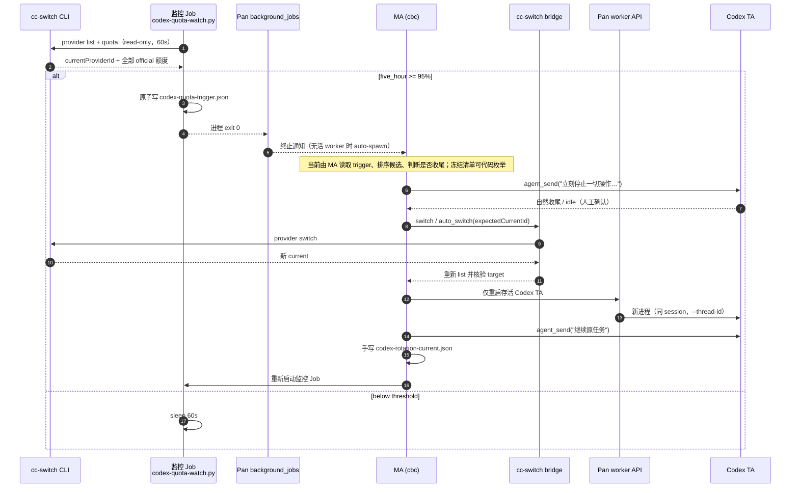

# Codex 自动换号全自动化差距（2026-10-25）

- 基线：`6a89fa5f`（与当前 practical HEAD 一致）
- 工作树：`D:/project/pan-worktrees/codex-auto-rotation-20261025`
- 分支：`research/codex-auto-rotation-20261025`
- 性质：只读研究 + 本文件；未改产品代码、未启停服务、未访问 8767/8768、未执行真实换号。
- 证据等级：`code` = 本工作树源码；`state` = `D:/project/Pan/data` 只读运行态；`probe` = 本次只读 CLI 查询；`needs_verification` = 无直接证据。

## 0. 结论摘要（10 行）

1. **不能。** 当前 practical 只把“五小时 ≥95% → 写 trigger → 唤醒 MA”这一段自动化了；从换号决策到续作仍是 MA 手工编排。
2. 换号工具、重启 API、续作发送都已存在且不需要 UI 或二次确认，但**没有任何代码把它们串成一条链**。
3. 内置 automation 的 quota policy 是 **default-off + production business effects unbound**：`ReadSource.current()` 恒为 `False`，`production()` 不注入任何 port，换号/重启/唤醒/续作 effect 都被拒绝。
4. Worker→provider 身份不可证明：当前安装的 cc-switch 不支持 private launch export（`probe` 为 `False`），`Bindings.row.accountId` 为 `None`，自动 inventory 直接失败。
5. 95% monitor 只规划 `wake_ma`，**不规划 `switch_account`**；唯一会自动规划换号的是 Codex 错误事件路径，且被上述两道门阻断。
6. 冻结清单可由公开 API 直接枚举（弱冻结）；自然收尾、capacity 判定、失败回滚、账本与监控再武装仍由 MA 手工完成。
7. 8768 重启不是换号必需步骤；若使用，当前 `startupPreference=ask` 需要人选择；有候选的一次启动恢复记录为 `decision=restart, autoPreference=null`。
8. MA 当前是 cbc / deepseek-v4.1-flash，不受 Codex 额度影响，`maSelfRestart=false`；因此“MA 自重启”不是当前阻塞，但**编排者生命周期**仍是全自动的架构问题。
9. 结论：**动作层大多可自动，链路层不可**；最小改造顺序应是“identity binding → production business effects → monitor 接入同一策略状态机”。
10. **当前换号链路硬阻塞 5 项；另 1 项实现细节（严格冻结身份）、1 项范围相关（8768）、2 项条件阻塞；7 项需实机验证（V1 最关键）。**

## 1. 先校正三个事实前提

### 1.1 `ma.md` 没有 Codex 自动/手动策略段

`ma.md` 是通用 MA 行为准则，没有 Codex 自动/手动策略段；它只在通用条款里提到换号/额度，并在 [ma.md:128](D:/project/Pan-main/docs/skills/pan/references/ma.md) 明确把“额度监控、恢复规则及临时覆盖”委托给项目 constraints / constraints 文件。

实际生效的 Codex 策略在：

- [model-policy-current.md:25-34](D:/project/Pan/data/workdirs/PAN_SMA/.workflow/model-policy-current.md)（2026-10-25 当前策略）
- [codex-auto-state.json](D:/project/Pan/data/workdirs/PAN_SMA/.workflow/codex-auto-state.json)（阈值、`rotationSequence`、`restartGate`）
- [codex-quota-policy.md:8-9](D:/project/Pan/data/workdirs/PAN_SMA/.workflow/codex-quota-policy.md)（历史授权 + “No Pan service restart, only Codex Workers authorized”）

策略规定的顺序（`rotationSequence`，只是 JSON 数组，不是可执行代码）[codex-auto-state.json:20-30](D:/project/Pan/data/workdirs/PAN_SMA/.workflow/codex-auto-state.json)：

`freezeLiveCodexWorkersAndRunningUnfinishedTasks` → `forceStopRunningCodexWorkers` → `allowNaturalSettle` → `refreshQuotas` → `switchAndVerify` → `restartLiveTAs` → `wakeOriginallyRunningUnfinishedTAs` → `handleReportedCapacity` → `recordRotationReceipt`

因此下文以 `model-policy-current.md` + `codex-auto-state.json` 为当前策略依据，不以 `ma.md` 为策略依据。

### 1.2 工具名校正：没有 `session_spawn`

MCP 侧实际是：

- `agent_spawn`（内部 `POST /api/spawn`；已有 worker 会先 kill）[mcp/server.py:1756-1780](D:/project/pan-worktrees/codex-auto-rotation-20261025/packages/mcp/server.py)
- `agent_restart_delayed`（只重启存活 worker，不启动离线 Session）[mcp/server.py:2767-2791](D:/project/pan-worktrees/codex-auto-rotation-20261025/packages/mcp/server.py)
- `agent_send_to_queue` / `agent_send` [mcp/server.py:1844-1933](D:/project/pan-worktrees/codex-auto-rotation-20261025/packages/mcp/server.py)
- `session_update` 只改 Session 设置，不是换号/重启编排工具 [mcp/server.py:1267-1283](D:/project/pan-worktrees/codex-auto-rotation-20261025/packages/mcp/server.py)

`session_spawn` 不是当前工具名；`worker_spawn` 是 `agent_spawn` 的 deprecated alias。

### 1.3 8768 不是换号必需步骤

当前授权明确“No Pan service restart, only Codex Workers authorized” [codex-quota-policy.md:9](D:/project/Pan/data/workdirs/PAN_SMA/.workflow/codex-quota-policy.md)。换号只需要重启 Codex Worker 进程，不需要重启 Pan 主服务。8768 自重启只作为“如果要求连服务重启也无人值守”的边界来评估，见 §4.5。

## 2. 现状时序图



**图的读法：**

- 前 4 个箭头（采样 → 判定 → 写 trigger → 通知 MA）是**无 MA 参与**的自动段。
- 从 `Note over MA` 开始全部是 MA 手工编排；`switch` / `restart` / `send` 只是“工具可自动执行”，不是“链路自动执行”。
- 监控 Job 是 one-shot：达到阈值写文件后退出，**不会自己再武装**；`codex-auto-state.json` 里的 `monitorJobId` 只是记录，不是调度器。
- 终止通知不带额度 payload；MA 必须再读 `codex-quota-trigger.json` / 日志。

## 3. 逐步判定表

判定口径：

- **已自动化**：无需 MA/人参与，代码或 Job 完成。
- **有代码可自动**：已有 API/工具/纯函数，缺编排调用；接上即可。
- **必须人工**：当前无可靠代码路径，或必须人判断/确认。
- **不适用**：当前策略已排除。

| # | 步骤 | 判定 | 证据 | 事实说明 |
|---|---|---|---|---|
| 1 | 五小时额度采样 | 已自动化 | [codex-quota-watch.py:14-24](D:/project/Pan/data/workdirs/PAN_SMA/.workflow/codex-quota-watch.py) | 每 60s 只读查询；当前 provider 必须是 `official`，否则报错；连续 3 次错误后 Job 退出。 |
| 2 | 95% 阈值判定 + trigger 落盘 | 已自动化 | [codex-quota-watch.py:26-37](D:/project/Pan/data/workdirs/PAN_SMA/.workflow/codex-quota-watch.py)、[63-64](D:/project/Pan/data/workdirs/PAN_SMA/.workflow/codex-quota-watch.py) | `remaining <= 100-threshold`；原子替换 `codex-quota-trigger.json`；命中后 `break`，Job 退出。 |
| 3 | 通知 MA / 唤醒 MA | 已自动化 | [job_10bb43426127c46e46b8c83f.json](D:/project/Pan/data/background_jobs/jobs/job_10bb43426127c46e46b8c83f.json)、[worker.py:6861-6863](D:/project/pan-worktrees/codex-auto-rotation-20261025/packages/core/worker.py)、[6962](D:/project/pan-worktrees/codex-auto-rotation-20261025/packages/core/worker.py) | 后台 Job 终止通知；目标无活 worker 时 `enqueue_notice` 会 `auto_spawn=True`。通知是 Job 终态，额度明细需另读 trigger/日志。 |
| 4 | 读取 trigger、判断候选/收尾 | 必须人工 | [model-policy-current.md:27-31](D:/project/Pan/data/workdirs/PAN_SMA/.workflow/model-policy-current.md) | 读文件可脚本化，但“选谁、是否已自然收尾”目前只在 MA 的判断里。冻结清单本身见第 5 行，不需要人。 |
| 5 | 枚举/弱冻结当前 live Codex Worker | 有代码可自动 | [server.py:2604-2670](D:/project/pan-worktrees/codex-auto-rotation-20261025/packages/web/server.py)、[server.py:5919-5925](D:/project/pan-worktrees/codex-auto-rotation-20261025/packages/web/server.py)、[server.py:13218-13231](D:/project/pan-worktrees/codex-auto-rotation-20261025/packages/web/server.py)、[server.py:9015-9045](D:/project/pan-worktrees/codex-auto-rotation-20261025/packages/web/server.py) | `GET /api/list` 取 live worker 的 `sessionId/workerId/status/generation`；`GET /api/sessions?summary=1` 按 `sessionId` join 出 `adapter/workerTaskId/workerTaskSeq/workerExecutionSeq`；过滤 `adapter=codex` + `status=running` 即可。`PATCH /api/sessions/{id}/queue/paused` 可冻结新队列项。用 `(sessionId, workerId, generation, workerTaskId, executionSeq)` 做弱冻结。严格身份（process birth token/provider/显式 role）只在内部 `Bindings` 需要，外部 orchestrator 不必需。 |
| 6 | Force 停止消息 | 有代码可自动 | [mcp/server.py:1905-1933](D:/project/pan-worktrees/codex-auto-rotation-20261025/packages/mcp/server.py)、[server.py:12290-12333](D:/project/pan-worktrees/codex-auto-rotation-20261025/packages/web/server.py) | `agent_send` 或 `/api/send force=true`；无二次确认。当前没有代码在阈值事件后自动发。 |
| 7 | 自然收尾确认 | 必须人工 | [model-policy-current.md:30](D:/project/Pan/data/workdirs/PAN_SMA/.workflow/model-policy-current.md)、[codex-rotation-current.json:18](D:/project/Pan/data/workdirs/PAN_SMA/.workflow/codex-rotation-current.json) | 策略要求“自然收尾、不直接 kill”；没有超时/放弃/升级的代码策略。轮转记录里 `settleObserved: "idle (natural)"` 是人工观察。 |
| 8 | 重新核实额度 | 有代码可自动 | [codex-quota-watch.py:14-24](D:/project/Pan/data/workdirs/PAN_SMA/.workflow/codex-quota-watch.py)、[quota_provider.py:55-89](D:/project/pan-worktrees/codex-auto-rotation-20261025/packages/automation/quota_provider.py) | 可重跑 `--check` 或直接调 bridge。注意 all-or-nothing：任一 official 账号 quota 未知，整个 snapshot 变 `unknown`（[quota_provider.py:76-80](D:/project/pan-worktrees/codex-auto-rotation-20261025/packages/automation/quota_provider.py)）。 |
| 9 | 候选排序/选择 | 有代码可自动 | [quota_policy.py:86-89](D:/project/pan-worktrees/codex-auto-rotation-20261025/packages/automation/quota_policy.py)、[codex-auto-state.json:4-7](D:/project/Pan/data/workdirs/PAN_SMA/.workflow/codex-auto-state.json) | `rank()` 已实现“周重置最近 → 周使用率低 → 五小时使用率低”；但 active watcher 不调用它，实际候选由 MA 选。两套状态源（`codex-auto-state.json` vs `quota-policy.json`）未合并。 |
| 10 | CAS 切换 | 有代码可自动 | [provider.py:373-403](D:/project/pan-worktrees/codex-auto-rotation-20261025/packages/cc_switch_bridge/provider.py)、[capabilities.json:68-155](D:/project/pan-worktrees/codex-auto-rotation-20261025/packages/cc_switch_bridge/capabilities.json)、[manifest.json:198-203](D:/project/pan-worktrees/codex-auto-rotation-20261025/manifest.json) | `switch` / `auto_switch` 是 agent-exported；`auto_switch` 的 capability 描述明确它是“future automatic account-rotation mechanism 唯一可调用的 switch”；CLI 路径无需 UI、无二次确认；带 `expectedCurrentId`。CAS 是“检查→调用 CLI→再检查”，不是 CLI 级原子 CAS（见 §4.8）。 |
| 11 | 切换后核验 | 有代码可自动 | [provider.py:400-403](D:/project/pan-worktrees/codex-auto-rotation-20261025/packages/cc_switch_bridge/provider.py) | `_switch` 重新 `list(panel=True)`，要求 `currentProviderId == target`；否则报“勿自动重试”。 |
| 12 | 重启存活 Codex TA | 有代码可自动 | [server.py:13887-13908](D:/project/pan-worktrees/codex-auto-rotation-20261025/packages/web/server.py)、[mcp/server.py:2767-2791](D:/project/pan-worktrees/codex-auto-rotation-20261025/packages/mcp/server.py) | `/api/worker/{id}/restart` 重启存活 worker；`agent_restart_delayed` 只重启存活且保留任务边界。`agent_spawn` 会先 kill 再 spawn，也能启动离线 Session，需过滤。 |
| 13 | 新 Worker 身份/provider 核验 | **必须人工 / needs_verification** | [provider_launch.py:303-319](D:/project/pan-worktrees/codex-auto-rotation-20261025/packages/core/adapters/codex/provider_launch.py)、[quota_host.py:110-112](D:/project/pan-worktrees/codex-auto-rotation-20261025/packages/automation/quota_host.py)、`probe private_launch_supported=False` | 能读 workerId/generation；**不能**读 process birth token 或 provider 绑定。`currentProviderId` 只能证明全局 cc-switch 当前值，不能证明该 worker 是用它启动的。四项门禁的第三项无法闭合。 |
| 14 | 续作（仅冻结未完成 TA） | 有代码可自动 | [server.py:12290-12333](D:/project/pan-worktrees/codex-auto-rotation-20261025/packages/web/server.py)、[codex-rotation-current.json:26](D:/project/Pan/data/workdirs/PAN_SMA/.workflow/codex-rotation-current.json) | `agent_send` 队列写入；无活 worker 时持久化排队。注意 `resumeReceipt: "queued worker-4"` 只是入队回执，不是“原任务已继续/完成”。 |
| 15 | Capacity 续作/换号判定 | 必须人工 | [runtime_issues.py:144-165](D:/project/pan-worktrees/codex-auto-rotation-20261025/packages/core/runtime_issues.py)、[model-policy-current.md:32](D:/project/Pan/data/workdirs/PAN_SMA/.workflow/model-policy-current.md) | 分类器能识别 `usageLimitExceeded`/`serverOverloaded` 等；但“先重试几次、何时算 capacity、无诊断 error 是否按 capacity”仍是 MA 的策略判断。 |
| 16 | 记录回执/账本 | 必须人工 | [codex-rotation-current.json](D:/project/Pan/data/workdirs/PAN_SMA/.workflow/codex-rotation-current.json)、[codex-auto-state.json](D:/project/Pan/data/workdirs/PAN_SMA/.workflow/codex-auto-state.json) | 两个文件**没有代码写入点**（本次 grep 只找到 watcher 读它们）；restart/resume 回执和候选判断是手写；冻结清单也可由脚本生成，但当前记录仍是手写。没有统一的 rotation 事务 ID / 幂等键 / 状态机。 |
| 17 | 重开监控 Job | 必须人工 | [codex-quota-watch.py:63-64](D:/project/Pan/data/workdirs/PAN_SMA/.workflow/codex-quota-watch.py)、[quota_policy.py:521-540](D:/project/pan-worktrees/codex-auto-rotation-20261025/packages/automation/quota_policy.py) | watcher 命中即退出；没有 re-arm 代码。内置 `monitor95` 可以建 interval Job，但要求 `mode=automatic`、host enabled、MA 未完成身份；当前未启用且只规划 `wake_ma`。 |
| 18 | 8768 重启 + 一次性唤醒 | 必须人工（当前） | [server.py:4011-4033](D:/project/pan-worktrees/codex-auto-rotation-20261025/packages/web/server.py)、[config.json:192-195](D:/project/Pan/config.json)、[server.py:6056-6066](D:/project/pan-worktrees/codex-auto-rotation-20261025/packages/web/server.py)、[6213-6250](D:/project/pan-worktrees/codex-auto-rotation-20261025/packages/web/server.py) | 主服务重启有 durable supervisor，但没有 MCP 工具；当前 `exitStrategy=preserve-running`、`startupPreference=ask`、`wakeMessage=continue`。启动恢复只收 `illegal` 候选；`ask` 需要人选择。有候选的一次记录 `decision=restart, autoPreference=null` 证明是人工点的。 |
| 19 | MA 自身重启 | 不适用 | [model-policy-current.md:28](D:/project/Pan/data/workdirs/PAN_SMA/.workflow/model-policy-current.md)、[codex-auto-state.json:15,19](D:/project/Pan/data/workdirs/PAN_SMA/.workflow/codex-auto-state.json) | MA 是 cbc / deepseek-v4.1-flash；不受 Codex 额度影响。当前策略删除了“确认 MA 自唤醒 Job / 重启 MA”两步。 |
| 20 | 失败回滚/不确定恢复 | 必须人工 | [provider.py:199-208](D:/project/pan-worktrees/codex-auto-rotation-20261025/packages/cc_switch_bridge/provider.py)、[quota_policy.py:434-451](D:/project/pan-worktrees/codex-auto-rotation-20261025/packages/automation/quota_policy.py)、[api.py:247-260](D:/project/pan-worktrees/codex-auto-rotation-20261025/packages/automation/api.py) | switch 只做目标核验，不做回滚；超时说“结果不确定，勿自动重试”；engine 把未知记为 `uncertain` 且永不重放；`confirm_recovery` 需要用户登录 + `confirm:true`。 |

**统计：** 3 项已自动化 / 8 项有代码可自动 / 8 项必须人工 / 1 项不适用；其中第 13 行同时是 `needs_verification`。

## 4. 真正阻塞全自动的点

分类：B1/B4 是“**现有内置 automation 不能自动**”；B2/B6/B7 是“**任何需要可信身份/事务的自动化（含新外部 orchestrator）都还缺底座**”；B3 是“**内置 engine 的严格冻结身份限制；弱冻结清单可由公开 API 直接取**”；B5 是“**只有在要求 8768 也无人值守时才成立**”；C1/C2 是条件阻塞。

### 4.1 B1：生产业务 effects 没有绑定（硬阻塞）

事实链：

1. `quota_host.py` 文件头就写明 “Default-off host projection; production mutation ports deliberately unbound” [quota_host.py:1-5](D:/project/pan-worktrees/codex-auto-rotation-20261025/packages/automation/quota_host.py)。
2. `production()` 只返回 `HostAdapter(store, ReadSource(root), Bindings(worker))`，**没有传 `ports`** [quota_host.py:308-309](D:/project/pan-worktrees/codex-auto-rotation-20261025/packages/automation/quota_host.py)。
3. `HostAdapter.perform()` 在 `command.operation not in self.ports` 时直接抛 `production_business_admission_unbound` [quota_host.py:286-288](D:/project/pan-worktrees/codex-auto-rotation-20261025/packages/automation/quota_host.py)。
4. 即使有人手工注入 ports，`Admission.commit()` 还要求 `a.source.current(self.observation)` 为真 [quota_host.py:215-231](D:/project/pan-worktrees/codex-auto-rotation-20261025/packages/automation/quota_host.py)；而生产 `ReadSource.current()` 恒返回 `False`，注释是 “No external write CAS/account binding in the existing production API” [quota_host.py:110-112](D:/project/pan-worktrees/codex-auto-rotation-20261025/packages/automation/quota_host.py)。
5. API schema 自己声明 `productionEffects: 'unbound'`、`defaultAdapter: 'unavailable'`、`unknownReplayed: false` [api.py:98-106](D:/project/pan-worktrees/codex-auto-rotation-20261025/packages/automation/api.py)。
6. 测试也把“生产未绑定 → command blocked”作为期望行为 [test_quota_host.py:223-227](D:/project/pan-worktrees/codex-auto-rotation-20261025/tests/test_quota_host.py)。

例外：`monitor95_job` / `reset_wake_job` 走 `ensure_job` 的内部路径，不经过 `adapter.perform` [quota_policy.py:425-432](D:/project/pan-worktrees/codex-auto-rotation-20261025/packages/automation/quota_policy.py)。但它们只创建/续期“唤醒 MA”的 Job，不做换号、重启或续作。

影响：**automation 引擎是“可读、可规划、不可执行”**。这不是“少一个配置”，而是产品代码里刻意留空的两道门（ports + `current()`）。任何“让 MA 不操作”的方案，都必须先改这里。

### 4.2 B2：Worker→provider 身份不可证明（硬阻塞）

事实链：

1. `provider_launch.py` 文件头：“Current Bridge needs a versioned private export capability for production binding; current unextended cc-switch does not advertise it and remains unbound.” [provider_launch.py:4-6](D:/project/pan-worktrees/codex-auto-rotation-20261025/packages/core/adapters/codex/provider_launch.py)
2. 本次只读 probe：`cc-switch --version` 返回 `contract=pan-cc-switch-gui/v1`、`guiVersion=4.0.15`，但 `private_launch_supported=False`（没有 `privateLaunchExport`）。因此 `launch_export.prepare()` 永远不会生成 trusted export [launch_export.py:1-4](D:/project/pan-worktrees/codex-auto-rotation-20261025/packages/cc_switch_bridge/launch_export.py)、[93-102](D:/project/pan-worktrees/codex-auto-rotation-20261025/packages/cc_switch_bridge/launch_export.py)。
3. `Bindings.row()` 的 `accountId` 来自 `provider_launch.candidate()`，没有 launch binding 时 `candidate()` 返回 `None` [quota_host.py:155-163](D:/project/pan-worktrees/codex-auto-rotation-20261025/packages/automation/quota_host.py)、[provider_launch.py:303-319](D:/project/pan-worktrees/codex-auto-rotation-20261025/packages/core/adapters/codex/provider_launch.py)。
4. `quota_identity.worker()` 要求 `accountId` 是合法非空字符串 [quota_identity.py:31-47](D:/project/pan-worktrees/codex-auto-rotation-20261025/packages/automation/quota_identity.py)；`Runtime.workers()` 遇到不可验证的 live worker 直接抛 `Unverifiable live Worker inventory` [quota_policy.py:293-304](D:/project/pan-worktrees/codex-auto-rotation-20261025/packages/automation/quota_policy.py)。
5. `consume()` 先做 `matches()`：codex 要求 `worker.accountId` 是非空字符串且等于 `currentAccountId`；`accountId=None` 时直接返回 `unknown` [quota_policy.py:306-313](D:/project/pan-worktrees/codex-auto-rotation-20261025/packages/automation/quota_policy.py)。即使绕过 `matches()`，`workers()` 也会抛 `Unverifiable live Worker inventory` [quota_policy.py:293-304](D:/project/pan-worktrees/codex-auto-rotation-20261025/packages/automation/quota_policy.py)。
6. `ReadSource.read()` 也明确返回 `binding: unknown`、`reason: worker_provider_launch_binding_unavailable` [quota_host.py:102-106](D:/project/pan-worktrees/codex-auto-rotation-20261025/packages/automation/quota_host.py)。

为什么不能拿 `codex_profile_key` 凑合：

- Worker 确实保存了 `codex_profile_key` [worker.py:8347-8350](D:/project/pan-worktrees/codex-auto-rotation-20261025/packages/core/worker.py)。
- 但它是 `sha256(home + account_id + chatgpt_account_id)` 的截断 [codex_quota_store.py:89-99](D:/project/pan-worktrees/codex-auto-rotation-20261025/packages/core/codex_quota_store.py)，不是 cc-switch provider ID；`Bindings.row()` 也没用它。
- 它能证明“原生账号 A/B 不同”，不能证明“这个 worker 是从 provider X 启动的”。若两个 provider 共用一个 ChatGPT 账号，profile key 还会相同。
- 结论：`codex_profile_key` 可作为**辅助证据**，不能替代 provider binding。标记 `needs_verification`。

影响：**无法安全地回答“这个 live Codex Worker 现在用的是哪个 provider”**。因此：
- 不能精确冻结“受影响的 worker”；
- 不能验证“换号后新 worker 确实用了新 provider”；
- 四项门禁的第三项（new worker identity/provider verified）无法闭合。

### 4.3 B3：冻结清单可直接取；严格冻结身份是内置 engine 的限制（实现细节，非硬阻塞）

**先直接回答“冻结谁”：取当前 live Codex worker 即可，这一步不需要 MA。**

公开 API 足够拼出弱冻结清单，**两次读 + 一次 join**：

- `GET /api/list` 只返回 live worker：`sessionId`、`workerId`、`status`、`generation` [server.py:13218-13231](D:/project/pan-worktrees/codex-auto-rotation-20261025/packages/web/server.py)。
- `GET /api/sessions?summary=1` 每个 Session 返回 `adapter`、`workerTaskId`、`workerTaskSeq`、`workerExecutionSeq` [server.py:5919-5925](D:/project/pan-worktrees/codex-auto-rotation-20261025/packages/web/server.py)、[2604-2670](D:/project/pan-worktrees/codex-auto-rotation-20261025/packages/web/server.py)。
- 按 `sessionId` join，过滤 `adapter == "codex"` 且 `/api/list` 的 `status == "running"`。
- `PATCH /api/sessions/{id}/queue/paused` 可以冻结新队列项，作为“换号期间不接新任务”的 line gate [server.py:9015-9045](D:/project/pan-worktrees/codex-auto-rotation-20261025/packages/web/server.py)。注意它只挡新队列项，**不打断当前 turn**；当前 turn 仍要另发停止消息。

最小脚本形状：

```text
live = GET /api/list                       # 只含 live worker
meta = GET /api/sessions?summary=1         # adapter + task identity
freeze = join(live, meta, key=sessionId)
         where meta.adapter == "codex" and live.status == "running"
         -> {sessionId, workerId, generation, workerTaskId, workerExecutionSeq}
for row in freeze:
    PATCH /api/sessions/{row.sessionId}/queue/paused {"paused": true}
```

动作前重新读一次 `live` + `meta`，`workerId/generation/workerTaskId` 任一变化就跳过或重新确认。用 `/api/list` 做 live 真源、summary 只做 join，可以避免 summary 里 `workerState` 的持久化状态造成“假 running”。

**仍然不可得的是“严格身份”**：

- process birth token 不在公开 API；
- provider 绑定不在公开 API（B2）；
- 显式 `sessionRoles` 未配置；内置 `Bindings.inventory()` 需要 `role` + `accountId` [quota_host.py:155-183](D:/project/pan-worktrees/codex-auto-rotation-20261025/packages/automation/quota_host.py)、[quota_policy.py:369-375](D:/project/pan-worktrees/codex-auto-rotation-20261025/packages/automation/quota_policy.py)。

但这是**内置 engine 的严格校验**，不是“列不出当前 Codex worker”。外部 orchestrator 用弱冻结即可；只有“证明新 worker 真的用了新 provider”仍必须解决 B2。另一个策略细节是 `activeTaskId=null` 时如何判定“原任务未完成”——可以冻结全部 running，续作前再按 `activeTaskId`/`lastResult` 是否变化决定；这需要一条明确规则，但不是 API 阻塞。

### 4.4 B4：95% monitor 只唤醒 MA，不会自动换号（硬阻塞，且是策略层）

这是最容易被“有 automation 引擎”误导的一点。事实：

- 外层 watcher 只写 `codex-quota-trigger.json`，然后退出 [codex-quota-watch.py:33-37,63-64](D:/project/Pan/data/workdirs/PAN_SMA/.workflow/codex-quota-watch.py)。
- 内置 `quota_policy.tick_jobs()` 在 `monitor95` 命中时，最终只规划 `wake_ma` 命令 [quota_policy.py:604-631](D:/project/pan-worktrees/codex-auto-rotation-20261025/packages/automation/quota_policy.py)。它**没有** `switch_account`。
- 内置 `consume()` 只有收到 `codex_quota_exhausted` / `codex_capacity` 这类 **runtime issue** 时才会规划 `switch_account` [quota_policy.py:221-290](D:/project/pan-worktrees/codex-auto-rotation-20261025/packages/automation/quota_policy.py)。
- 外层 watcher 不是 automation 的事件源：automation API 明确“Event registration/publishing has no public route” [api.py:1](D:/project/pan-worktrees/codex-auto-rotation-20261025/packages/automation/api.py)。watcher 没有把 trigger 注入事件总线。
- 内置 monitor 还绑定在“MA 正在跑一个未完成任务”上：`create_monitor('monitor95')` 要求 `identity.original_eligible(wakeTarget)`，否则直接拒绝 [quota_policy.py:521-540](D:/project/pan-worktrees/codex-auto-rotation-20261025/packages/automation/quota_policy.py)；`tick_jobs` 发现 `wakeTarget` 不再 eligible 时会把 Job 标成 `blocked` [quota_policy.py:580-593](D:/project/pan-worktrees/codex-auto-rotation-20261025/packages/automation/quota_policy.py)。

影响：**即使 B1/B2 都修好，95% 阈值路径仍然会先唤醒 MA，而不是自己换号**。要“彻底脱离 MA”，必须把 95% monitor 改成会规划 `switch_account` 的路径，或者接受“95% 只提醒、错误才自动换号”的产品语义。这是策略决策，不是单纯接线。并且内置 monitor 不能脱离“一个正在跑任务的 MA”独立存在；全自动服务化必须去掉这个绑定。

### 4.5 B5：8768 自重启 + 一次性唤醒默认需要人（范围相关阻塞；换号不需要它）

事实：

- `/api/main/restart` 是 durable 的：先落 Job，再 `worker.shutdown_all`，再由 detached supervisor 停/起服务 [server.py:4011-4033](D:/project/pan-worktrees/codex-auto-rotation-20261025/packages/web/server.py)、[4136-4199](D:/project/pan-worktrees/codex-auto-rotation-20261025/packages/web/server.py)、[main_lifecycle.py:148-199](D:/project/pan-worktrees/codex-auto-rotation-20261025/packages/core/main_lifecycle.py)。
- 没有 MCP 工具封装 `/api/main/restart`；agent 不能通过 Pan MCP 直接调用。
- 实际配置：`exitStrategy=preserve-running`、`startupPreference=ask`、`wakeMessage=continue` [config.json:192-195](D:/project/Pan/config.json)。
- `preserve-running` 会在 shutdown 时把 running sessions 标成 illegal [worker.py:11938-11941](D:/project/pan-worktrees/codex-auto-rotation-20261025/packages/core/worker.py)；启动恢复只收 `illegal` 候选 [server.py:5991-6008](D:/project/pan-worktrees/codex-auto-rotation-20261025/packages/web/server.py)。
- `startupPreference=ask` 时不会自动执行，必须人选择；有候选的一次启动恢复记录 `decision=restart`、`autoPreference=null`，证明是人工点的 [f840ff861aae45a1a1b485281eae6d63.json](D:/project/Pan/data/startup_recovery/f840ff861aae45a1a1b485281eae6d63.json)。
- 如果改成 `startupPreference=wake-running`，`_run_automatic_startup_recovery` 会调 `api_sessions_wake`，给所有 illegal 候选发一次 `continue` [server.py:6213-6250](D:/project/pan-worktrees/codex-auto-rotation-20261025/packages/web/server.py)、[6138-6157](D:/project/pan-worktrees/codex-auto-rotation-20261025/packages/web/server.py)；`wake_session` 会写队列并调度 recovery/spawn [worker.py:11146-11164](D:/project/pan-worktrees/codex-auto-rotation-20261025/packages/core/worker.py)、[6690-6732](D:/project/pan-worktrees/codex-auto-rotation-20261025/packages/core/worker.py)。机制存在，但会**唤醒所有 illegal Session**，不是只唤醒冻结清单；范围太宽。

影响：**8768 重启 + 一次性唤醒可以做成自动，但当前配置是 ask，且没有 scoped list**。由于换号本身不需要 8768 重启，这个阻塞只在“连服务重启也要无人值守”的目标下成立。

### 4.6 B6：失败回滚/不确定恢复没有自动路径（硬阻塞）

事实：

- `switch` 只核验“最终 target 正确”，不保留/恢复 from provider；超时直接报“结果不确定，勿自动重试” [provider.py:199-208](D:/project/pan-worktrees/codex-auto-rotation-20261025/packages/cc_switch_bridge/provider.py)、[400-403](D:/project/pan-worktrees/codex-auto-rotation-20261025/packages/cc_switch_bridge/provider.py)。
- engine 对 `dispatching` 的异常/未知统一 `finish(..., 'uncertain')`，并且 `dispatch()` 不会重试 uncertain [quota_policy.py:398-452](D:/project/pan-worktrees/codex-auto-rotation-20261025/packages/automation/quota_policy.py)；重启后 `recover()` 把遗留 `dispatching` 标成 `uncertain` [quota_policy.py:513-519](D:/project/pan-worktrees/codex-auto-rotation-20261025/packages/automation/quota_policy.py)。
- 重试 uncertain 要用户登录 + `confirm:true` [api.py:247-260](D:/project/pan-worktrees/codex-auto-rotation-20261025/packages/automation/api.py)。
- 策略本身也只要求“记录 requested-pending”，没有回滚流程 [codex-auto-state.json:52](D:/project/Pan/data/workdirs/PAN_SMA/.workflow/codex-auto-state.json)。

影响：换号后如果 restart 失败，系统会停在“新 provider + 旧 worker 已死/未验证”的状态；自动路径只能停住并等人确认，不会自动切回旧账号，也不会自动重试。**这是有意的安全设计，不是遗漏**；但它是“全自动”的硬边界。

### 4.7 B7：账本/状态/再武装仍是 MA 手工（硬阻塞）

事实：

- `codex-auto-state.json` 和 `codex-rotation-current.json` 没有代码写入点；本次 grep 只找到 watcher 读 `codex-auto-state.json`。
- watcher 命中即退出；没有 re-arm 代码，也没有重复提醒/升级。`monitorJobId` 只是记录。MA 忙碌或离线时，95% 之后不会再有第二次采样。
- `quota-policy.json` 不存在；`codex-auto-state.json` 与 `quota-policy.json` 是两套策略状态（阈值/禁用账号/选择顺序 vs mode/host/roles/commands）。
- 数据模型也不通：watcher 的 trigger 是 `quotas[].quota.tiers[].name = five_hour/seven_day` [codex-quota-trigger.json:7-30](D:/project/Pan/data/workdirs/PAN_SMA/.workflow/codex-quota-trigger.json)；engine 的 `normalize()` 期望 `accounts[].fiveHour/week` [quota_policy.py:56-83](D:/project/pan-worktrees/codex-auto-rotation-20261025/packages/automation/quota_policy.py)。两者之间没有转换层。
- trigger 没有 `consumedAt` / lease / ack。本次只读看到 trigger 记录 `currentProviderId=d370…` [codex-quota-trigger.json:3](D:/project/Pan/data/workdirs/PAN_SMA/.workflow/codex-quota-trigger.json)，而 bridge `list` 当前是 `b374…`（`probe`）；`codex-auto-state.json` 又记 `b374…`、`codex-rotation-current.json` 记 `b374 → c3e2…`。三份文件是不同时间的人工记录，不是同一个事务状态机；当前真值只能以 bridge `list` 为准。
- `codex-rotation-current.json` 的 `resumeReceipt` 只是 `queued worker-4`，不是任务完成回执 [codex-rotation-current.json:26](D:/project/Pan/data/workdirs/PAN_SMA/.workflow/codex-rotation-current.json)。

影响：进程崩溃/服务重启/MA 会话替换后，没有权威事务记录可以恢复“换到哪一步”。这直接违反 `restartGate` 的“四项缺一只能记 requested-pending” [codex-auto-state.json:52](D:/project/Pan/data/workdirs/PAN_SMA/.workflow/codex-auto-state.json)。全自动需要 durability，而当前账本是手写 JSON。

### 4.8 C1：CAS 不是 CLI 级原子（条件阻塞）

事实：

- `Bridge.invoke()` 在 bridge 自己的文件锁内执行 list → CLI switch → list [provider.py:283-321](D:/project/pan-worktrees/codex-auto-rotation-20261025/packages/cc_switch_bridge/provider.py)。
- `_switch()` 先比较 `currentProviderId == expectedCurrentId`，再调用 `cc-switch provider switch <id>`，再核验 target [provider.py:392-403](D:/project/pan-worktrees/codex-auto-rotation-20261025/packages/cc_switch_bridge/provider.py)。
- CLI 的 switch 命令本身没有 `expectedCurrentId` 参数；bridge 锁也不约束独立运行的 cc-switch GUI。
- 因此这是“check-then-act”，不是线性化 CAS。外部 GUI 在检查与写入之间切换，会被覆盖；bridge 只能保证最终 target 正确，不能保证“from 仍是预期的 from”。

影响：只有在“有人同时操作 cc-switch GUI”时才构成实际风险。若运行时约定“换号期间不手点 GUI”，可作为条件阻塞接受；若要 100% 无人值守，需要 CLI 侧 expected id 或 GUI 侧共享锁。

### 4.9 C2：权限/确认（条件阻塞）

事实：

- `switch` / `auto_switch` 是 agent-exported [manifest.json:198-203](D:/project/pan-worktrees/codex-auto-rotation-20261025/manifest.json)，无 UI、无二次确认；只有 `nonManualDisabled` 门禁 [provider.py:358,373-378](D:/project/pan-worktrees/codex-auto-rotation-20261025/packages/cc_switch_bridge/provider.py)。
- 启用一个被 `nonManualDisabled` 的 profile 只能走 Panel-only `panel_config`，不在 agent 能力里 [capabilities.json:296-336](D:/project/pan-worktrees/codex-auto-rotation-20261025/packages/cc_switch_bridge/capabilities.json)。
- automation 的 `host` / `mode` 写入要求用户登录（`require(request)`）[api.py:124-165](D:/project/pan-worktrees/codex-auto-rotation-20261025/packages/automation/api.py)。
- `confirm_recovery` 也要求用户登录 + `confirm:true` [api.py:247-260](D:/project/pan-worktrees/codex-auto-rotation-20261025/packages/automation/api.py)。

影响：

- **正常换号不需要人确认**（这是好消息）。
- 但“启用 automation host / 修改 mode / 启用被禁 profile / 确认 uncertain 恢复”是人工/管理员动作。若“全自动”包括冷启动后无人配置，这些是阻塞；若允许一次性 setup，则不算。

### 4.10 V1：跨账号 thread resume 未证明（needs_verification）

事实：

- Codex adapter 把 `s.cli_session_id` 作为 `--thread-id` 传入 [adapter.py:296-301](D:/project/pan-worktrees/codex-auto-rotation-20261025/packages/core/adapters/codex/adapter.py)；app-server wrapper 在 resume 时调 `thread/resume` 且 `excludeTurns=True` [app_server_wrapper.py:416-439](D:/project/pan-worktrees/codex-auto-rotation-20261025/packages/core/adapters/codex/app_server_wrapper.py)。
- worker restart 明确不清 `cli_session_id` [worker.py:8280-8285](D:/project/pan-worktrees/codex-auto-rotation-20261025/packages/core/worker.py)。
- 但现有真实 CLI 测试只覆盖“固定 provider 的 start/resume”，没有覆盖“换 provider/账号后 resume 原 thread” [test_provider_launch_real_codex.py:93](D:/project/pan-worktrees/codex-auto-rotation-20261025/tests/test_provider_launch_real_codex.py)。
- 轮转记录只证明消息 `queued`，没有证明原任务继续/完成 [codex-rotation-current.json:26](D:/project/Pan/data/workdirs/PAN_SMA/.workflow/codex-rotation-current.json)。

影响：如果 `thread/resume` 在换号后失败，自动续作会退化/报错；需要一次真实账号切换的端到端验证。**不要在报告里把它当成已成立。**

## 5. 可行性结论

### 5.1 哪些能 100% 自动

**现在已经 100% 自动（无需 MA/人）：**

1. 五小时额度采样（60s，只读）。
2. 95% 阈值判定与 `codex-quota-trigger.json` 原子落盘。
3. 监控 Job 终止通知；目标 MA 无活 worker 时自动 spawn 并投递。

**单个动作层已经可 100% 自动（只差调用者）：**

4. `cc-switch-bridge.switch` / `auto_switch`：带 `expectedCurrentId`，无 UI、无二次确认，agent-exported。
5. 存活 Codex Worker 的 restart（`/api/worker/{id}/restart` 或 `agent_restart_delayed`）。
6. 续作消息入队（`agent_send` / `/api/send`），无活 worker 时持久化排队。
7. 候选排序纯函数 `rank()`（周重置最近 → 周使用低 → 五小时使用低）。
8. 主服务 durable restart（`/api/main/restart`）+ 启动恢复一次性 wake（配置 `wake-running` 时）。

这些动作本身不需要人，但**没有一条现成链路把它们按正确顺序、带身份校验、带幂等/回执地串起来**。

严格说，如果允许**新增一个外部 orchestrator**（不改产品代码），它可以用 `Bridge` + `/api/list` + `/api/sessions/{id}` + `/api/worker/{id}/restart` + `/api/send` 串起大部分动作；但它仍受 B2（provider 身份）、B3（严格冻结）、B6（失败回滚）、B7（账本/再武装）限制，并且要自己实现幂等键、自然收尾超时和 uncertain 处理。**缺的不是单点 API，而是 orchestrator + 可信身份 + 事务账本。**

### 5.2 哪些只能“自动到需要人确认”

1. **95% 主动换号**：当前语义就是“提醒 MA”，不是自动换号；要改语义才能全自动（§4.4）。
2. **候选选择遇到 unknown/stale quota**：`normalize` / `sample` 是 all-or-nothing；一个 official 账号查不到，整个 snapshot 变 unknown。策略要求“异常不等于耗尽，通知 MA 核对”，不能猜。
3. **自然收尾超时**：策略禁止直接 kill；如果 TA 不 idle，必须人决定继续等/强杀/放弃。
4. **capacity vs 其他错误**：无诊断 error 只按 capacity 做恢复，不伪造分类；是否继续重试/换号是策略判断。
5. **换号后 restart 失败 / uncertain**：只能记录并停住，重试需要 `confirm:true`；没有自动回滚。
6. **启用/禁用 non-manual profile、启用 automation host/mode**：Panel/用户登录动作。
7. **8768 重启后的唤醒范围**：`wake-running` 会唤醒所有 illegal，不是冻结清单；需要 scoped wake 才能安全自动。

### 5.3 最小改造清单

按依赖顺序，不做过度设计。先选路线，不要两条同时做：

- **路线 A（修内置 engine）**：P0-1 / P0-2 / P0-4 / P0-5，让 automation 自己执行。
- **路线 B（新外部 orchestrator）**：只需要 P0-3（可信 provider 身份）+ 事务账本 + 失败回滚；冻结/暂停/重启/续作都可以用公开 HTTP API 串起来。

**P0（不做就无法全自动）**

| # | 改造 | 为什么 | 风险 |
|---|---|---|---|
| P0-1 | 给 `production()` 注入生产 ports：`switch_account`、`restart_worker`、`wake_ta`、`continue_once`；`monitor95_job` / `reset_wake_job` 继续走内部 `ensure_job` | 当前所有 account/worker/session effect 都在 `HostAdapter.perform()` 被 `production_business_admission_unbound` 拒绝 [quota_host.py:286-288](D:/project/pan-worktrees/codex-auto-rotation-20261025/packages/automation/quota_host.py) | port 内必须复用现有业务入口，不能新开绕过 gates 的 API；未知回执不能重放 |
| P0-2 | 让 `ReadSource.current()` 做真实 account 校验，替换 `return False` | 即使有 ports，`Admission.commit()` 也会因 `host_account_changed` 拒绝 [quota_host.py:110-112,219-223](D:/project/pan-worktrees/codex-auto-rotation-20261025/packages/automation/quota_host.py) | 需要可信的 provider 观测；不能用“全局 current”冒充 worker 绑定 |
| P0-3 | 提供 worker→provider 绑定：优先让安装的 cc-switch 支持 `privateLaunchExport`（当前 probe=False）；退路是 Worker 保存 `codex_account_id` + 可信 provider 映射 | 没有它，`Bindings.row.accountId=None`，`Runtime.workers()` 直接失败 [quota_identity.py:31-47](D:/project/pan-worktrees/codex-auto-rotation-20261025/packages/automation/quota_identity.py)、[quota_policy.py:293-304](D:/project/pan-worktrees/codex-auto-rotation-20261025/packages/automation/quota_policy.py) | 改 cc-switch GUI fork 的成本/兼容性未验证；退路映射可能不唯一 |
| P0-4 | 把 95% monitor 接入同一策略状态机，并把命中动作从 `wake_ma` 扩展为 `switch_account`（或新增 `auto_rotate` command）；同时去掉 monitor 对“MA 正在跑未完成任务”的绑定；用 `quota_policy.monitor95_job` 替代/驱动外层 watcher，或让 watcher 通过内部 Job 提交事件 | 当前 95% 只规划 `wake_ma`，且 `create_monitor` 要求 MA 未完成身份；外层 watcher 又不进事件总线 [quota_policy.py:604-631](D:/project/pan-worktrees/codex-auto-rotation-20261025/packages/automation/quota_policy.py)、[521-540](D:/project/pan-worktrees/codex-auto-rotation-20261025/packages/automation/quota_policy.py)、[api.py:1](D:/project/pan-worktrees/codex-auto-rotation-20261025/packages/automation/api.py) | 主动换号会在 95% 时杀活；必须复用冻结/自然收尾 gate；两套 monitor 可能双跑；必须单 owner + 幂等 re-arm |
| P0-5 | 一次性配置 `quota-policy.json`：`mode=automatic`、`host.enabled=true`、显式 `sessionRoles`、`disabledAccountIds` | 当前目录没有 `quota-policy.json`，默认 manual/host disabled/roles 空 [quota_policy.py:95-101](D:/project/pan-worktrees/codex-auto-rotation-20261025/packages/automation/quota_policy.py) | 角色配置错误会导致误重启/误唤醒；必须只列 intended MA/TA |

**P1（为了 durability 和安全）**

| # | 改造 | 为什么 | 风险 |
|---|---|---|---|
| P1-1 | 用 `quota-policy.json` 的 commands/cases 作为唯一账本，淘汰/派生 `codex-auto-state.json`、`codex-rotation-current.json` | 手写 JSON 无事务、无幂等键；崩溃后无法恢复步骤 [codex-auto-state.json](D:/project/Pan/data/workdirs/PAN_SMA/.workflow/codex-auto-state.json) | 迁移期双写可能产生冲突；需要一次性迁移与只读校验 |
| P1-2 | 明确“失败回滚”策略：记录 pre-switch provider；restart 失败时只允许“停住/人工确认”，不自动回切；若要做自动回切，必须验证旧账号仍有可用额度 | 当前无回滚；uncertain 永不重放 [quota_policy.py:434-451](D:/project/pan-worktrees/codex-auto-rotation-20261025/packages/automation/quota_policy.py) | 自动回切可能把已耗尽账号再切回来，造成二次失败 |
| P1-3 | scoped one-time wake：不要用全局 `wake-running`，而是把冻结清单持久化为一次性 Job，只唤醒清单内的未完成 TA | 当前 `wake-running` 会唤醒所有 illegal [server.py:6213-6250](D:/project/pan-worktrees/codex-auto-rotation-20261025/packages/web/server.py) | 清单错误会漏唤醒/误唤醒；需要 frozen identity + 幂等 receipt |
| P1-4 | 真实端到端验证：换 provider 后 `thread/resume` + `agent_send` 是否真能继续原任务 | 目前只有 queued 回执，没有完成证据 [codex-rotation-current.json:26](D:/project/Pan/data/workdirs/PAN_SMA/.workflow/codex-rotation-current.json) | 若 resume 失败，需改续作协议（例如新 thread + 摘要） |

**P2（体验/安全）**

- 增加只读“rotation status”视图，展示 phase、frozen list、provider、restart receipts、pending confirmation。
- 给 `/api/main/restart` 增加受控的 agent 工具（如果确实需要服务重启），并强制 scoped wake。
- 把 `codex-auto-state.json` 的 `selectionOrder` / `disabledAccountIds` 迁移到 `quota-policy.json`，避免两套策略漂移。

### 5.4 对“信任收尾 + delayrestart + 群发续作”的判定

**结论：顺序大方向可行，但“信任收尾”要换成 `agent_restart_delayed` 的 idle gate + 超时/失败分支；“群发”要换成按冻结清单定向发送。** 直接“发固定消息 → 信任 → 换号 → delayrestart 所有记录 → 等最后一个成功 → 群发”会漏失败、误唤醒完成/闲置 Session。

推荐顺序：

1. `GET /api/list` + `GET /api/sessions?summary=1`：冻结**全部 live Codex**（`sessionId/workerId/generation/workerTaskId/executionSeq`），并标记 `running_unfinished` 子集。
2. `PATCH /api/sessions/{id}/queue/paused {"paused": true}`：冻结新队列项；记录原有 paused 状态，避免恢复时误解除用户暂停 [server.py:9015-9045](D:/project/pan-worktrees/codex-auto-rotation-20261025/packages/web/server.py)。
3. `agent_send("立刻停止一切操作，等待我说继续再继续")`：只发 `running`；**不要用 `agent_send_to_queue`**，它是延迟队列，不会停当前 turn [mcp/server.py:1844-1853](D:/project/pan-worktrees/codex-auto-rotation-20261025/packages/mcp/server.py)。
4. `cc-switch-bridge.switch` / `auto_switch`（带 `expectedCurrentId`）：先换号，再下 delayrestart；否则 idle worker 可能立刻用旧 provider 重启 [provider.py:373-403](D:/project/pan-worktrees/codex-auto-rotation-20261025/packages/cc_switch_bridge/provider.py)。
5. `agent_restart_delayed`：对**全部 live Codex**下延迟重启（不是只对 running）。它会在 valid idle boundary 才真正重启，所以不需要额外的“收尾确认”等待；running 的 worker 会先完成当前 turn [mcp/server.py:2767-2791](D:/project/pan-worktrees/codex-auto-rotation-20261025/packages/mcp/server.py)。
6. 轮询 `agent_restart_delayed_status` 直到**全部**目标进入 `completed/failed/cancelled`；不要只等“最后一个成功”。失败集合要单独记录；超时要有 kill/abort/告警分支 [mcp/server.py:2794-2813](D:/project/pan-worktrees/codex-auto-rotation-20261025/packages/mcp/server.py)。`completed` 只代表 replacement 已创建，还要用 `GET /api/list` 确认新 worker 没立刻进入 `error`；否则不算成功。
7. 只对 `completed` 且原 `workerTaskId/executionSeq` 仍未完成的 Session 发送“继续原任务”。**不要 `agent_send_many` 给所有记录**；`agent_send_many` 是普通 fan-out，会把已完成/闲置 Session 也唤醒 [mcp/server.py:1879-1903](D:/project/pan-worktrees/codex-auto-rotation-20261025/packages/mcp/server.py)。
8. 恢复第 2 步记录的原 paused 状态；续作消息可以在 unpause 前入队，由恢复后的 worker 消费。
9. 记录回执；provider 核验仍只能做到“全局 current + 额度变化”级别的 best-effort（B2），不能证明每个新 worker 的 provider 绑定。

必须补的失败分支：

- worker 状态是 `error/done/cancelled` 时，`agent_restart_delayed` 会拒绝（“use Restart to recover”）[worker.py:9094-9099](D:/project/pan-worktrees/codex-auto-rotation-20261025/packages/core/worker.py)；改用 `/api/worker/{id}/restart` 或 `agent_spawn`，并记录这是一次强杀/恢复。
- 目标已无 live worker 时，`agent_restart_delayed` 不会启动离线 Session [server.py:13876-13884](D:/project/pan-worktrees/codex-auto-rotation-20261025/packages/web/server.py)；跳过并记录，不要 `agent_spawn` 离线。
- 某个 worker 永不 idle：delayrestart 的 intent 会一直 pending；必须有超时，不能无限等“最后一个成功”。
- 新 worker `completed` 不等于 provider 已核验；B2 仍然存在。

### 5.5 主要风险

1. **杀活丢工作**：换号要重启 Codex worker；如果自然收尾未完成就 kill，当前 turn 可能丢。策略要求自然收尾，但自动化必须定义超时/升级。
2. **跨账号 resume 未证明**：`thread/resume` 换 provider 后是否可用、是否保留上下文，未有真实证据；失败会导致“换号成功但任务接不上”。
3. **身份误判**：冻结全部 live Codex worker 不需要 provider binding；但“验证新 worker 用的是新账号”需要。没有 binding 时，任何“按账号筛选/验证 worker”的逻辑都可能是错的，这是最危险的一类。
4. **CAS 竞态**：外部 GUI 同时切换会破坏 expectedCurrentId 语义；bridge 锁不覆盖 GUI。
5. **全局唤醒风暴**：`wake-running` 会唤醒所有 illegal Session，不仅是 Codex TA；可能把无关任务一起拉起。
6. **两套 monitor 双跑**：外层 watcher + 内置 `monitor95` 同时存在会重复触发；需要单 owner。
7. **quota 全有或全无**：一个 official 账号查询失败会让整个 snapshot unknown，自动换号会停住；这是安全但降低可用性。
8. **本地 HTTP 隔离不完整**：`/api/send`、`/api/spawn` 等端点本身不做 MCP 层的 `pan_access` 检查；外部 orchestrator 必须严格限制在本机/受信进程，并核实是否还有上层鉴权。

## 6. `needs_verification` 清单

| # | 待验证 | 为什么重要 | 建议验证方式 |
|---|---|---|---|
| V1 | 换 provider/账号后 `thread/resume` 是否成功、是否保留上下文 | 决定“续作”能否自动 | 在隔离环境用两个真实账号，切换后 resume 同一 thread，跑一个可判定的小任务 |
| V2 | 安装的 cc-switch GUI fork 能否实现 `pan-cc-switch-launch/v1` 的 `provider launch-export` | 决定 P0-3 的成本 | 查 fork 源码/版本能力；当前 `--version` 只有 `pan-cc-switch-gui/v1`，`privateLaunchExport` 缺失 |
| V3 | `agent_restart_delayed` + `agent_send` 后原任务是否真的继续/完成 | 当前只有 queued 回执 | 用真实 Codex TA 做一次换号 + 续作，记录 `worker.result` 与 `activeTaskId` |
| V4 | 后台监控 runner 在 graceful 8768 restart 后是否存活 | 决定监控是否需要 re-arm | 在隔离 Pan 实例做一次 `/api/main/restart`，观察 runnerPid/Job 状态 |
| V5 | `startupPreference=wake-running` 的唤醒范围 | 决定是否能用全局 one-time wake | 在隔离实例制造多个 illegal Session（含无关 cbc），观察是否全部被唤醒 |
| V6 | 两个 provider 是否可能映射到同一个原生 ChatGPT account | 决定 `codex_profile_key` 能否作为辅助身份 | 读 `auth status` + `provider list` 的完整元数据（只读）并比对 |
| V7 | `/api/send` 在无活 worker 时的 spawn 时序与 `activeTaskId` 继承 | 决定续作是否幂等 | 用隔离 Session 做 queued send + spawn，核对 queue item/taskId |

## 7. 外部 orchestrator 实现状态（2026-10-25）

已新增独立脚本（不改产品代码）：

- [scripts/codex_auto_rotate.py](D:/project/pan-worktrees/codex-auto-rotation-20261025/scripts/codex_auto_rotate.py)
- 测试：[tests/test_codex_auto_rotate_script.py](D:/project/pan-worktrees/codex-auto-rotation-20261025/tests/test_codex_auto_rotate_script.py)，本次 10 个用例全过（成功、dry-run、restart 失败、offline、timeout、immediate restart、已完成任务不续作、无候选、stale trigger、snapshot 阈值）。

模式：

```text
# 一次性读取 trigger，dry-run（默认，不写）
python scripts/codex_auto_rotate.py

# 一次性真实执行（需要人工授权窗口）
python scripts/codex_auto_rotate.py --execute

# 独立监控 + 自动执行（替代现有 codex-quota-watch.py；启动前先停旧 watcher）
python scripts/codex_auto_rotate.py --watch --execute

# 失败后继续监控（默认失败即停，避免在混合 provider 状态上反复换号）
python scripts/codex_auto_rotate.py --watch --execute --retry-on-failure
```

已实现：

1. `GET /api/list` + `GET /api/sessions?summary=1` + `GET /api/sessions/{id}?view=metadata` 冻结全部 live Codex。
2. `PATCH /api/sessions/{id}/queue/paused` 暂停队列；记录原状态，只恢复自己暂停的。
3. `agent_send` 等价的 `POST /api/send force=true` 固定停止消息。
4. `cc-switch-bridge.auto_switch` + `expectedCurrentId` 换号并核验 target。
5. `POST .../worker/delayed-restart?existing_worker_only=true` 对全部 live Codex 下延迟重启；`error/done/cancelled` 走 `/api/worker/{id}/restart`；offline 跳过。
6. 轮询 delayed status 到全部 terminal；超时/失败/新 worker error 都记录；不把“最后一个成功”当全部成功。
7. 续作只发 `running_unfinished` 且 `activeTaskId` 未变、未 terminal 的 Session；使用稳定 `clientMessageId`；不用 `agent_send_many`。
8. 原子 ledger JSON（每个阶段落盘），包含 frozen/restart/resume/errors；`--watch` 每次生成独立 ledger。
9. `--watch` 直接通过 bridge 读 official quota，达到 threshold 才运行；不依赖一次性 watcher。

### 7.1 从“通知 MA”切到“直接执行”

**方式 A（推荐，连 re-arm 一起解决）**：停掉现有 `job_10bb43426127c46e46b8c83f`，新建一个 background-process Job，argv 改为：

```text
<pan-python> -u D:/project/pan-worktrees/codex-auto-rotation-20261025/scripts/codex_auto_rotate.py --watch --execute
```

`--watch` 自己读 `codex-auto-state.json` 的 mode/threshold、通过 bridge 轮询 official quota，命中后直接跑完整轮换。成功时 Job 保持 running，不产生 terminal notification；失败退出时 Job 的 terminal notification 仍会唤醒 MA，作为兜底。

**方式 B（最小改动，保留现有 watcher）**：在 `codex-quota-watch.py` 写完 trigger 后同步调用：

```text
<pan-python> -u D:/project/pan-worktrees/codex-auto-rotation-20261025/scripts/codex_auto_rotate.py --execute --trigger <trigger-path>
```

这仍是 one-shot：轮换完成后 watcher 退出，不会自动再武装；下次仍需重开 watcher。不要同时保留旧 watcher 和方式 A，否则双监控可能双换号。

**两种方式都要注意：**

- 只保留一个监控 owner；先取消旧 Job，再启新 Job。
- 方式 A 成功后没有“MA 收到通知”这一步；需要成功通知就加 `--notify`（当前脚本未实现），或看 Job 日志/ledger。
- 方式 A 的 `--watch` 不写 `codex-quota-trigger.json`；依赖该文件的策略/看板需要改为读 ledger 或 `codex-auto-state.json`。
- 失败/超时后按当前脚本策略停住；若换号已确认，队列保持 paused，需人工恢复。

已知边界（按用户当前要求接受）：

- 不做 provider/account 证明；`restart completed` 只证明 replacement 生成，不证明它用了目标账号。
- 不做自动回滚；失败/超时只记录并停住，由人确认。
- 脚本不自动注册为 Pan background Job；`--watch` 需要由用户/Job 启动。
- 未对真实 8768 执行；本轮只跑 fake API 测试。

## 8. 交付回执

- 本文档：`docs/design/CODEX_AUTO_ROTATION_GAP_20261025.md`
- 产品代码改动：无
- 服务启停：无
- 8767/8768：未访问
- 真实换号：未执行
- 只读查询：`cc-switch --version`、`Bridge.read_only('list')`、状态文件/Job 记录/Session 元数据
- 结论：**当前不能完全自动化；换号链路硬阻塞 5 项，另 1 项实现细节（严格冻结身份）、1 项范围相关（8768）、2 项条件阻塞；7 项需实机验证（V1 最关键）**
