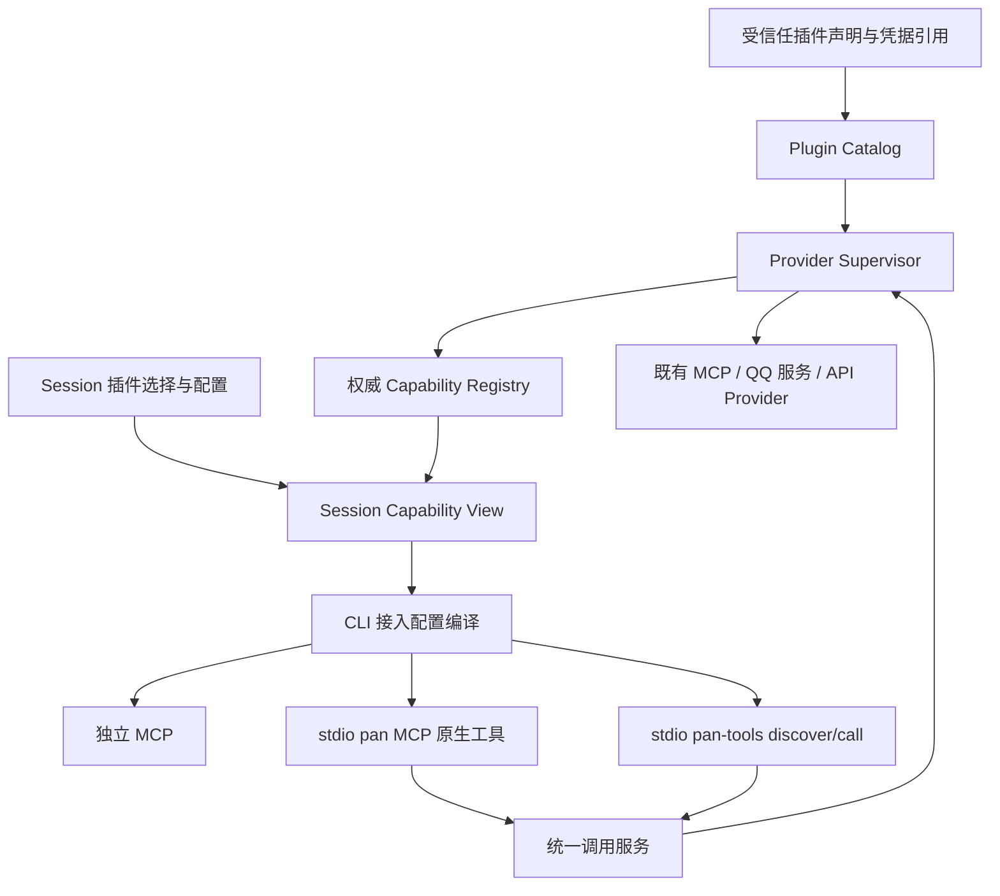

# Scepter 插件能力平台：三种启用方式与 QQ 首个实战规划

> 状态：本工作树实现及隔离验收已完成：后端 448 项、前端 71 项相关测试通过，QQ 指定账号及 Codex/CBC 三种模式完成调用验证；未提交、合并或部署。实测范围和未覆盖边界见 [交付报告](../../audit/plugin-platform-20261018/REPORT.md)。
>
> 日期：2026-10-17。
>
> 工作树：`D:\project\pan-worktrees\plan-plugin-manager-20261017`。
>
> 分支：`feature/plan-plugin-manager-20261017`；核查基线：`2c5b4655eedc7d994099e3460ab31e7dc0aac7b5`。
>
> 本文已按 2026-10-17 用户对 D1、D3、D6 的答复更新；其余决策采用此前推荐值。设计确认不代表代码或迁移已经完成。

## 1. 目标与已确认事项

建设一套统一插件基础设施，让同一个插件在不同 Session 中选择不同的 Agent 呈现方式，再用 QQ 完成三个模式的真实业务接入。

用户已确认：

1. 同时建设原生 MCP 投影和固定 discover/call 聚合调用。
2. 插件必须暴露标准 MCP，或提供 Pan 制定的结构化、可执行 API 描述；普通说明文档不能直接变成可调用能力。
3. 每个 Session 中，每个插件可选择：独立 MCP、并入 Pan 原生 MCP、聚合 discover/call。
4. 并入 Pan 的工具使用 `pan_` 前缀。
5. 优先以 QQ 作为首个实战插件；插件名称由 `pan-qq` 改为 `qq`。必须完整保留旧数据与所有原功能，包括非 MCP 的 Job、订阅和通知链路；如兼容性预检不能收敛，先用测试插件验证平台，QQ 整体顺延，不能只迁移七个工具就宣称 QQ 完成。
6. 在现有 Session MCP 每行的最右侧选择启用方式，保留左侧启停控制。
7. 不强行改造已有 HTTP MCP；它可以独立连接，也可以由 Pan 作为上游客户端适配。
8. 新增的 Pan 本地内部通信优先使用 stdio / 本地 IPC，不为了聚合再建立本地 HTTP 执行服务。
9. 原生和独立 MCP 沿用已有空闲后 Worker restart 使列表与 Schema 生效；固定 discover/call 接入已存在时，其后台能力目录即时更新，不要求重启 Worker。
10. 工作仅在当前工作树进行；其他工作树只读。
11. 本批不新增 Pan 认证、鉴权或细粒度权限系统；保留现有管理约束及上游认证行为，相关新建设计延期。
12. 同一插件每 Session 单模式；插件声明默认模式，Session 可覆盖；新插件默认关闭，历史插件保持 standalone。
13. 关闭 Session 的 QQ 工具暴露不停止已有订阅、通知、定时任务或删除历史，相关自动化沿用原管理入口。

本次规划的交付范围：协议、统一能力目录、Provider 接入、三种呈现方式、Session 配置与 UI、兼容迁移、QQ 全链路兼容及七个工具接入、隔离自动化及实际 CLI 验证。QQ 是否在首阶段交付由下文兼容性预检决定，默认仍以 QQ 为首个实战目标。

首期不建设插件市场、下载更新器、任意代码安装执行、Python 模块热卸载、完整事件总线，也不替换现有 QQ 网关体系。

## 2. 代码现状与证据

### 2.1 当前工作树现场核查

| 位置 | 当前实现 | 规划影响 |
|---|---|---|
| `packages/core/manifest_loader.py` | `McpServer` 支持 command/args/env/cwd/url/transport/headers/type；Manifest 按名称合并 | 扩展声明协议，保留旧 Manifest 的读取能力 |
| `packages/mcp/manifest.json` | 声明 `pan`、`pan-qq` | 以显式 alias 完成 `pan-qq -> qq`，不能只改 UI 文案 |
| `packages/core/adapters/mcp.py` | 构造各 CLI MCP 配置，为 Pan 相关服务注入 Session 信息 | 引入统一的 Session 配置编译结果，保留现有 Session 上下文注入 |
| `packages/core/adapters/codex/adapter.py` | 以启动 `-c` 注入 MCP，常驻 app-server | 首期使用现有 Worker 重建机制，避免把连接标记刷新作为交付前提 |
| `packages/web/server.py` | `mcpServers: string[]` 按 Manifest 名称解析；支持模板 always/never 锁 | 新字段不能破坏锁、显式空列表、配置写入权限 |
| `packages/core/worker.py` | `_mcp_enabled` 直接判断旧 `adapter_config.mcp_servers`；有 delayed restart 流程 | 更新到“有效物理接入是否存在”的统一判断，保持队列和 owner/generation 边界 |
| `ManageModal.tsx` | 每行 checkbox；提交整组 `mcpServers`，没有模式字段 | 每行右侧增加模式选择，显示已保存与实际生效差异 |
| New Session / 模板保存 / handoff | 多处复用旧 MCP 配置 | 必须一起覆盖，不能只修 ManageModal |
| `packages/qq/mcp.py` | 七个工具；通过既有 QQ / Pan HTTP API 执行业务 | 提取可复用 Provider/薄 Service；保留现有业务参数和底层网关 |
| `packages/remote/mcp_gateway.py` | 已有远程 Pan MCP 入口；进程环境不能区分多个调用 Session | 本批不扩展为新的远程插件入口，不把同一个进程 Session 配置用于多个 Session |

当前工作树未发现适用的 `AGENTS.md` 或 `.workflow` 控制文件。本轮只编写规划，不创建编排 Session、不派发实现任务、不操作服务。

### 2.2 本轮之前的实测结论

证据见当前工作树：

- `audit/dynamic-mcp-20261017/README.md`
- `audit/dynamic-mcp-20261017/round2/REPORT.md`
- `audit/dynamic-mcp-20261017/round2/results/verdict.json`

当前 Codex 0.162.1 收到 `tools/list_changed` 后不自动刷新；更换 MCP 连接后可以取得新目录。Pan wrapper 的 stdio 和 native-control 路径均可工作。强制重连可保留 Codex 进程和 thread，但首期没有必要依赖这条额外控制链。

CBC 2.168.0 在关闭延迟工具加载的测试配置下支持目录热更新。默认延迟模式未验证，不据此承诺所有 CLI 都实时生效。

已验证并发独立 stdio Session 的初始 Schema 隔离。没有把这一事实扩张成“当前 Pan 已实现共享 HTTP 服务的多身份隔离”。

## 3. 产品模型：连接来源与呈现方式分开

### 3.1 插件来源

一个插件的能力来源为：

- `mcp`：标准 MCP Server，现有 stdio、Streamable HTTP，已有 SSE 配置作为兼容来源。
- `pan_api`：Pan Capability Manifest v1，描述能力与已批准的执行绑定。

一个插件可以同时提供两个来源，但首期要求声明唯一 `primary_source`；备用来源不能在上游拒绝或未知调用结果后自动切换执行。

### 3.2 Session 启用模式

| 持久化值 | UI 名称 | Agent 实际看到什么 |
|---|---|---|
| `standalone` | 独立 MCP | 上游 MCP 原有工具；API 文档来源通过独立 stdio Shim 转换成真实 MCP |
| `pan_native` | 并入 Pan MCP | `pan` Server 中的一组真实工具，例如 `pan_qq_send_message` |
| `gateway` | 聚合发现 / 调用 | 统一 MCP 中固定的 `api_discover`、`api_call`，业务能力按需查询 |

同一 Session 的同一插件只允许一个模式；不同 Session 的配置、工具目录与 Schema 各自独立。关闭后记住用户上次选择的模式；受管理入口停止暴露和接纳该插件的新调用，独立入口按已有重启流程断开。

一个模式不可用时必须显示具体原因，不静默退回另一模式。例如缺凭据、源服务离线、协议不支持、能力声明冲突。

### 3.3 聚合 MCP 的组织

固定聚合 Server 的逻辑名称为 `pan-tools`，按 Session 配置自动生成接入：

- 至少一个插件选择 gateway，才接入一个 `pan-tools`。
- 所有 gateway 插件共用两个固定入口，不为每个插件再生成一组 discover/call。
- `pan-tools` 是派生接入，不在插件目录里变成需要用户再次手动勾选的插件。

该命名按推荐值采用；它是接入名称，不是额外需要勾选的插件。

### 3.4 Pan 核心工具的独立开关

用户只开启 QQ 的 pan_native 模式时，物理上需要 `pan` Server，但不能因此自动启用或显示 Pan 的 Session/Worker 管理工具。这是逻辑选择与物理接入的区别，本批不为此新增权限系统。

建议：

- UI 中的 `pan` 行表示“Pan 核心管理能力”是否启用。
- 物理 `pan` 连接可以只承载 QQ 投影；core 工具组和插件工具组独立控制。
- list 与调用分派使用同一份已启用工具组配置；未启用的工具组不注册处理器，不能只隐藏列表。
- 新 Session 不能仅因物理上接入 pan 而被侧边栏归类为 MA；既有 `sessionFilters.ts` 对旧 `mcpServers.includes('pan')` 的逻辑需要改用逻辑选择。

启用 QQ 原生模式不会顺带勾选 pan 核心能力。

`pan` 核心组与派生的 `pan-tools` 是保留对象，不允许再作为上游插件聚合进自己；核心 pan 行首期固定为核心 MCP 接入，模式控件只读。注册时还应检测间接循环，避免某插件引用当前聚合入口形成递归调用。

## 4. 总体架构



### 4.1 职责边界

- Plugin Catalog：插件 ID、名称、声明来源、版本、模式支持、alias 与配置校验。
- Provider Supervisor：启动/连接上游、能力发现、状态、超时、退出与清理；不实现业务权限。
- Registry：保存每个 Provider 上下文的不可变能力快照，原子发布和版本管理。
- Session View：按 Session 选择、模式和上游实际目录生成视图；本批不建设新的 Policy / RBAC 层。
- Invocation Service：Schema 校验、契约匹配、调用绑定、错误与结果规范化、审计。
- Projection：将相同能力生成独立 MCP、Pan 原生工具、聚合发现/调用视图。
- Session Config Compiler：把逻辑选择编译成某个 CLI 的物理 MCP 接入；不把物理接入当用户选择。

### 4.2 状态所有权

Pan 主服务持有唯一权威 Registry 与 Provider ownership。每个 CLI 的 stdio MCP Adapter 只负责协议和本地 IPC，复用已有启动链传递的 Session 上下文。

Registry 的“唯一”不意味着所有 Session 共用一份无差别目录。每个上游绑定按上下文分区，例如：

```text
plugin_id + session_id + credential_ref + provider_config_revision
```

上游可能按账户返回不同工具、Schema 和结果；默认每个 Session 独立连接/进程，首期不池化共享第三方 stdio 进程。QQ 的既有网关可以共享，但调用上下文独立。

独立 MCP 模式默认由 CLI 管理上游进程；native/gateway 模式由 Pan Provider Supervisor 管理。一个 Session 的同一个插件不能同时由两条路径重复执行。

Provider 具有 disconnected / discovering / ready / degraded / draining 状态；只加载未启用插件的静态声明，不因打开配置列表就启动其可执行程序。首次启用尚未完成发现时明确显示初始化中；不能使用其他 Session 或账号的目录来填补。

QQ 既有网关、Job sender、订阅与通知服务保持原生命周期。Session 工具入口的关闭或 Provider 释放不能停止这些共享业务服务；管理工具接入和业务服务存活分别计数，不把全局后台任务归属于某个 CLI Worker。

### 4.3 本地传输

- Agent -> Pan MCP / 聚合 MCP：stdio。
- 新增 Adapter -> Pan 主服务：Windows Named Pipe，采用有长度上限和版本字段的请求帧。
- 为跨平台留接口，Unix Domain Socket 可后续实现，不作为 Windows 首期交付前提。
- IPC 沿现有启动链传递 Session ID 和配置代际，用于路由、状态匹配与清理；不在本批新增签名凭证、调用者认证或权限协议。Session ID 不被描述为已验证的安全身份。
- 不使用 pickle，不接收任意函数名、import path、shell 或目标 URL。

保留既有 HTTP MCP 和 QQ 网关内部 HTTP；不把“外层接入 stdio”描述成底层完全没有 HTTP。

## 5. 插件声明协议草案

### 5.1 公共插件描述

建议在现有 Manifest 体系中新增 `plugins` 段，保留 `mcp_servers` 为旧格式兼容输入，避免维护两个独立目录。

```json
{
  "protocol": "pan-plugin/v1",
  "id": "qq",
  "display_name": "QQ",
  "aliases": ["pan-qq"],
  "version": "1.0.0",
  "source": {
    "kind": "mcp",
    "server_ref": "qq"
  },
  "exposure": {
    "supported_modes": ["standalone", "pan_native", "gateway"],
    "default_mode": "standalone"
  },
  "tool_exports": {
    "qq_send_message": "send_message",
    "qq_send_file": "send_file",
    "qq_read_conversation": "read_conversation",
    "qq_list_contacts": "list_contacts",
    "qq_read_inbox": "read_inbox",
    "qq_bind": "bind",
    "qq_unbind": "unbind"
  }
}
```

采用插件声明 default_mode、Session 可覆盖的规则。QQ 的默认模式为 standalone，保持历史行为；声明默认模式不等于默认自动启用。

插件 ID 与能力 ID 稳定；display_name 可修改。只允许受信任安装/配置来源登记可执行 Provider，Agent 不能通过 tool 输入自行安装或注册任意程序。

### 5.2 能力身份与名称

| 位置 | QQ 示例 |
|---|---|
| 原上游工具 | `qq_send_message` |
| Canonical capability ID | `qq.send_message` |
| 独立模式工具 | 保留 `qq_send_message` |
| Pan 原生投影 | `pan_qq_send_message` |
| 聚合调用 | `api_call(name="qq.send_message", arguments={...})` |

名称由明确的 export 映射确定，不能靠不受控的字符串删除前缀猜测。通用插件采用 `pan_<plugin_key>_<export_key>`；注册时检查合法字符、长度、保留名和全部冲突。规范化后冲突必须拒绝，不能静默覆盖或添加随机后缀。

### 5.3 Pan API 描述

建议使用 JSON 文件作为唯一机器可读真源；Markdown 文档由其生成。支持标准 JSON Schema，默认 Draft 2020-12，并显式验证所声明 dialect。

```json
{
  "protocol": "pan-capability/v1",
  "plugin_id": "example",
  "provider": {
    "kind": "pan_api",
    "transport": "stdio_jsonrpc",
    "command_ref": "approved-provider"
  },
  "capabilities": [
    {
      "id": "example.lookup",
      "export_key": "lookup",
      "description": "Lookup one accessible item",
      "contract_version": "1.0.0",
      "input_schema": {
        "type": "object",
        "properties": {"item_id": {"type": "string"}},
        "required": ["item_id"],
        "additionalProperties": false
      },
      "output_schema": null,
      "action": "read",
      "execution": {"method": "capability.invoke", "operation": "lookup"}
    }
  ]
}
```

API 文档必须有可执行绑定，不能只有参数说明。首期执行绑定建议支持：

1. 受信任内置 Provider，供 QQ / 测试能力复用现有业务服务。
2. `stdio_jsonrpc`：Pan 定义最小调用 framing、版本握手、request ID、错误与取消契约。
3. 既有 HTTP API：声明固定 base endpoint 和相对路由绑定；凭据为引用，不嵌在 Schema。只连接已批准地址，调用者不能覆盖 URL/method/header。

这是三个执行绑定适配器，不是三套业务调用服务。若首期范围需要收敛，必须至少保留一个真正外部 API 文档 Provider 的端到端验收；不能只给 QQ 内置 Python 函数贴标签就宣称文档协议已通用。

`stdio_jsonrpc` 的初稿接口：`provider.initialize`、`capability.invoke`、`invocation.cancel`（可协商支持）。请求带 `protocol_version/request_id/operation/arguments`；Session 上下文由宿主传入，不作为业务参数让模型选择。取消未确认不能当成未执行。本批不引入 permission key 或新的调用授权协议。

### 5.4 MCP 语义覆盖

第一版聚合层建议以 **tools** 为明确范围：

- 保留 inputSchema/outputSchema、annotations、结构化内容、文本、图片、音频、资源链接和 isError；不能全部压成任意 JSON 文本。
- 不支持的 MCP 交互必须明确拒绝或声明不支持，不能静默丢弃。sampling、elicitation、prompts、资源订阅等需要后续独立适配。
- 一个工具若依赖未实现的交互或资源读取，不能标成模式 2/3 完整可用；独立模式仍保持原生能力。
- 上游 annotations 作为行为提示保留，不据此新增 Pan 读写权限规则。

参考 MCP [工具与结果定义](https://modelcontextprotocol.io/specification/2025-11-25/server/tools)。

## 6. Registry、发现与调用

### 6.1 Descriptor 与版本

每项至少包含：稳定 ID、plugin/provider owner、来源工具名、说明、输入/输出 Schema、契约版本、契约摘要、副作用分类、超时和状态。副作用分类用于结果确认和禁止错误重放，不作为本批新增的读写授权规则。

分别使用：

- `registry_generation`：全局/Provider 快照发布代际。
- `session_selection_revision`：用户选择的模式、启停等。
- `contract_version/contract_digest`：一次调用依赖的能力契约。
- `instance_id`：主服务重启边界。

Generation 用于快照和生命周期匹配，不能替代契约版本，也不作为认证令牌。

### 6.2 Discover

固定工具暂沿用 `api_discover`：支持 query、plugin、name、include_schema、limit、cursor。

- 先按有效模式、Session 选择和上游实际可用目录筛选，再做分页和摘要。
- 游标绑定 instance、Provider/目录版本、配置版本、Session 和查询条件；相关上下文变化后旧游标失效。
- 精确名称查询返回完整 Schema；普通查询默认摘要，限制大小。
- 不运行 Handler，不 Claim Session，不创建 QQ 绑定。

### 6.3 Call

固定 `api_call` 接受 canonical name、arguments，可带 expected contract digest；不会接受任意 transport 指令。

执行链：

```text
读取接入对应的 Session 上下文
 -> 读取当前 Session 模式与启停配置
 -> 匹配该模式已注册能力及 Provider readiness
 -> 校验契约和参数
 -> 获取 invocation lease
 -> 执行既有业务，保留其现有检查与上游认证
 -> 原样保留业务确认语义，记录脱敏审计
```

原生工具投影进入同一调用链。旧 Schema 或旧目录不能让已从该 Session 受管理入口移除的能力继续被分派。这是配置生效语义，不新增 Principal、RBAC、动作授权或目标资源授权。

### 6.4 生命周期与失败

- 上游发现成功并验证完整后，原子发布能力；失败保留 last-known-good 元数据但状态不可假称 ready。
- 新配置失败不能静默恢复已被用户关闭的旧配置。UI 保留 desired/applied 差异，允许显式恢复旧配置。
- 受管理入口禁用后停止新调用；已开始的调用默认 drain，是否执行成功由原业务回执决定。第三方独立直连入口需待既有 restart 流程断开，不能宣称 Pan 已即时拦截其调用。
- 模式切换中的旧 Worker 不应继续接纳新的旧模式调用；退出前保留在途事务、Session 和原业务幂等键。
- 超时、断连和取消未确认均不得自动重发有副作用操作。
- 同步阻塞 Handler 不在主 event loop 中直接执行。
- Provider 退出、stdio EOF、主服务重启、目录或配置解析失败均给出明确状态。

原生工具 Schema 即使做了 Session 投影，也不应把不断变化的资源 ID 全部写成 enum；目标参数仍由现有业务验证，减少目录抖动和频繁重启。上游返回的真实 Schema 差异保留并纳入视图版本，不为此新建 Pan 权限模型。

## 7. Session 上下文与既有认证边界

### 7.1 Pan 管理的入口

用户明确：Pan 本批不新增任何认证、鉴权机制。原规划中的 Principal、签发 Session 凭证、Policy、permission key、逐动作/资源授权和未知调用者 fail-closed 建设全部移出本批；后续是否建设另行规划。

本批保留以下既有行为与正确性约束：

- 沿既有 MCP 启动链传递 Session 上下文，用于选择相应目录和业务路由；不把进程环境 Session ID 称为认证证据。
- QQ bind/unbind 沿用现有 Session 来源和缺失时的 `missing_identity` 返回，不增加一套新身份校验；模型参数仍不新增可任意指定的 Session 字段。
- 按 Session、Provider 配置、已有凭据引用和目录版本隔离缓存，不能按 URL 单独共享工具 Schema。
- 修改配置仍遵守已有 managed/readonly、模板锁和普通设置约束；不扩大也不移除现有行为。
- Schema 校验、工具分派和 Session 模式选择属于协议与配置实现，不包装为新增鉴权体系。
- 现有远程 MCP 网关不在本批扩展为多租户插件平台；缺少 Session 路由上下文时不猜用某个其他 Session 的目录。

### 7.2 独立模式的真实边界

直接连接第三方 MCP 时，第三方服务和 CLI 沿用其认证、工具 list 与执行规则。Pan 管理接入配置，不新增逐工具拦截或授权。

QQ 三种模式共享原业务实现和原有检查；第三方来源返回什么工具与 Schema，由该上游连接的现有上下文决定。Pan 能按 Session 隔离目录，不代表本批提供新的安全隔离或权限分配保证。

### 7.3 HTTP 与凭据

独立 HTTP MCP 可以沿用 CLI 自己管理的登录。切换到 native/gateway 后，Pan 作为新的 MCP Client，通常需要自己的合法授权。

不自动复制 CLI 的 token，也不把凭据写入 Session JSON、Schema 或日志；Pan 侧仅支持已配置的上游凭据引用。模式切换缺凭据时显示“需要连接”。这是适配上游已有认证，不新建 Pan 认证系统。

首期支持预配置凭据引用和无认证测试 HTTP Provider；完整第三方 OAuth 登录 UI 不在本批。

既有 SSE 来源保持 standalone 兼容；native/gateway 只有在桥接实现验证过该 transport 后才标为可用，不静默改为 Streamable HTTP。

## 8. Session 配置、持久化和迁移

### 8.1 一个配置真源

建议新增版本化的逻辑选择结构，存入现有 Session 持久化模型：

```json
{
  "plugin_config_version": 2,
  "plugin_bindings": [
    {"plugin_id": "pan", "enabled": false, "mode": "standalone"},
    {"plugin_id": "qq", "enabled": true, "mode": "pan_native"}
  ]
}
```

实现时可按既有 Session 组织放在 adapter_config 中，但必须只有一处可写真源。`mcp_servers` 对 v2 仅作为派生兼容视图或 v1 读取输入，不能与 plugin_bindings 分别接受互相覆盖的写入。

新旧字段同时出现在请求时拒绝歧义。旧 `mcpServers` 写请求经兼容翻译更新逻辑选择，不能在背后重新生成另一套独立状态。

逻辑选择、编译后的物理 MCP 接入、Worker 已应用配置分别返回，不使用同一个数组承载三个含义。

### 8.2 配置作用范围

全部覆盖：现有 Session、New Session、模板保存与继承、默认新建设置、复制/handoff、导入恢复。

- 字段省略表示继承，显式空列表表示清空，不能用 truthiness 合并。
- template always/never 和用户现有显式解除流程保持服务端约束。
- 普通设置不能提交任意 command/url/Manifest 路径。
- 每次配置提交带 expected selection revision，避免两个窗口互相覆盖。
- 保存采用既有原子持久化模式；保存失败不宣称已生效。

### 8.3 qq alias 与旧数据

- `qq` 是新的 canonical plugin ID，`pan-qq` 是显式 alias。
- 读取旧 Manifest / Session / 模板时转换为逻辑 qq + standalone，保留原来的启用状态。
- 若旧新 ID 同时出现，识别为同一插件；相同配置去重，有模式冲突则报错，不启动两份。
- 新写入使用 qq；旧命令入口 `python -m packages.qq.mcp` 保留。
- 独立模式中的 `qq_*` 工具名保持，避免把插件名称迁移扩大成所有提示词/调用契约破坏。
- 更新 `_PAN_IDENTITY_SERVERS` 等按名称匹配的身份注入逻辑，不能因为重命名丢失 QQ Session 绑定。
- 保留变更前快照和迁移版本；回滚旧二进制前按工具恢复兼容配置，不能保证旧版本自动理解 v2 模式。

历史第三方 MCP 声明均自动包装为 legacy plugin，默认 standalone，不要求一次迁移全部第三方仓库。

## 9. 生效与重启

已确认 D1：原生 MCP 与独立 MCP 沿用已有“空闲后 restart”；固定 discover/call 的后台目录即时更新。规则取决于 Agent 看到的 MCP 接口是否改变，不取决于上游是 MCP 还是 API 文档。

固定聚合入口已经接入时，增删其业务能力、修改业务 Schema，只更新 Registry / Session View；两个固定 MCP 工具的名称和 Schema 不变，无需重新注册客户端工具，也不依赖 `tools/list_changed`。仍需实现目录发布、缓存失效和调用读取最新快照，不能理解为后台完全不用改动。此前 discover 的结果不会自动改写模型历史，调用旧契约时按当前契约明确返回错误，再发现后重试；不自动重发未知结果的业务操作。

持久化并展示：

- desired revision：用户已保存的选择。
- applied revision：当前 Worker 实际接入版本；纯 gateway 目录变化另以 catalog generation 表示，不把已即时生效的目录误标为等待 Worker 重启。
- apply status：pending / applying / applied / failed。
- 最近一次可解释失败原因。

配置状态可沿 Session 恢复；不盲目持久化运行时 PID 或将重启意图误认成已执行。

| 情况 | 已确认处理 |
|---|---|
| Worker 不存在 | 下次启动使用当前配置，不为一次设置变更自动唤醒模型 |
| 原生/独立 MCP 变更，Worker 空闲 | 沿用已有受控 restart 与 CLI Session 恢复，验证新目录实际生效 |
| 原生/独立 MCP 变更，Worker 运行中 | 等待已有安全空闲边界；保留任务、队列、attachments、暂停和 owner/generation |
| 用户使用已有立即重启操作 | 沿用原中断/重启语义；普通保存不会触发强制中断 |
| 已有 pan-tools 中新增/修改/移除 gateway 能力 | 立即更新该 Session 的目录和调用分派，不重启 Worker；下一次 discover/call 使用当前快照 |
| 首次接入或最后移除 pan-tools，或 MCP 连接参数改变 | 物理连接配置有变化，按已有空闲后 restart 处理 |
| standalone / pan_native 工具集合或 Schema 改变 | 即使上游为 API 文档，也按空闲后 restart 获得新的原生 Schema |
| standalone / pan_native / gateway 之间切换模式 | 首期统一按已有空闲后 restart 处理，保留清楚的待应用状态 |
| Session 禁用工具入口 | native/gateway 服务端停止新的相应调用；独立直连入口在 restart 后移除。QQ 既有后台任务保持运行 |

模式切换涉及物理接入集合变化，统一按重启策略处理。不能仅因旧 `pan-tools` 连接仍在，就让已切换到 native 的能力继续从 gateway 可调用。

原生控制状态由用户持有时不强抢 owner；延后并明确待应用。仅比较配置保存时间不能证明当前 Worker 已更新。

更精细的“保持 Codex 主进程、只刷新 MCP 连接”作为后续优化接口预留，首期不额外承担已经实测过但更复杂的配置 epoch 机制。

## 10. 前端交互

在当前列表上增量改造，不建设独立的庞大插件管理页面。

```text
[✓] pan        Pan 核心管理能力                     [独立 MCP ▾]
[✓] qq         QQ                                  [并入 Pan MCP ▾]
[✓] notion     原有 HTTP MCP                        [独立 MCP ▾]
[ ] example    Pan API 文档 Provider               [聚合发现 / 调用 ▾]

已保存 · 等待当前任务结束后应用
```

- 每行左侧 checkbox、名称/简要来源、最右模式选择；窄屏可换行但保持相同行归属。
- 关闭插件时保留模式选择；选项不可用显示原因。
- 用户不需要手动勾选自动生成的 pan-tools，也不因选择原生模式被动获得 pan 核心工具。
- 按变更类型显示“已生效”“等待空闲后重启”“应用失败”“需要连接”；纯 gateway 目录更新成功即可显示已生效，原生/独立 MCP 保存成功不能冒充已应用。
- 修改一行时用版本保护提交，防止较旧异步响应覆盖另一行较新的选择。
- 新建与管理页复用一份插件选择组件；数据加载、模板持久化等调用方逻辑留在各自流程。
- 不展示 Secret；连接协议可简要标明 stdio / HTTP，不把协议与启用模式混在一个下拉框。

## 11. QQ 首个实战对象

### 11.1 工具清单与语义

| Canonical ID | 原工具 | 业务副作用 |
|---|---|---|
| `qq.send_message` | `qq_send_message` | 对外发送，写 |
| `qq.send_file` | `qq_send_file` | 对外发送文件，写 |
| `qq.read_conversation` | `qq_read_conversation` | 读取 |
| `qq.list_contacts` | `qq_list_contacts` | 读取 |
| `qq.read_inbox` | `qq_read_inbox` | consume=false 为读；consume=true 会删除已消费消息，属于有副作用操作 |
| `qq.bind` | `qq_bind` | 修改当前 Session 订阅 |
| `qq.unbind` | `qq_unbind` | 修改当前 Session 订阅 |

`qq_read_inbox` 不能因为名称含 read 就标成永远只读。`target_type` 在发送工具中使用 private/group，在绑定工具中使用 user/group，首期保留原契约，通过 Adapter 显式映射，不能静默统一导致旧调用失败。

`bot_uin` 必须贯穿所有模式，保留多账号“谁收到谁回”的行为；不能跨 Session、账号或目标共享错误的状态/缓存。

### 11.2 复用方式

把工具注册与可复用的 QQ 业务调用分开。独立 QQ MCP、Pan 原生投影、gateway 都复用同一 Provider/薄调用层，不复制三份发送、订阅、错误处理代码。首期优先适配既有 `packages/qq/mcp.py` 的执行实现与 HTTP API，不为了统一目录迁移整个 QQ 后端，也不要求 Job 必须经过 MCP 才能发送。

既有 QQ 网关 HTTP、消息存储、订阅、队列通知继续使用原语义。接入插件平台不顺带重做 QQ inbox、路由和 Gateway Plugin Manager。

`send_file` 的路径是网关侧可读路径，URL 也由原网关处理；不能在新聚合层引入“让主服务下载任意地址/读取任意文件”的隐式行为。

### 11.3 幂等和结果确认

不凭空给现有 QQ API 宣称 exactly-once。当前发送接口未在本轮证明具有端到端幂等键。

新增层必须禁止自动重放；超时返回结果未确认，先查业务状态。若后续要增加 request ID 幂等，需要 QQ 网关和发送确认链共同实现，并作为独立变更验收。

### 11.4 真实操作边界

先覆盖本节完整清单的隔离回归，再以 QQ 做真实 CLI 业务验收。向真实 QQ 对象发消息、发文件、消费 inbox、bind/unbind 需要明确测试对象和范围；这是执行阶段的测试输入，不是尚未决定的架构选项。

不自动对现有联系人/群发送测试消息，不对现有生产 inbox 做消费测试。

### 11.5 关闭插件的含义

已采用 D5 推荐值：关闭 Session 的 qq 仅停止该入口的工具暴露与新调用，不自动删除现有 qq_subscriptions、既有定时发送或历史，也不停止原有通知。订阅、通知、定时任务和全局 QQ 网关仍由各自原入口管理。

### 11.6 完整兼容清单：不只验收 MCP

下表来自当前工作树的静态调用关系核查，代表已识别的兼容要求，尚不构成运行验证结果。实施前继续扫描调用方并建立对应回归，发现遗漏即补入，不以表格代替验证。

| 链路 | 当前入口/数据 | 本次必须保持与验证 |
|---|---|---|
| 七个 MCP 工具 | `packages/qq/mcp.py`；既有 `/api/qq/send`、`send_file`、`history`、`recent_contacts`、`inbox` 和 Pan subscribe/unsubscribe | 参数、默认值、返回内容、错误、bot_uin、消费语义不变；三种模式业务结果一致，独立模式旧工具名不变 |
| 定时 Job | `packages/jobs/actions.py` / `api.py`、`packages/core/background_jobs.py`、Web `_send_scheduled_qq` | 旧 `action.api = send_qq`、`args.targetType/targetId/botUin`、顶层 text 保持；不能把旧 Job 改写为 `qq.send_message`；无 Session target 的任务仍可独立执行 |
| Job 调度与恢复 | 原持久化 Job、schedule、运行记录与投递状态 | 创建、编辑、禁用、取消、重启恢复与发送回执不退化；Worker 不在线、Session 未勾选 QQ 工具也不影响原定时发送；不因模式切换新增调度实例或重发 |
| 完成通知 | `packages/core/qq_reports.py`；`qq_report_targets`、`qq_report_outbox` | 保持原发送身份键和 pending/attempted/sent/failed/cancelled 状态；保留发送前持久化 attempted 的顺序，不因迁移把已尝试记录改回 pending |
| 通知默认与收件箱 UI | Postbox、CompletionBridgeDefaultsPanel、NewJobForm；Web `/api/qq/contacts`、`/api/qq/channels` | 保持既有联系人选择、bot 选择、qqTargets/订阅设置、默认继承和原交互；复用已有联系人组件，不另建第二套数据存储 |
| QQ 入站与自动回复 | `packages/qq/plugin.py`，mirror / selective，command-routes | mirror 绑定/派发/回复，selective 写历史与 inbox 且不自动唤醒，命令前缀确定路由均保留；插件启用模式不是 QQ mirror/selective 业务模式 |
| 订阅与队列 | `qq_subscriptions`、`/api/qq/notify`、queue_pending | 原目标键（含旧无 bot 与新带 bot 格式）、通知封装、队列项目 ID、暂停和消费顺序保留，不能因接入层重建重复入队 |
| Session 持久化与 handoff | Session JSON、copy_settings、QQ postbox 关系转移、既有 Job retarget | 逻辑插件配置按既有复制规则处理，QQ 订阅仍转移；完成通知目标与 outbox 按原归属保留，不顺带新增迁移/重放语义 |
| 消息与文件数据 | `data/qq_history`、`data/qq_inbox`、既有媒体路径与文件发送 | 旧平铺文件与按 bot 分目录的数据都可读，沿用已有 legacy 迁移、锁和上限；不清空、不重建，不改写网关侧文件路径含义 |
| 多 bot 与网关管理 | channels、NapCat/SnowLuma、gateway plugin manager、配置和启动参数 | 原账号、网关选择/启停/自启动/配置入口与环境变量保持；同 target_id 不同 bot 不串历史、inbox、联系人或消息来源 |
| 历史名称与直连 | Manifest、模板、Session 中的 `pan-qq`；`python -m packages.qq.mcp` | alias 只迁移插件逻辑 ID，不把 QQ 网关 plugin_id、bot ID、消息/任务/订阅 ID 或旧业务 API 名字一起重命名；旧独立 MCP 入口继续工作 |

### 11.7 QQ 首个实战的可行性与退出条件

**当前静态判断：适合继续优先使用 QQ，但前提是薄适配、旧契约保留。** 已有 MCP 和 Job 都调用稳定的 QQ HTTP 业务入口，三种工具呈现不要求重写 Job、消息存储或网关。因此本轮不因“QQ 功能多”直接放弃它，也不承诺未经回归的一次迁移必然成功。

实施安排：

1. P0 建立上述清单、旧数据 fixture、既有回归基线；所有临时数据和服务只在本工作树隔离路径/端口运行，不使用生产数据目录。
2. 先验证声明、目录、Session 隔离和薄 Provider，再接入 QQ，保持旧业务入口可运行；平台基础测试始终有一个可控测试 MCP / 外部 API 描述 Provider，不用真实 QQ 承担故障注入。
3. QQ 整体交付门槛为：旧 Session/模板/Job/历史/inbox/outbox 兼容、非 MCP 链路回归、三模式工具、实际 CLI 与明确对象的业务验证全部完成。只完成七工具不标记 QQ 迁移成功。
4. 若需要大规模改写 QQ 业务或存储、无法复现旧数据、关键回归无法封闭，则平台首阶段以测试 MCP 交付，QQ 整体延后并列明原因；不将删减 QQ 功能作为“迁移成功”的条件。
5. 配置迁移保留副本和兼容读取，隔离环境验证恢复流程；回滚不回退已发生的消息发送状态、不重放 outbox/Job。实际升级/服务切换不由本规划自动执行。

## 12. 分阶段实施与验收

| 阶段 | 产出 | 完成条件 |
|---|---|---|
| P0 协议冻结与 QQ 预检 | 已确认决策、JSON Schema、名称/配置规则、QQ 调用清单和旧数据基线 | 样例可校验；QQ 全链路测试范围明确，无未说明的功能删减；明确继续 QQ 或按 11.7 整体顺延 |
| P1 目录与配置基础 | Plugin Catalog、alias、Session v2、投影编译 | 旧数据/空列表/模板锁/多窗口版本冲突测试通过 |
| P2 Provider 与统一调用 | MCP stdio/HTTP、API 文档 Provider、IPC、Registry、Session View | 独立假 Provider、外部 API 描述接入、Schema 动态变化、Session 隔离、失败/超时有自动化证据；不引入新鉴权 |
| P3 三种呈现 | standalone、pan_native、pan-tools | 同一能力经三种方式得到一致业务结果；核心工具不隐式启用 |
| P4 QQ 完整兼容迁移 | qq 逻辑名称迁移、七个能力薄适配、11.6 全部链路与旧数据兼容 | 三模式、Job、通知、入站、订阅、handoff、历史/inbox/outbox、多 bot、网关管理与旧别名回归均通过；原功能不删减 |
| P5 Session UI 与生效 | 共享选择组件、新建/管理/模板、desired/applied | 真实浏览器验证保存、切换、失败和待重启；后端重启 gate 有隔离证据 |
| P6 CLI 实战与交付 | Codex/CBC、stdio、已有 HTTP fixture、QQ 真机验证、文档与恢复步骤 | 真实模型按指定低成本模型验证；指定对象的 QQ 业务与非 MCP 链路完成验收，未验收不宣称 QQ 整体迁移完成 |

工程依赖上，前后端可在接口冻结后分别实现；Registry/Session 配置协议未冻结前，不发散建设三套入口。本文件不自动授权创建或派发其他 Agent。

不预先承诺日历工期。首个风险收敛点是 QQ 全链路与旧数据基线，其次是 Session 配置与 Worker 生命周期、通用第三方 MCP 的 tools 适配。依赖额外交互或新登录流程的第三方继续 standalone，不扩张本批边界。

## 13. 必须覆盖的验证矩阵

1. 同一插件：三个模式 × MCP 来源/API 文档来源，调用结果一致。
2. 多 Session 并发：不同启用模式、不同工具集合、同名能力不同 Schema、不同凭据，不相互覆盖。
3. pan 行关闭而 qq 为 pan_native：只有 QQ 投影，直接猜 Pan 核心工具名也不能调用；MA 归类不误判。
4. 已有 gateway 工具列表稳定；上游新增/禁用/注销和 Schema 变化即时发布，下一次 discover/call 读取最新视图，旧 cursor/契约有明确反馈且 Worker 不重启。
5. native 配置保存、Worker 重建、同一 CLI 对话恢复、新 Schema 应用；区分保存成功、初始化成功和模型实际调用。
6. 旧 Session、模板、默认设置、handoff、显式 []、省略字段、always/never 锁和 readonly/managed 权限。
7. `pan-qq` alias、qq 新 ID、重复声明和命名冲突，无重复进程或工具。
8. Session 上下文、instance/generation、旧 cursor、配置代际和契约匹配；A/B 并发不串目录或业务目标。验证已有管理约束仍生效，不为本批新增认证/权限测试系统。
9. Provider 崩溃、初始化失败、last-known-good 元数据、未知执行结果、无自动重放。
10. MCP rich content/isError/outputSchema，依赖未支持交互的工具不能误报可用。
11. HTTP 既有来源、凭据引用、缺凭据、不同账号目录、URL/header 参数注入拒绝。
12. QQ 七个工具、`bot_uin`、private/user 差异、consume 副作用、原缺失 Session 返回；旧参数、默认值、结果与错误一致。
13. 前端真实浏览器：每行选择、键盘、窄屏、重复点击、并发保存、待应用/失败和模板继承。
14. 进程和连接清理：仅停止自有且身份匹配的进程，主服务退出/Worker 更换不留下悬挂 Provider。
15. 旧 QQ Session/模板/Job/历史/inbox/outbox fixture 完整加载、保存与重启恢复；flat/bot 目录兼容，旧名称 alias 不波及网关 ID。
16. 定时 QQ Job 创建/编辑/取消/恢复/执行/回执；无 Worker、关闭 Session 工具、切换三模式仍按原计划运行，无重复发送或任务丢失。
17. QQ 完成通知 pending/attempted/sent/failed/cancelled、撤销目标、readonly、重启与模式切换；保持原状态转换和发送前落盘，不重放已尝试记录。
18. QQ mirror/selective、命令前缀路由、多 bot、入站通知、队列暂停/消费、Postbox/handoff 和网关选择/启停/自启动；各自原管理入口保持可用。
19. 混合变更：gateway 目录部分即时生效，原生接入部分等待 restart；前端分别反映目录与连接状态，不能整批误报全已生效或全未生效。

静态检查、单元测试、模拟集成、真实 CLI、真实浏览器、外部 QQ 实际交付分别报告。合成模型 fixture 的 usage 数字不计作真实 token/费用证据。

已有回归入口包括 `packages/qq/test_qq_api.py`、`packages/qq/test_channels.py`、`packages/qq/test_snowluma_accounts.py`、`tests/test_qq_gateway_plugins.py`、`tests/test_qq_python_resolve.py`、`tests/test_session_handoff.py`、`tests/test_handoff_job_retarget.py` 和 `NewJobForm.scheduled-qq.test.tsx`。这些是实施时复用和补充的起点，本轮只查阅，尚未运行；不把名称列表当作已覆盖所有场景的证据。

## 14. 已确认的决策

### D1：变更的应用时机

用户明确：原生与独立 MCP 沿用现有空闲后 restart；固定 API 聚合 MCP 的后台目录即时更新。按第 9 节区分目录变化与物理连接变化；不因上游是 API 文档就把原生 Schema 更新也当成即时生效。

### D2：新插件的默认模式

用户接受推荐值：插件声明 default_mode，Session 可覆盖；旧插件迁移为 standalone；新插件默认关闭。未支持的模式不可选择。

### D3：QQ 完整迁移与实战对象

用户明确：QQ 必须一次完整兼容迁移，旧数据、Job 和所有原功能均纳入，不接受只验七个 MCP 工具。优先 QQ 做首个实战对象；若工作量/风险不适合首阶段，则先测试 MCP，QQ 整体移至下一阶段。

采用薄适配和兼容基线，满足第 11.7 节门槛后再声称 QQ 迁移完成；不以未经测试的信心代替证据。真实写操作的测试对象与范围在执行阶段指定。

### D4：第三方 MCP 的首期兼容范围

用户接受推荐值：native/gateway 首期支持 tools；依赖未支持资源/交互的插件仅保留 standalone。HTTP 使用上游已有预配置凭据，不建设全套第三方 OAuth 登录 UI。

### D5：关闭 QQ 是否同时停止已有订阅与自动化

用户接受推荐值：只停该 Session 的工具入口，不自动删除既有绑定、定时任务和历史；通知/自动化/全局网关独立管理。

### D6：本批不新增 Pan 鉴权

用户明确：Pan 不做任何额外鉴权；若未来要做，也不在本批。适用于全部三种模式，不只独立模式。删除此前建议的统一 Policy、签名身份链和新逐工具/资源授权要求，现有行为保持。

### 其余采用的设计默认

用户接受此前推荐值：同一插件单模式、核心 pan 能力独立开关、聚合 Server 名称 pan-tools、qq 显式 alias 迁移、旧工具名保留、不同 Session 默认不共享第三方 Provider 进程、已有 HTTP 原样适配、新内部链路 stdio / Named Pipe。

当前没有阻塞规划的未决产品选项。QQ 兼容性是否达标由隔离实现和验收证据判断，测试对象属于后续执行输入。

## 15. 与旧 MVP 文档的关系

此前指定的 `Scepter-Dynamic-API-Gateway-MVP-Implementation.md` 聚焦两个固定 MCP 工具。本规划扩展到三种呈现和 QQ，并修改其默认内部 HTTP 执行入口为本地 IPC。

继续保留唯一权威 Registry、Schema 校验、快照/lease、固定执行绑定和未知结果不重放等契约。原文档关于新增认证、调用时鉴权和身份 fail-closed 的要求，由用户最新 D6 明确移出本批；不能引用旧文档把它们重新带回实施范围。

本规划没有修改其他工作树中的旧文档，也不将其“待实现”写成已完成。本文件作为当前已确认范围，可继续拆为接口规格和可验收实施任务。
