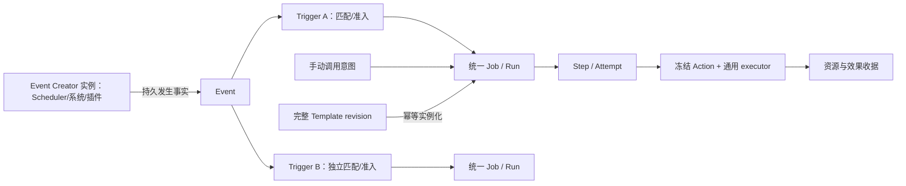

# Job 终局模型与旧链路退场计划

日期：2026-10-25。设计 TA Session：`ses_3f4766dcd0e592c3`。工作树：`D:/project/pan-worktrees/job-final-design-20261025`；分支：`design/job-final-20261025`；代码核对基线：`bcbed26a089441b7782ddc1ca4095836537239d6`。

**交付性质：设计与计划，待实现。** 本文没有修改产品代码，没有运行迁移、服务、构建或外部效果。用户已明确终局约束，并确认 D1：应为 **Event Creator，Scheduler 实例是一个 Event Creator**；D2 选择 A：**所有 Trigger 的效果执行收敛到统一 Job，删除直接 Trigger→Action 的独立执行生命周期**。D3 已确认区分 Retry/Run again/Clone and run；D6 已采用用户替代方案：简单实例脚本迁移，复杂实例明确不兼容、原状保留且不迁移，建议手动新建。其余具体模型是实施建议，D4 已定由 Scheduler 实例拥有全部时间/skip/补发政策，实际驱动时发 Event；D5 的重复政策选择已撤回，沿用现有 Authorization 授权矩阵，具体接线待实现。卡片创建成功只证明问题已持久化，不证明选择获批。

## 0. 目标、依据与状态边界

终局必须同时成立：全部旧 Job 能力由 Action / Event / Trigger / Event Creator / 统一 Job / Template 组合表达；表达不了就修改这些抽象；旧链路、旧入口、旧代码最后彻底删除，全部调用经过新抽象。兼容投影、旧 kind 下挂 system Action、保留旧 dispatcher 或双轨页面，均不能作为完成标准。

后续 D6 明确修订**既存实例**处置要求：简单实例脚本迁移，复杂实例不删除也不迁移，明确不兼容并建议手动新建。它不撤销全部旧能力的新模型覆盖及旧代码删除要求；但“零 legacy 记录”改为零可执行旧注册/owner/lease，允许已披露、原状保留且不再执行的复杂旧数据存在。不得再用“全部旧格式物理记录为零”作验收条件。

本要求取代旧设计中“长期保留原 MCP 工具名”“无法映射就一直留旧 owner”“直接 Trigger 仍可独立执行 Action”的终局解释。迁移期间可有明确截止点的旧读取和隔离 owner，不能因此获得永久豁免。用户要求的删除方向已定，不再询问是否保留旧入口。

| 依据 | 本次读到的事实／适用范围 |
|---|---|
| 根 `AGENTS.md`、`CODEBUDDY.md`、跨平台与当前开发计划 | 文档与代码层证据独立；三平台门禁；平台差异进 platform；不动 main/practical、不 push、不启停服务、不碰 8767/8768 |
| `JOB_ACTION_CHAIN_SCHEDULER_EVENT_DESIGN_20261024.md` | **该文件不存在于本工作树基线**；只读参考 `D:/project/Pan-main/docs/design/job-unification/` 同名文件，内容 SHA256 `c4e29ca41a83e31e26605f53f520b728c149795fba70c2bd81dc3ab8775e379a`。它是外部参考，不能当作 bcbed26a 的受版本控制文件 |
| [Phase 1 矩阵](IMPLEMENTATION_MATRIX_20261025.md)、[Phase 4 兼容矩阵](PHASE4_COMPAT_MATRIX_20261025.md)、[Phase 4b 完成矩阵](PHASE4B_COMPLETION_MATRIX_20261025.md) | 已有串行链、来源、组合和局部 owner switch；整体迁移仍 partial；兼容结构实际存在 |
| [Phase 5 E2E](PHASE5_E2E_REPORT_20261025.md) | 历史隔离样例含真实 HTTP/stdio/Chromium；报告记载 525 passed、1 skipped 及两条 E2E。是前阶段证据，**本轮未复跑**；真实 QQ/provider、生产迁移、部署、远端 CI 仍未证明 |
| `packages/automation/{engine,store,service}.py`、`packages/jobs/{chains,legacy_compat,action_runtime}.py`、`packages/scheduler/{time_events,legacy_bridge}.py` 与 §1 入口 | 本轮静态核对真实符号；说明当前行为，不等于已接受的终局设计 |

状态用语统一：**设计已定**＝此次用户已明确的约束、D1 的对象名称/来源职责/实例关系、D2 的唯一 Job 执行生命周期、D3 的三操作区分、D4 的来源驱动/事件发生语义及 D6 的实例处置规则；**设计建议**＝无阻塞产品选择的技术方案，尚待实现审查；**provisional Dn**＝不能据此改变产品行为；**待实现**＝本轮没有产品实现。共创建 **6 张卡；D1/D4 聊天已定，D2/D3 已提交 A，D6 拒绝原选项并给出已采纳的替代要求；D5 复用现有授权政策并撤回重复卡；待决 0 组**。D6 原建议的 30/90 天清理未获采纳，不自动删除；后续清理范围/期限另行确定，不作为本次旧代码退场前置选择。后文 Creator 均为 Event Creator 的简称，`createdBy` 则是对象创建者身份。

## 1. 真实旧入口与依赖清单

以下路径相对仓库根；定位使用 `文件:符号`，不依赖易漂移的行号。范围是 Job、Scheduler 及其生命周期调用者，不把 Rewind、Worker 或操作系统 Job Object 仅因名字含 Job 就列为退役对象。

### 1.1 HTTP、MCP、UI、CLI

| 编号 | 真实文件与符号 | 当前入口／作用 | 终局处置 |
|---|---|---|---|
| E01 | `packages/web/server.py:api_background_job_start/api_background_job_list/api_background_job_get/api_background_job_cancel/api_background_job_update/api_background_job_retry` | POST/GET `/api/background-jobs`；GET/PATCH `/{job_id}`；POST `/{job_id}/cancel`、`/retry`；普通 HTTP 仍可写旧记录，trusted MCP 部分分流 | 全部删除；调用方转 canonical Job API，取消/重试传显式作用域与 revision |
| E02 | `packages/web/server.py:api_session_message_job_start` | POST `/api/session-message-jobs`；单 Session 或广播 | 删除；改用消息／fanout Action 的 Job composition |
| E03 | `packages/web/server.py:_legacy_mcp_authority/_legacy_action_job` | IPC 来源分流；`legacy-mcp` 权限类型；旧形状返回 | 删除；授权改通用 principal/grant，不能把 transport 当永久执行权 |
| E04 | `packages/jobs/api.py:list_jobs/create_job/get_job/patch_job/delete_job/job_runs/run_job_now/next_preview/job_kinds` | `/api/jobs` 混合 facade，`/{job_id}`、`/runs`、`/run-now`、`/next`、`/kinds`；按旧 kind 校验与分支 | 删除旧 router 后由单一 canonical router 接管。即使复用 `/api/jobs` URL，也必须删除旧 handler、payload 和 kind 分流，不能只改名字 |
| E05 | `packages/jobs/api.py:list_templates/create_template/delete_template`；`packages/jobs/templates.py:list_templates/create_template/delete_template` | `/api/jobs/templates`、`/{template_id}` 是时间片段模板，与完整 Job Template 不同 | 导入为完整 Template 的 time composition 后删除时间模板 API/store；内置快捷项成为普通完整 Template |
| E06 | `packages/scheduler/api.py:list_tasks/create_task/get_task/switch_owner/update_task/delete_task/pause_task/resume_task/run_task_now/task_runs/next_preview/engine_status` | `/api/scheduler/tasks`；`/{task_id}`、`/owner-switch`、`/pause`、`/resume`、`/run-now`、`/runs`；`/api/scheduler/next`、`/status` | 删除旧任务 router；Creator preview/status 与 Job Run 查询分别承担其职责；owner-switch 仅迁移包存在，终局删除 |
| E07 | `packages/mcp/server.py:agent_background_start/agent_background_get/agent_background_list/agent_background_cancel/agent_background_retry` | background 原工具组 | tools/list、tools/call、HTTP catalog、gateway 全部撤销；发布 canonical Job tools |
| E08 | `packages/mcp/server.py:agent_message_job_create/agent_message_job_get/agent_message_job_list/agent_message_job_update/agent_message_job_cancel` | 延时消息／广播工具组 | 同上；Agent 的创建便捷性由通用 composition/Template 提供 |
| E09 | `packages/mcp/server.py:scheduler_create/scheduler_list/scheduler_get/scheduler_update/scheduler_delete/scheduler_pause/scheduler_resume/scheduler_run_now/scheduler_runs` | 旧定时任务 MCP | 删除；时间 Creator CRUD + Job composition/controls；不继续导出旧别名 |
| E10 | `packages/web/server.py:api_main_restart/api_main_restart_status/api_main_exit/api_main_exit_status` | POST `/api/main/restart`、`/exit`；GET 各自 `/status` | 特权意图和状态改通用受保护 Job 操作，随后删除旧路由与旧 Job 构建代码；旧路由不是终局里的“特例入口” |
| E11 | `packages/web/src/views/JobsView.tsx:JobsView/handleLegacyCreate/handleUpdate` 及其 legacy tab；`packages/web/src/components/jobs/NewJobForm.tsx:NewJobForm`；`packages/web/src/components/jobs/JobDetailDrawer.tsx:JobDetailDrawer` 的 legacy branches | Legacy Jobs、New legacy Job、kind editor、旧详情控制；`packages/web/src/components/jobs/LegacyJobDetails.tsx:LegacyJobDetails` | 删 legacy tab/form/details、kind selector 与 kind 行为分支；保留统一 Job 列表与通用 drawer；新 UI 对象导航为 Job/Trigger/Creator，Action/Template 复用管理入口 |
| E12 | `packages/web/src/services/api.ts:fetchScheduledTasks/createScheduledTask/updateScheduledTask/deleteScheduledTask/pauseScheduledTask/resumeScheduledTask/runScheduledTaskNow/fetchTaskRuns/fetchSchedulerNext/fetchSchedulerStatus` | 旧 Scheduler transport | 删除旧函数与类型；编辑器、导航、测试一起迁移 |
| E13 | `packages/web/src/services/api.ts:createJob/patchJob/fetchJobKinds/cancelJob/fetchLegacyJob/retryLegacyJob/runJobNow` | 旧 kind 创建、旧后台取消与重试 | 删除旧实现；名称若复用必须切成新契约；`fetchJobs/fetchJob/deleteJob/fetchJobRuns` 去 mixed facade 解析 |
| E14 | `packages/web/src/services/api.ts:fetchMainRestartStatus/restartMainService/fetchMainExitStatus/exitMainService`；`packages/core/cli.py:lifecycle`；`packages/core/console_exit.py:start_console_exit/ConsoleExit`；`packages/core/host_console.py:HostConsole.start_input`；`scripts/restart.bat`、`scripts/stop.bat`（脚本整体） | Settings/CLI/console 仍调用 main 旧 HTTP；CLI 以 `/api/main/{operation}` 动态拼接，并直接读 `data/background_jobs/jobs/{id}.json` 等终态 | 全部改统一特权 Job 入口与可跨服务停止读取的 operation receipt，再删除旧 URL 字面量、动态旧路由拼接与旧 JSON 文件读取；UI 的 Restart/Exit 用户动作保留 |
| E15 | `packages/jobs/independent_service.py:Handler._run/JobStore.create/request_cancel/retry/events/ack`；`packages/jobs/pan_bridge.py:request/recover_events/public_job` | 独立服务 `/jobs`、`/jobs/{id}`、`/cancel`、`/retry`、`/events`、`/events/{id}/ack` 是旧第二套 Job 生命周期 | 保留独立执行能力，改为同一 Run/Step/Attempt 的 executor 协议；删除独立 Job create/retry/store 形状、旧 bridge 投影和 terminal notice 生产者 |

核对说明：同文件的多个符号以 `/` 分隔，类方法省略类名的后续成员仍属于该类；脚本按整体定位。旧路由清单以 decorator 与 handler 共同核对，动态 CLI 路径单独追踪。

### 1.2 旧 store、扫描 pass、兼容层与必须抽出的安全能力

| 编号 | 真实文件:符号 | 当前职责与退场目标 |
|---|---|---|
| S01 | `packages/core/background_jobs.py:start/start_message/start_broadcast/update_message/cancel_message/retry` | 旧创建/更新/重试；终局删除。`get/list_jobs/_create/_update/_write_job/_job_path/_normalize_job` 的旧 JSON 事实源由 canonical store 取代后删除 |
| S02 | 同文件 `run_due_message_jobs/run_due_scheduled_tasks/_fire_scheduled_entry/_run_job_action/_execute_job_action/_redeliver_undelivered/_advance_paused_entries/_repair_missing_next_fire` | 旧时间认领、旧 api 分发、undelivered 重投；终局整段删除。`_execute_job_action` 对未知旧 action 回落 assign 的语义不得带进新模型 |
| S03 | 同文件 `register_scheduled_tasks/_scheduled_task_hooks/append_run_record/list_run_records/_append_task_run/_append_run_record_once/_reconcile_scheduled_processes` | hooks、旧 runs JSONL 与 parent-child 对账；改 canonical effect backend/Run ledger 后删除 |
| S04 | `packages/scheduler/store.py:_job_from_payload/_task_from_job/_job_for_task/create_task/update_task/delete_task/replace_task_schedule/set_task_misfire_policy/migrate_legacy_tasks/_job_from_legacy_task/_merge_legacy_runs/legacy_root` | task↔Job 投影、旧 tasks 导入与 run 合并；迁移工具一次性使用后删除运行时 loader，终局从交付包删除迁移实现 |
| S05 | `packages/scheduler/engine.py:_ensure_registered/tick_once/run_now/preview_next/start_loop/stop_loop/drain/status` | tick 目前经旧 background pass 间接驱动新 runtime，start_loop 自动 migrate，stop_loop/drain 是兼容桩；删旧依赖、启动隐式迁移与桩。可复用一个调度 wake loop，但只调 Creator 发布与统一 Job coordinator |
| S06 | `packages/jobs/legacy_compat.py:config_for/_schedule/request_key/legacy_view/is_legacy_action_job`；`packages/scheduler/legacy_bridge.py:LegacySchedulerBridge` 全类 | 参数/结果兼容、旧游标投影和 owner switch；零可执行 legacy 后整文件删除，不改名常驻；D6 保留的复杂原数据不要求清空 |
| S07 | `packages/jobs/system_actions.py:definition/arguments/prepare/finish/sync/invoke/settle/execute` | 按旧 kind 注册和执行，`system_scheduled_task` 内嵌旧 action payload；改成真正独立 Action descriptor 和 executor API 后删 kind factories、旧快照 writer 与旧 dispatcher 调用 |
| S08 | `packages/jobs/action_runtime.py:config_job/Runtime.create_legacy/event_targets/queue_event/tick/consume_entry/skip_misfire/publish_events`；`packages/jobs/unified.py:project/projected_schedule/_unknown_legacy_fields` | 新 Job 仍依赖旧 `_job_from_payload`、inline schedule、混合视图和旧 `scheduler.task.fired`；删除这些旧依赖及第二条 Job Event 匹配路径 |
| S09 | `packages/automation/engine.py:Engine.drain/run_attempt`；`packages/automation/store.py:Ledger.claim/finish/prepare_action/confirm_uncertain/sync_attempt`；`packages/automation/chain_engine.py:run_chain` | 独立 Trigger Action 执行/重试账本。按已定 D2-A 删除执行部分，Ledger 保留 Trigger 定义、admission receipts/关联，Run/Attempt 统一归 Job；不能删 Event 广播匹配本身 |
| S10 | `packages/core/background_jobs.py:create_service_job/transition_service_job/find_service_job/get_active_service_job`；`packages/core/main_lifecycle.py:run_supervisor/run_exit_supervisor` | 旧 lifecycle kind writer 删除；supervisor 保留外部监督职责，改统一 executor receipt。不能用 host 内 await 自己退出替代 |
| S11 | `packages/core/background_jobs.py:recover_notifications/_broadcast_independent_terminals/_terminal_broadcast_candidate/_recovery_loop/start_recovery_loop/stop_recovery_loop`；`packages/jobs/pan_bridge.py:recover_events` | 旧通知生产、恢复与 ack；先转唯一通知 outbox，删除重复生产和 legacy notice ID 分支；原队列收据迁移不重发 |
| S12 | `packages/jobs/independent_service.py:JobStore`、`packages/jobs/independent_runner.py`；`packages/core/background_runner.py:main` | 第二 Job store/runner wire 退场；提取后只接收 canonical Attempt lease，独立 backend 不再分配 Job/Run ID；可跨 Pan 停机继续执行 |
| S13 | `packages/core/background_jobs.py:retarget_session_jobs/delete_job/cleanup_jobs_by_statuses/cleanup_job_log_files/run_completed_job_retention`；`packages/jobs/api.py:pin_job/get_completed_retention_settings/put_completed_retention_settings` | handoff、删除、pin、保留五规则不能遗漏。改为通用引用操作/安全资源清理/metadata 后删旧 schema 处理；pin/retention 能力继续存在 |
| S14 | `packages/jobs/process_cleanup.py:terminate_owned_jobs/_capture_process/_verify_completed_proof`；`packages/jobs/owned_process.py:job_startup_info`；`packages/jobs/cleanup.py:CleanupStack`；`background_jobs.py:_owns_process/_kill_tree/runner_spawn/runner_update/reconcile_running` | **安全算法必须迁出再删旧宿主**：PID+birth identity、进程树/句柄、Windows Job Object、隐藏窗口、清理未确认阻止删除。平台私有实现进入 platform backend；不是把安全性一起删掉 |

旧 kind 集合取自 `background_jobs.py` 常量：`background-process/session-message/session-broadcast/scheduled-task/main-lifecycle`。它们及 `action.api=assign/send_session/send_qq/shell/resume_legal_running/action_reference` 的旧枚举 dispatcher 都须退出执行模型。新模型可以有 Action provider/operation 和 capability，但禁止用一个 `legacyKind` 或 `oldApi` 字段重新实现同一分发器。

## 2. 对象模型：定义、边界与一等关系

### 2.1 共同契约

所有定义对象有 `schemaVersion, id, profileId, revision, createdBy, owner, createdAt, updatedAt`；name 不是身份，Session 不是存储 root。owner 是归属/审计元数据，不增加 Session/Agent/scope ACL。授权沿现有 profile-wide Authorization Agent matrix：一个用户、全局 Agent grants，User 身份与 Agent 委托分开。Event 事实不可编辑，schemaRevision 是结构版本，payload 不携带可执行授权；读取及使用仍检查所属对象的现有矩阵/业务规则。创建者身份、owner 元数据、executor lease、target 四者分开；trusted principal 来自服务端 UserAuth 或可信 IPC，payload.source/system/creatorSessionId 不能授予权限。owner Session 删除不自动删除 Job，也不自动改变 profile grants。

统一 schema 使用显式版本、严格字段与类型；未知字段进入迁移审查，不忽略、不强转、不执行默认 assign。更新使用 `expectedRevision`；创建和每项控制使用 caller-scoped `requestKey`，同 key 同内容返回原 receipt，同 key 异内容冲突；结果 unknown 只能查原操作身份。定义 revision、runtime stateRevision、ownerEpoch、providerGeneration 分离，暂停不伪装为内容编辑。引用记录 ID、revision、digest 与来源，不接受客户端自报 digest 作为授权。

复用 `packages/automation/auth.py:UserAuth` 的现有权限键和默认值：Trigger/Action 的 read/create/updateConfig/lifecycle/delete，Job 的 read/create/updateConfig/lifecycle/execute/delete，Template 的 read/create/updateConfig/use/delete，系统 Action 的 manageSystemActions。现有 22 个 Agent 布尔默认全 false；不能自行假定 Agent 默认有草稿权。组合配置+启用同时检查两项，模板 use 不能替代 Job create/lifecycle/execute；Agent 运行系统 Action 需 job.execute + action.manageSystemActions。用户执行与 Agent 委托的服务端 authorization basis 及 authorizationRevision 保留，调度/重试/每个效果前复查当前授权与 Action enablement。插件 manifest 不授予权限；移除插件不删除运行证据。D5 原二选一撤回，沿现有矩阵处理，不新建 grandfather grant。

**D5 核对依据与实施边界**：[现有授权契约](../Authorization-Profile-Agent-Matrix.md)、`authorization.py:principal/require/authority/require_write`、`action_runtime.py:Runtime._check_authorization/launch/execute` 已覆盖上述分工与复查。旧文档将 IPC allowlist 写为四对象；当前 `authorization.py:object_path` 已包含部分 background/message 别名，因此退场要以代码清除旧路径。本设计只扩展同一矩阵/可信传输的对象覆盖，不另建按 Session/owner 的授权体系。

现有实现的两个真实缺口仍**待实现**：①矩阵/IPC object_request 只有四类对象，新增 Event Creator 的管理操作要在同一权限模型增加明确的对象项和 schema upcaster，已有 grants 原值保留、缺失新项默认拒绝；发出的 Event 不向 Trigger/Job 传递执行权。具体键是技术设计草案，不是假称已有功能。②`jobs/chains.py:freeze` 与 `actions/executor.py:execute_dynamic` 当前拒绝 high_risk，现有 main-lifecycle 不能因此宣称已支持通用执行。产品固定的 restart/exit Action 需接入受控 system executor/外部 supervisor，按同一 User/Agent 矩阵及业务/进程身份 gates 执行；不得删除任意插件/脚本 high_risk 的拒绝来完成接线。它是新模型能力补齐工作，不重新询问是否将系统 Job 抽象为 Action。

简单迁移只保留可验证的服务端 user/agent basis 和当前 profile grants，不凭旧 enabled、kind 或 MCP 来源推定 user。缺少可验证授权基础则按 D6 保留原实例、明确不兼容并建议手动新建；不要求所有旧任务重新授权，也不为旧入口制作永久执行权例外。D5 卡因已有政策足够而撤回，不能将 no_answer_needed 记成用户选择了原 A 或 B。



图中 Event Creator 及 Scheduler 实例关系按已定 D1；Trigger 到统一 Job 的执行收敛按已定 D2-A。手动创建/Run now 直接形成 canonical admission intent，不要求合成虚假时间 Event；审计记录 `cause=manual`，仍经过相同 Job 入场门禁。所有需编排的旧调用均使用同一服务，UI/MCP/CLI 只做呈现与传输。

### 2.2 六个对象的一等定义

| 对象 | 身份与 schema 核心 | 生命周期、所有权及冻结 | 并发、完成与权限边界 |
|---|---|---|---|
| **Action** | `actionId`；input/output JSON Schema；providerRef/releaseDigest；execution descriptor；effect class；requiredCapabilities；completionContract；cancel/reconcile/retry declarations | 产品 system Action 不可用户改写定义；用户 Action 草稿→发布 immutable revision→retired。disabled 是实时撤权 gate，退休不改历史快照。Run 入场固定每步完整 release/参数映射；effect 前查当前授权和禁用 | 不拥有定时、循环、Run 或全局通知；调用一定归 Step Attempt。幂等声明不是自动重投许可证。provider 只实现操作，不决定 Job 终态。内部系统操作同样有 schema/output/error/receipt |
| **Event** | `eventId, eventType, schemaRevision, creatorId, creatorRevision, occurrenceKey, occurredAt, emittedAt, receivedAt, payload, trustedSystem, factDigest`；Scheduler payload 含 driveId/driveReason，原计划点 scheduledAt 仅为来源解释信息 | 不可变的**驱动发生事实**（已定 D4）；`occurredAt` 是本次实际驱动发生时间，补发不倒填成未实际驱动的历史时刻。同 ID+不同 factDigest 冲突。已持久化→订阅结算→满足保留条件后 GC；独立 receipt/pins/去重 tombstone 控制删除 | Event 无 pause/retry/cancel；来源决定是否新产生驱动，已有 Event 的发布/投递重试保持原 ID/内容。用户 replay 带 replayRequestId/原因，不改原事实；不触发 unknown effect 重放。`persisted` 不等于 Job 成功 |
| **Trigger** | `triggerId`；eventType/schema/creator selector；纯 filter/condition；参数绑定；`targetJobId`；managedByComposition 可选；admission policy | 草稿→enabled/paused/disabled→retired；用户或 plugin release 所有。接纳固定 Trigger revision、条件观察值、Event、Job revision及授权。Job 编辑器生成的 Trigger 可见且有来源，可导向 owner 编辑 | 只负责匹配和准入，**不执行 Action，不持有第二套效果 retry**（D2）。一个 `(eventId,triggerId)` 仅一次业务准入；revision 不进入唯一键，编辑不重新触发旧事实；多个 Trigger 指向同 Job 的多个 Run 以 triggerId 区分，不被 eventId-only 去重吞掉 |
| **Event Creator** | `creatorId` 标识来源实例；provider `{type:time/core/plugin,id,release,generation}` 标识实现；config/schemaRef；eventTypes；configRevision；ownerEpoch；cursor/pendingPublication；capabilities/health/links。Scheduler config 持有完整时间/暂停/skip/补发/产生次数政策及 drive ledger | **通用对象与 Scheduler 实例关系已定（D1/D4）**；草稿→enabled/paused/disabled→retired，配置更新发布新 revision。Scheduler 实例复用原调度规则和推进/恢复逻辑，将执行出口替换为持久发布 Event。同一时间但 skip/补发策略不同是不同 Scheduler 实例；策略相同可显式共享。系统/插件使用同一来源契约；owner 元数据属实例，操作权限沿 profile 矩阵，不建立实例 ACL | 以驱动事实的持久 Event receipt 结算来源，不 await Action 或随下游失败生成新驱动。skip 不产生业务 Event；补发由该来源维护并产生新的实际驱动。事件产生次数按已持久化唯一 Event 计数，发布重试不增次数。每来源有 fence publisher，generation 不符拒绝 |
| **Job** | `jobId`；steps[]；input/defaults；Trigger links[]；overlap/recovery/notification/retention；requiredCapabilities；definition/configRevision；templateProvenance；runtime summary | 持久执行定义，不等于进程。草稿→enabled/paused/disabled→retired。一次 manual/event intent 生成 Run；Run 有 StepExecution，Step 有 Attempt/effect receipts。定义与执行状态分离；无旧 kind。每个 Run 固定全部 Action、映射、输入、策略、选择器、来源版本；更新只影响未来 Run | 全部副作用共享 Run ledger/ownerEpoch。Job 的多个 Trigger 共用 overlap gate。特权 Job 与普通 Job 同模型，executor 可在独立服务或 supervisor；保护由 grant 和能力而非旧入口实现 |
| **Template** | `templateId`、immutable published revision、digest、完整 Job 配置、steps、Trigger links 与 Creator create-or-reference composition、provenance | 被动完整配置：草稿→发布→retired；无 enabled/paused/Run。无必填参数洞；实例化不需要回想历史 Job ID。完整 Job 不依赖 Template 也可创建。用户确认的 overrides 是创建新 Job 的显式差异，不修改 Template revision | 实例化 requestKey 幂等；引用固定 ID/revision；模板更新不改已建 Job。create-new Creator 每次实例化分配新 ID；reference-existing Creator 显式保留共享引用；不按规则内容自动合并 |

**D1 已定的实例边界**：用户原话：“我可能说错了，我要说的是event creator。我的意思是scheduler实例是一个event creator”。据此，六对象中的正式名称采用 Event Creator；不再另设 Trigger Creator 一等对象。创建 Trigger/Job 的组合服务是配置操作，不承担事件来源职责。Scheduler provider 是实现类型，Scheduler 实例才有自己的 `creatorId`、规则、revision、游标、所有权和健康状态；多个实例可共用实现但不共用身份。`Event.creatorId` 指向产生该事实的来源实例，`createdBy` 指向配置者。EventSource 如作为内部命名，仅可表示同一对象/接口，不另建生命周期或事实源。

例如，“每天 09:00” Scheduler 实例 `creator_daily_9` 按规则产生一次到点 Event；Trigger A 匹配它并准入提醒 Job，Trigger B 可独立匹配同一 Event 并准入统计 Job。来源实例不因订阅数复制，也不等待两个 Job 完成；暂停 Trigger A 只暂停该订阅的准入，暂停来源则控制未来事件产生，已发布事实不撤回。此处实例/事件/订阅关系按 D1，执行归属按 D2；时间及暂停积压归来源（已定 D4）。授权沿既有矩阵，不由事件或 owner 授予；具体 provider wire/schema 仍是待实现设计。

**D2 已定的执行边界**：用户在原卡提交 `choiceId=one`（A），已核验 `status=responded`、revision=1，response=`response_e0b1da75c319d58283839595d8438395d42ccfe0aea6df5de03237b097104f16`，提交时间 `2026-10-25T13:05:25.639984+00:00`。直接 Action 的编辑体验可创建可见的受管单步 Job，链创建受管多步 Job；Trigger 统一引用 `targetJobId`，不再保有 Action executor、效果重试、执行终态或独立通知生产者。所有运行和控制统一关联 Job/Run；简单可迁的旧 TriggerRun 历史保留原身份与 provenance，复杂实例按 §5.4 原状保留；活执行按 §5 排空或安全交接，不能为收敛账本重做已发生效果。独立进程/远端服务仍可承载 executor，但不能另建一套 Job 生命周期。重试身份按已定 D3；权限沿既有矩阵，迁移不扩大授权。旧复杂 Trigger 实例按已定 D6 原状保留、不迁移并排除执行；D2 不要求为其开发复杂转换。

### 2.3 Run / Step / Attempt / Effect / Operation receipt

这些是 Job 的组成记录，不是新平行产品系统。

| 层次 | 身份和准入 | 状态／完成边界 |
|---|---|---|
| Admission | `admissionId`；cause manual 或 `(eventId,triggerId)`；固定 targetJob/configRevision 与 authority；先持久化再排队 | admitted/skipped/rejected/blocked；每个 skip 有 overlap/paused/condition/capacity 等 reason；未执行不伪造 Attempt |
| Run | `runId`；一次逻辑业务执行，含 frozen planDigest 与 provenance | queued→running→retry_wait/paused_at_boundary/cancelling/settling→completed/failed/cancelled；uncertain 是阻断状态，只有 reconcile 可改。Job summary 不取代多个 Run 的事实 |
| StepExecution | `stepExecutionId=(runId,stepId)`；稳定 stepId，串行顺序与前序输出依赖 | pending→running→completed/failed/uncertain/cancelled；前步完成契约满足才执行后步。步骤各自声明 completion，不使用一个 monitoring 契约强套整条混合链 |
| Attempt | `attemptId`；一次实际执行当前 Step，带 lease/epoch、generation、start/end、backoff、error | 执行前持久 preparing/attempt intent；effect admission 后运行；终态只接受同 ownerEpoch 的可信回执。host coroutine 重建不是一次新效果 Attempt |
| Effect/资源 | `effectKey=(runId,stepId,targetId,operationOrdinal)`；receipt、target selection、process identity/remote messageId、cleanup proof | 同一副作用的重查/重试保持 effectKey；确认未执行的失败可新 Attempt，但不换键规避去重。新的 Run 才有新的 effectKey。成功、明确拒绝、未知、部分成功分开 |
| Operation | 每次 create/update/pause/retry/cancel/retire 的 `operationId+requestKey` 与 expectedRevision | accepted/pending/completed/rejected/unknown；接纳取消请求不等于进程树已经结束。通知 ack 也不等于用户/CLI 已读 |

历史旧 Run、旧 retryOf、旧 Attempt、dispatchKey、queueItemId 都以原身份进入 provenance/receipts。无真实 Step/Attempt 的历史标 `historicalEvidenceOnly`，不得伪造“曾由新引擎执行”。未知记录的可执行配置与历史审计分开，详见 §5。

**D3 已定：三个独立操作。** 原卡已核验 `status=responded`、revision=1、`choiceId=attempt`，用户附言“按你说的，区分三个”；response=`response_66174462ce0cc6de62e71493ad2b65d350e61c1ddeb96081820808964d9b7650`，时间 `2026-10-25T13:39:27.250551+00:00`。

| 操作 | Job / Run / Step 身份 | 执行范围、冻结与通知 |
|---|---|---|
| Retry／重试 | 原 Job、原 Run、原 StepExecution；新 Attempt | 继续原冻结计划的失败步骤，保留已确认成功的步骤/目标收据；允许恢复后继续后续步骤。同 effectKey 查询/重试，uncertain 先 reconcile。失败记录不覆盖；通过显式控制操作及新的 transitionSeq 恢复运行，通知仍关联原 Run，不重复生产已 ack 的旧通知 |
| Run again／再次运行 | 原 Job、新 Run、新的 StepExecution/Attempt | 从头运行，生成新的效果身份；保留原 Run 的失败/成功历史。入场显式固定本次选择的 Job revision，不静默把旧 Run 当当前配置；UI 展示本次将产生的新效果，通知关联新 Run |
| Clone and run／复制并运行 | 新 Job、新 Run、新的 StepExecution/Attempt | 显式复制配置并记录 clonedFrom/provenance，再通过通用 composition/admission 运行；后续可分别编辑。来源 create/reference 按 Template/composition 规则处理，不能因复制自动共享授权或激活周期来源 |

例如生成文件成功、上传失败时，Retry 仅恢复上传并继续发送链接；Run again 从生成文件开始；Clone and run 创建另一份任务后运行。已完成 Run 不通过 Retry 从头执行；已清理冻结材料时遵守 §2.6 的可恢复性检查，失败则返回明确不可重试原因，由用户选择新的 Run。旧 background 的新 Job+retryOf 不再作为 Retry 的新契约；可迁移的历史关系保留，不重写为同 Run 曾经发生过的 Attempt。

### 2.4 Job 配置示例（完整契约见 §10，非已存在 API）

```json
{
  "schemaVersion": 2,
  "id": "job_example",
  "configRevision": 4,
  "owner": {"type": "session", "id": "ses_example"},
  "steps": [
    {"stepId": "prepare", "actionRef": {"id": "act_process", "revision": 2},
     "arguments": {"argv": {"from": "input", "path": "argv"}},
     "completion": {"contract": "process-exit"}},
    {"stepId": "notify", "actionRef": {"id": "act_session_send", "revision": 3},
     "arguments": {"text": {"from": "step", "stepId": "prepare", "path": "summary"}},
     "completion": {"contract": "durable-queue-accepted"}}
  ],
  "triggerLinks": [{"triggerId": "trg_example", "creatorId": "creator_example"}],
  "overlap": {"mode": "queue", "maxActive": 1, "maxPending": 128},
  "recovery": {"automatic": false, "maxAttempts": 3},
  "notification": {"on": ["completed", "failed", "uncertain"], "recipients": []}
}
```

示例省略公共 envelope 和部分策略，仅演示 Job 内容，不作为可直接 POST 的完整对象。规范字段、默认值、请求/返回与错误见 §10；实施者由该契约生成严格 JSON Schema。沿用 `chains.resolve` 的 literal/input/event/前序 step 绑定思想，无任意脚本。缺字段/错类型/前向或循环引用显式失败；完整链在副作用前校验静态映射，每步前校验动态结果。对象 literal 中的保留键必须明确转义。结构化输出与 MCP rich result 分开保留，不能把所有结果压成文本。

### 2.5 控制、通知、并发的精确作用域

| 对象／操作 | pause / resume | retry / cancel | update / retire / notification |
|---|---|---|---|
| Action | 没有“暂停一个定义的运行”；disable 撤销后续 effect，已发生效果不可回滚 | 不直接 retry/cancel；操作 Job Run/Step | 新 revision 不改变已冻结语义；紧急撤权仍立即复检；引用和保留快照在时不物理删除 |
| Event | 不支持，返回明确 unsupported | 不支持取消事实；重投未结算 admission 不等于效果 retry | 不可编辑；到期 GC 不得清除未结算/uncertain 去重证据 |
| Trigger | 暂停其新准入；已持久 admission 留在 Job。只结算已发布 Event 的订阅收据，不从时间表生成/补发驱动；暂停期订阅处理按显式准入契约记录，不改变来源的 skip/补发规则 | 无效果 retry；cancel subscription 退订，不取消已接纳 Run | 改 revision 固定生效边界，不重新匹配已结算旧 Event；通知是 admission 诊断，不产生第二条业务终态通知 |
| Creator | 暂停未来发生点预留；已 pending publication 必须结算或显式 disposition；resume 依 misfire/backlog policy | 可重试同一 publication envelope；cancel 仅撤销尚未发布 occurrence，已有 Event 不撤回 | 更新 pending 存在时先结算或返回冲突；共享来源修改展示全部引用；delete 要禁用、无引用、无 pending/pin/lease |
| Job | pause 停新 effect/Attempt 入场，Run 到安全步骤边界等待；运行中外部进程继续，不假装 OS suspend。resume 不解除 Session Illegal/Pause/readonly/lease | `retry(runId,stepId)` 按 D3；`cancel(runId)` 与 `cancelJob` 分开，后者还 disable/取消 queued；控制 receipt 明确 scope。取消等当前 backend 证明 stopped/cleanup，无法证明→uncertain/cleanup_pending | 内容更新未来 Run 生效；pause 运行状态变化不使旧 queued plan 隐式失效。移除配置不得删除历史和活资源；通知 policy 在 Run 入场冻结，发送时重检接收权限 |
| Template | 不支持，返回 unsupported | 无运行与 retry/cancel；实例化操作可在未激活组合前取消 | publish 新 revision，retire 阻新实例；不改变已建 Job；实例化成功通知指配置已建，不是 Run 完成 |

全局 Pause everything、Session queue_paused、Manual、Illegal、Stop reports、编辑 lease、native owner/generation 等保持独立 gate；Job resume 不能绕过。显式 Wake 是特权 Action，按 §3 的选择器和权限执行。后台进程已经运行时 pause 只暂停后续 admission；用户要停进程用 cancel。

overlap 在 Job 层唯一裁决：forbid→持久 skipped，queue→有界 FIFO，parallel→显式上限。所有关联 Trigger/手动 Run 共用额度；quota、全局容量与 provider 并发另有明确预算，但不得再形成第二套效果重试宿主。满队列返回可见 rejected/backpressure；不因“临时错误”丢掉已接纳 intent。跨 Trigger 的旧并发不同须在新 Job 中显式表达；不能擅自把 serial 改 parallel。

通知用一个通用持久 outbox：键含 `(runId,transitionSeq,recipientId,channel)`；事务提交结果和通知 intent 后异步投递，取得 Queue 或通道持久收据再 ack。未知投递查原键，不换 ID 重发；Session 已删记 undeliverable，不能改投任意存活 Session。用户配置的终态/目标/来源与错误码保留；中间 retry 可见而是否通知按冻结策略；实时 WS 不是持久通知回执。Job cleanup 不得先删未 ack outbox。

### 2.6 冻结、清理与恢复

Run 接纳即固定完整计划；不是等拿到执行槽才读最新 Action/Job。每步前重检当前授权、Action enabled、插件 generation 与每目标门禁；撤权阻止未来效果，但不把已产生效果改成“未执行”。绑定交互卡批准还须校验原 Trigger/Action digest、参数、目标与授权来源，不把任意卡片回答作为通用执行权。

失败重试用原冻结计划；Step 已完成绝不重跑。自动重试须同时有显式 policy、有限预算、可证明的安全边界与 Action/backend 契约；uncertain 不自动 retry，用户点击也先 reconcile。异常不一律算“明确未执行”；QQ 网络超时、进程身份未知、队列写后回执丢失均保留未知。

completion 由 Action 契约定义，Job/Step 只能选择它声明支持的契约或加严，不能把 process/monitoring 偷换成“调用返回即成功”。普通进程要求 exit outcome 与可验证进程树结束；monitoring 还要来自该 Run/Step/Attempt 的结构化完成信号，exit 0 不能单独证明完成，late/错执行身份的 signal 拒绝。恢复的 maxAttempts/backoff/stableReset 使用 Run 冻结策略；沿用当前 5/15/60 秒、300 秒稳定重置的配置语义但不静默启用恢复。重试预算与门禁等待分开，合法暂停等待不消耗实际效果 Attempt。失败/异常退出已证实、资源已退出且策略允许时才可能恢复；进程或副作用未知始终阻断。

可执行快照与不可执行审计分离。活 Run、retry_wait、paused_at_boundary 的冻结材料保留；终结后先写 settlement intent、保存允许保留的输出/收据和 digest，再删除可执行副本并提交 cleaned，写失败保持 settling。uncertain 清掉可执行副本后只保留 reconcile 句柄，不允许靠最新 Action 重建重放；确认未发生且需要恢复时，重新审核可执行内容并显式接纳。失败若已彻底终结并清掉快照，D3 的同 Run retry 也必须重新审核重建且 digest 一致，无法一致则只能显式新 Run；绝不隐式升级版本。审计不保留秘密与完整命令正文，效果查询所需材料按最小权限独立加密/引用保存。

### 2.7 已有 Trigger State 布尔条件：保留实现，区分可读状态范围

当前基线已实现而非本方案新造：`automation/engine.py:evaluate` 支持嵌套 and/or/not，叶子为 `{field,op,value}`，比较符 eq/ne/gt/gte/lt/lte；`Engine.match` 在 Event 类型/过滤匹配后求值 condition，再准入目标 Job 或旧执行路径。同一 Trigger/Event 求值内每字段缓存一次，观测值存入原 run.state；false 记 skipped，读取/比较异常记 failed。求值是在匹配时，不是一直等待条件为真，也不在效果开始时自动重算全部条件；权限/业务 gates 的效果前复查是另一机制。

当前 `automation/service.py:Service.__init__` 的核心 state_reader 仅开放 `workers.runningCount`，值来自真实 worker registry 中 status=running 的数量；未知字段报错。不能据此宣称已支持任意 Session/Job/插件 State、字段对字段运算或统一状态数据库。UI 的 `automation/fields.tsx:ConditionEditor` 已提供 AND/OR/NOT 及比较编辑，TriggerEditor 的 Check State after Event 已接入；`tests/test_automation_core.py:test_state_cache_mapping_errors_and_skip` 有嵌套条件、缓存、跳过及错误行为覆盖。本轮为源码及现有测试审阅，不冒称本轮跑过该测试或真实浏览器验收。

终局保留该求值器及条件编辑器，把条件观测与结果挂统一 admission receipt，再准入 Job，删除的是第二执行宿主。State 条件不负责时间补发、不替代 Authorization、不因自身变真自动产生 Event。新增可读 State 必须显式 provider/schema/权限/可用性契约；这是后续模型扩展，不能靠任意字段路径绕过现有 reader。

## 3. 语义对等矩阵与必须发生的模型变更

本节缩写：C=create、U=update、L=list/get/runs、X=cancel、R=retry、P=pause/resume、N=notify。以下是**新契约的完整覆盖目标，均待实现**；D1/D2/D3/D4/D6 已定，D5 的重复选择撤回并沿用既有政策；具体实现方案仍待实现审查。通用 API 草案是 `/api/jobs`、`/api/jobs/{id}/runs`、`/api/job-runs/{runId}/operations`、`/api/triggers`、`/api/event-creators`、`/api/job-templates`；旧 router 必须先退场，不能在同路径上同时注册两个不同 owner。MCP 直接导出这套服务的 operations，UI/CLI 也调用同一服务。

| 行 | 旧能力与代码锚点 | C / U / L 新表达 | X / R / P / N 新表达 | 当前不能表达处 → 修改抽象（不留兼容层） |
|---|---|---|---|---|
| M01 | background argv/cwd/name、creator/target、hideWindow、日志；S01/S14 | C=process.exec Action 单步 Job（直接创建或完整 Template）；U=未来 Run 的 arguments/metadata；L=Job+Run+logs/resource receipt | X=backend 按 PID/birth/lease 取消整树；R=原 Step 新 Attempt（D3）；P=阻未来启动，当前进程继续；N=原 creator/指定 recipients，保留 exit/error | 必须新增 executor lease/resource receipt，后台 detach 为 capability；不能继续调用旧 `start` 另建隐形 Job |
| M02 | 独立 Job service 离线存活、恢复、terminal outbox；E15/S12 | C=同一 Job/Run/Step 委派 independent executor；U=配置在 canonical store，已交付 attempt 不变；L=同一身份与 owner，离线可查资源真相 | X=通用 cancel receipt；R=同一 effectKey/Attempt 规则；P=停后续 admission，进程不假暂停；N=同一 canonical outbox，独立 backend 只交回 receipt | 模型必须区分 control-plane、execution lease 与通知投递；删除第二套 Job ID/store/retry。Pan 离线不等于 executor/Creator 支持离线；能力显式发现 |
| M03 | 单 Session 延时/周期消息、source/prefix/handoff；`start_message/update_message/run_due_message_jobs` | C=session.send Action + time Creator + Trigger + Job；U=消息、目标、日程分别按 revision 更新；L=关联图和每次 queue receipt | X=撤销尚未 effect 的 Run；已 queued 消息不可声称撤回；R=查原 queueItemId，明确拒绝才可重试；P=Job 与 Creator 暂停分开；N=保留 creator、target 和 source 分类 | 新增 durable-enqueue completion、可信来源审计、Session alias/显式 retarget 操作；不能把 queued 当 CLI 已消费 |
| M04 | 广播顺序去重、逐目标结果、单目标列表身份；`start_broadcast`、`system_actions.execute` | C=通用 fanout receipt 契约的 session.send-many Action；U=未来 Run target list；L=每目标 accepted/rejected/unknown 及 queueItemId | X=停止未发目标，已发保留；R=仅明确未发生的目标；P=目标间安全边界停；N=全量统计+部分失败/未知，不只 aggregate success | 新增 target selection checkpoint、每目标 effectKey 与 all/partial/uncertain 结果；不是另一种旧 broadcast kind。空集合完成、部分成功失败策略必须在 Action contract 明示 |
| M05 | scheduled assign；`_execute_job_action` 最后 assign 分支；scheduler runs | C=session.assign Action + time Creator/Trigger/Job；U=未来文字/目标/时间；L=Run+task correlation+receipt | X=取消未准入；队列已收后沿原 Queue 控制，不假停止模型任务；R=同一 task/dispatch receipt；P=来源/Job 分别暂停；N=dispatched 与业务答复完成分开 | Action completion=durable dispatch，不是 Session 回答完成。需要等回答时显式等待 receipt/event Step；任务关联身份不能只用新随机 Attempt ID |
| M06 | scheduled send_session；旧 source=automation；同 S02 | C/U/L=与 M03 同 Action，显式保存 source policy 与 schedule composition | X/R/P/N=同 M03，保留原来源及队列 gate | 删除 `system_scheduled_task.action.api=send_session` 路径；调度不是一种 Action 类别 |
| M07 | scheduled shell、自定义命令、parent/dispatch child；`start_scheduled_process/_reconcile_scheduled_processes` | C=process.shell Action（受控 command/cwd/hideWindow）+ time composition；U=未来参数；L=Step resource/log/output，不再返回隐藏 child Job | X=与 M01 同整树清理；R=确认原 child 终结后当前 Step；P=阻未来 fire；N=exit/output/error/timeout与 process receipt | 新增 shell backend descriptor 与父 Run/Step admission；进程资源不是第二 Job；不得把 shell command 当 argv 任意拆词或按平台猜解释器 |
| M08 | QQ 文本、targetType/targetId/botUin、messageId/qqErrorCode；`normalize_scheduled_qq_action/_execute_job_action` | C=channel.qq.send Action + time composition，可由完整 Template 预填；U=未来正文/联系人/bot；L=Run+明确通道回执 | X=未发送可取消，已发送不承诺撤回；R=明确拒绝按契约，timeout unknown 查证；P=停未来 effect；N=保留 messageId、QQ 错误码与原失败通知 | 输出 schema 必须保留 provider typed receipt；通道异常不能统一折叠 failed 然后自动重发。插件缺失=unavailable，非成功 |
| M09 | `resume_legal_running`；`background_jobs._execute_job_action` | C=session.wake-matching 受保护 Action + time composition；选择器实际为 `Illegal && no alive Worker`；每次 effect 开始解析一次并持久固定排序目标；U=只改未来规则/授权；L=选择证据、逐目标 Wake receipt | X=停止未开始目标；R=同 fire/Session 原 Wake key；P=不解除 Illegal/Manual/Pause；N=matchedCount、每目标错误与通知 | 新增受授权的动态 selector + 每目标 gate + Wake 操作；不能按旧名字猜选 running，也不能用普通 send“继续”代替 Behavior 唤醒。旧 `job-resume:*` key 迁入 effect identity，不重置；权限沿既有 job.execute/manageSystemActions 矩阵及业务 gates |
| M10 | main restart/exit、ask/offline/preserve、supervisor；E10/S10 | C=service.restart / service.exit 受保护 Action 的单步 Job，携带用户 intent、root/port/PID birth、策略快照；U=效果前可修改未激活 intent，进入不可逆阶段后拒绝；L=同一 Job/Run/operation 跨服务停止可查 | X=stop 前可取消；已 stop 则按 phase 显式 unsupported 或仅取消后续 start，不能谎报撤回；R=先查 supervisor/新进程 ready；P=仅在 stop 前安全边界；N=独立 supervisor 持久写并稍后转投 | 新增 protected invocation + external executor + phase/cancellation window + evidence-based completion。restart 必须新 PID/root/port/ready 确认，exit 必须 offline 证明；不允许现有 main-lifecycle 继续旁路。授权沿既有矩阵；产品固定系统 Action 的受控执行接线待实现，不放开任意 high_risk Action |
| M11 | once/delay/interval/weekly/cron、多 entry、时区/DST、秒/分数；`legacy_compat._schedule/LegacySchedulerBridge._entry/time_events.Sources.put` | C=复用原调度机制的 Scheduler Event Creator，原生完整 rule set；同时间不同 skip/补发策略为不同实例，不自动合并；U=revision+生效切点，保持 nextFire；L=preview/drive/cursor | X=撤未来规则不撤已发布 Event；R=同 pending envelope；P=暂停/补发/skip 由来源维持；N=来源诊断可查，业务终态仍归 Job | **已定 D4**：实际驱动发生才发 Event，occurredAt 是实际驱动时间，scheduledAt 仅为解释信息。模型原生保留 weekly 秒、decimal interval、anchor、zone/fold/gap；删除有损转换；复杂旧实例按 D6 不迁 |
| M12 | pause、misfire/grace、undeliveredFires/maxRuns、manual run_now；S02/S08 | C=Scheduler 来源持有暂停/skip/补发及事件产生上限；Trigger 只做 Event 匹配准入；Job 持有业务执行/overlap/recovery；U=计数域与生效边界；L=drive/event/admission/run 分层计数 | X=每层明确 scope；R=Event 发布交接恢复与 D3 效果重试分开；P=来源与 Job 分开；N=跳过/过期为来源诊断，实际补发驱动广播新 Event | D4 已定：同一 drive 的发布重试不增事件数，新补发 drive 产生新 Event；来源不因 Action 失败重复驱动。旧目标缺失积压移至 Job 业务恢复，不保留来源内 dispatcher；旧业务 runCount 不能直接冒充事件数；手动 Job Run 不移动周期 cursor |
| M13 | list/get/edit/cancel/delete/retry/pause/runs、pin/五类 retention；E01/E04/S13 | C=通用 composition；U=按对象归属和 CAS；L=唯一可分页事实源+非执行 provenance，原 Job ID 保留或审计 alias | X=Job/Run/Step 明确 scope；R=D3；P=§2.5；N=一个 outbox、原通知对象。delete 先 retire、清理资源和引用，满足保留再 purge | Job metadata/pin 不参与执行权；五规则 completed/failed/timed_out/cancelled/logs 映射通用 outcome/日志 retention，unknown/cleanup_pending 不自动过期；不能因旧 kind 删除而丢此能力 |
| M14 | Schedule 模板、完整 Job Template、draft CRUD；E05、`action_templates.Templates`、`job_config_drafts` | C=完整 Template，可保存整链和全部 composition；U=新 revision；L=检索/引用/digest；实例化固定版本与新 Job ID | X=取消未激活 composition 操作；R=原实例化 key 查原结果；P=模板无运行返回 unsupported；N=实例化 receipt 与 Job completion 分开 | 可简单确定补齐的旧 schedule-only 模板脚本转完整配置；不能确定则按 D6 保留原数据、告知不兼容并手动新建，不能暗藏必填洞。新增 Creator create/reference 的冻结和幂等组合意图 |
| M15 | 旧直接 Trigger→Action/steps 与新 Job event trigger 双路径；`Engine.run_attempt/Runtime.event_targets` | C=Trigger + 可见受管单步/链 Job；U=分对象 revision；L=一套 Run/Step/Attempt，旧 Run 挂历史证据 | X/R/P/N=归 Job；Trigger 仅控制准入。每订阅独立成功/失败；已禁用订阅记录 skipped/disabled，无效果 Attempt；具体 retry 身份按已定 D3 | **已定 D2-A**：删除直接 Action executor 和 Job 内嵌事件扫描，统一 Trigger admission。新增多 Trigger 同 Job 的 admission identity，避免当前 eventId-only eventReceipts 误去重 |

M01 的 monitoring/recovery 与混合链由 §2.6 的逐步 completion 契约覆盖；M14 中 Action 引用固定 Template 的现存能力继续表达为 `job.instantiate-template` Action，完成于新 Job composition 已持久提交，返回 createdJobId，不伪称子 Job 已执行完成。需要等待子 Run 时用显式关联 receipt/后续 Step；引用图继续验证循环/深度与授权，不恢复旧后台 child Job。

**覆盖结论**：M01–M15 每行的 C/U/L/X/R/P/N 都有新表达或明确“不适用/不可逆”；没有任何一行以“保留 legacy executor”补洞。是否逐行为等价必须由实施证据决定；本矩阵不是产品已通过声明。M09 的真实筛选与 M10 的退出完成边界尤其不得依据旧命名推断。

三大模型变更建议：

1. **通用 Event Creator 与发布协议**：从时间专属 Sources 提升为时间/系统/插件来源实例；Scheduler 实例是 Event Creator，provider 是其实现类型。对象关系与时间/skip/补发政策归属已定（D1/D4）；原调度器作为来源复用，精度、规则、游标、backlog 与 generation 的抽离/发布实现仍待完成。
2. **唯一 Job 执行账本与效果身份**：按已定 D2，Trigger 只准入，直接 Action/链均归可见受管 Job，拆掉双执行生命周期；Run→Step→Attempt→每目标 receipt，独立服务作为 executor，统一控制与通知。retry/再次运行/复制并运行按已定 D3 区分；旧 kind/api 按退场计划删除。
3. **能力与受保护执行、实例处置分离**：每步完成契约、资源所有权、外部 supervisor 和显式授权进入通用模型（权限沿现有 Authorization 矩阵）。按已定 D6，简单实例脚本迁移，复杂实例保留原数据、明确不兼容并建议手动新建；模型能力仍须补全，绝不回旧默认分发或以 blocked Job 包装复杂旧实例。

## 4. Event Creator、时间与跨存储组合协议

### 4.1 所有 provider 共用的持久发布

`reserve(creatorId,revision,epoch,occurrenceKey)` 先写完整不可变 envelope 和 next cursor；`publish` 调 EventStore，收到相同 eventId 的 persisted receipt；`advance` 对 pending ID+epoch CAS 提交 cursor；最后 release pin/ack。三个提交边界靠稳定身份与恢复，不声称跨数据库天然原子。发布回执丢失重查原 event；Event Store 去重保留期不能短于未结算 cursor/pin。修改 provider generation 后，旧 callback 只能结算已接受句柄，不可预留新事实。

Scheduler 驱动先持久分配 driveId/driveSeq（或同等稳定键），time occurrenceKey 标识 creator/configRevision 下的这次实际驱动；原计划点、规则 ID、时区 fold/ordinal、补发原因保留为关联信息，不能仅按“当前发送时间”重算身份。eventId 在驱动认领时固定，`occurredAt=驱动实际发生时间`；补发来源在恢复时新产生驱动，不伪造历史已经广播过 Event。重复发布同一 driveId 是原 Event 重试，不是新的补发驱动；合并补一次或逐点补发几次仍由原 Scheduler 规则决定，不由本设计自动扩为全量补发。迁移已预留驱动沿用原稳定 Event ID/identityVersion，避免双发。core 状态来源使用持久 transitionSeq/boot identity，plugin 使用受认证 provider event key；无稳定上游键的来源不能宣称 exactly-once。

Scheduler 的 time calculator 迁入通用 time provider，避免新来源 import `background_jobs._entry_next_fire`。时间用显式 UTC instant+IANA zone/wall rule 表达，保存 decimal precision 和 DST policy；旧 naive 时间只有确定原 host zone/解释规则后才映射。tzdata 缺失或能力不足显式 unavailable，不 silently 改 host-local。按已定 D4 保留原 gap/fold、补发和暂停规则，策略在 Scheduler 实例配置；不转交 Trigger。

### 4.2 组合创建／更新／删除

通用 `CompositionOperation` 持久保存 requestKey、预期对象 revision、全部 IDs、desired graph、授权证据、旧图 digest 和 phase。步骤为 reserved→disabled_objects_created→links_verified→activation_committed→active→complete。对象可分库，统一激活 token/epoch 是准入硬 gate；没有 committed token 的 Job/Trigger/Creator 即便 enabled 字段误写也不能执行。

失败重启按同一 operationId 恢复，不另建对象；保留用户可见的 pending/failed setup 与修复/撤销入口。取消只退订本组合拥有的 Trigger/新建且未共享来源；已被其它组合引用的来源不删。编辑共享 Creator 要列出影响对象与 CAS；更换一个 Job 的来源只换它的 link。删除 Job 先 disable/retire，拒绝新准入，再清理自己的 Trigger link，不自动删共享 Creator；来源删除要无引用、无 pending/lease/pin。Template 实例化使用同一协议，不引入另一个“模板调度器”。

### 4.3 三种重试严格分开

publication retry＝相同事实同 envelope；admission persistence retry＝同 Event/Trigger 的原准入；effect retry＝D3 的原 Run/Step 新 Attempt。misfire、Job overlap、Step recovery 分别由 Creator、Job admission、Job executor 负责。共享 Event 的订阅者失败不持有其它订阅者的执行锁；只有 metadata commit 用短锁，provider I/O、进程等待、插件 handshake/close 不在全局锁内。

### 4.4 D4 已定：Scheduler 整体作为驱动来源，执行出口改发 Event

用户明确：“直接复用原来的逻辑，将原来‘执行’的时间变成‘发出事件’”；“同时间，skip，补发属于两个scheduler而非一个”；“event的语义定义为‘驱动发生的时候’”。这是聊天已定的新表述，取代原卡未决选项以及此前把时间补发政策移到 Trigger 的草案。原卡按聊天回答关闭 no_answer_needed，不伪造为 A/B 提交。

复用范围为 Scheduler 的时间计算、持久 nextFire/cursor、到期认领、暂停推进、misfire/grace、skip/补发、产生次数和统一唤醒/恢复逻辑；将原本调用具体业务操作的出口替换成 Event 的持久发布/确认。原代码具体计算器仍为 `background_jobs.py:_entry_next_fire`→`packages/jobs/cron.py:next_fire_after`；抽离到来源模块后删除对旧 Job store/pass 的依赖。此处“整套复用”指调度语义及可复用实现，不保留旧 kind/store/api dispatcher，不让 Scheduler 继续运行 Action。

例：同为每天 09:00，Scheduler S1 配置 skip，S2 配置沿原规则补一次。机器 09:30 恢复且已超过宽限：S1 推进计划而不发业务 Event；S2 在 09:30 产生实际补发驱动并广播，`occurredAt=09:30`，`payload.scheduledAt=09:00` 可说明缘由。Trigger 订阅 S1 或 S2，不再对同一来源另设相反时间补发策略。两者各有 creatorId/config/cursor/计数，不能按时间表达式自动合并。

需要区分三个边界：来源主动产生补发驱动＝新的驱动及新 Event；同一 Event 发布回执丢失后重试＝同 ID/同 envelope；Action 已开始后失败＝D3 的原 Job Run/Step 恢复。Scheduler 不检查下游 Job 是否成功来决定本次 Event 发布是否成功；目标 Session 缺失等业务未投递恢复交给 Job 的持久收据/恢复契约，不能把旧 `undeliveredFires` 的业务 dispatcher 原样带回来源。

转换局限仍须修正：weekly 秒不能有损转分钟 cron，多条规则不能经单 entry 桥静默丢弃。按 D6，简单实例无损脚本迁移，复杂实例保留原数据并告知不兼容，不要求复杂转换。来源产生上限限制实际唯一 Event 数，不等于下游成功 Run 数；如旧次数绑定业务执行，只能显式映射到 Job 计数或按 D6 归复杂，不能谎称完全对等。

### 4.5 原实现的驱动、积压与新模型借鉴（源码事实／建议分列）

**当前基线的源码事实**：`packages/web/server.py` 的启动流程调用 `background_jobs.start_recovery_loop`；`background_jobs.py:_recovery_loop` 每轮 await `recover_notifications`，之后等待停止信号、timeout=1 秒。它不是严格每秒完成一轮，慢的内联操作会延后下一轮。`recover_notifications` 驱动 `run_due_message_jobs/run_due_scheduled_tasks` 及通知恢复。`scheduler/engine.py:start_loop` 只注册/迁移，`stop_loop` 是兼容桩；并没有每个 task 一个独立 watchdog。

scheduled-task 路径为：读取持久 `nextFireAt`→检查 `<=now`→跨进程锁内先落盘认领→`_fire_scheduled_entry` 判断 grace/skip/fire_now→派发→从 `max(原计划点,now)` 计算未来网格点并推进。休眠跨过多个时间点时，fire_now **只补一次**，不先计算 N 再逐点补 N；skip 跳过，超宽限 once 过期，暂停则 `_advance_paused_entries` 推进而不补。message 路径用 `nextRunAt` 认领一次，完成后 `_message_next_run` 求后续时间，同样不是统一的全量错过次数账本。

另一类补发是目标缺失：`_backlog_undelivered_fire` 写 `undeliveredFires[]`，每条含 entryId/fireAt/dispatchKey/text/error，保留最近 20 条（`SCHEDULED_TASK_UNDELIVERED_MAX`）；`_redeliver_undelivered` 在后续 pass 重新读取最新目标/暂停/状态，按原 dispatchKey 逐条尝试，成功后在锁内只移除已交付条目。它记录的是**已观察且未投递的派发**，不是停机期间所有理论发生点；截断也不能当完整历史计数。旧代码存在宽泛异常/状态判断，终局只借鉴持久身份、积压与确认后移除机制，仍执行本设计的 unknown 不自动重放规则。

Phase 4 的 time Event 来源已经采用 `time_events.py:Sources.reserve/advance`：持久 nextFireAt/pending envelope→发布 Event→验证持久 receipt→推进游标；`action_runtime.py:Runtime.tick` 驱动 time_events.tick，又从上述统一 pass 接入。因此可将这条持久发布路径迁到新 coordinator，删除旧 Job pass 接线，无须为每个 Creator/Trigger 再造 watchdog。

**按已定 D4 的复用映射**：Event Creator 保留原规则 revision、生效切点、nextFire/cursor、补发状态与 pending 发布；计数采用实际产生且持久化的唯一 Event，不用该总数反推错过时间点。是否合并/跳过/补发及需保存多少调度历史由来源的原规则决定，不为下游虚构完整历史事件；skip 可只记来源诊断，不要求制造所有未发生驱动的 Event。

Trigger 只保留已经真实发布 Event 的 admission receipts（admitted/skipped/deferred）和消费游标；乱序/部分失败保留未结算集合。这是 Event 总线交接恢复，不是时间表补发。来源未结算调度、Event 未结算订阅、Job 未完成执行分开诊断；时间补发政策只在 Scheduler 实例定义一次。

唤醒复用一个受服务生命周期管理、可跨平台的统一 coordinator：启动时恢复扫描，运行时 timer 唤醒，状态改变可主动唤醒，周期检查兜底；按 lease/fence 防双 owner。持久状态而非 timer 精确性决定结果，不为每个 Creator/Trigger 增设 watchdog。机器休眠/进程停止期间没有实际驱动发生；恢复后由各 Scheduler 规则决定是否产生新的补发驱动。若要求 Pan 停止期间持续执行，仍需显式外部运行能力。D4 已定职责和语义，本段具体实现方式仍是待实现建议。

## 5. 迁移协议：可盘点、可停、可恢复且不双执行

### 5.1 盘点与 dry-run（本轮未执行真实数据）

仅未来获得真实数据读取/迁移授权后进行。对每个 profile/registry/independent executor 盘点，不能只扫当前 main 默认目录：旧 `job_*.json`、scheduler legacy tasks/runs、Actions JSON 中 Templates/TriggerRuns/snapshots、time-events SQLite sources/links、独立 service SQLite/outbox、pins/retention、Session queue notices、handoff references、CLI/MCP/tool catalog、运行中的 Runner/supervisor 身份。秘密、真实文本和账号不进 Git。

每条 manifest：`migrationId, sourceType, originalId, schemaFingerprint, sourceDigest/revision, owner/target/authEvidence, status, cursor/pending, activeEffectHandles, noticeReceipts, referenceEdges, targetIds, mappingVersion, classification, reason, expectedSemanticDiff`。最终实例处置分为 `simple-script-migratable`、`incompatible-preserved`，进行中的资源另加 inflight/uncertain 标记。未知字段、破损记录、无法证明映射和需要复杂恢复的实例归第二类；模型能力缺口仍进入模型改进计划，但不因此要求复杂实例转换。原始数据保持原状并校验 hash，不把未知字段丢弃或回落默认。

dry-run 禁止写实际 operational store、建立活来源、发 Event/启动进程/投队列。简单实例离线输出目标图、字段去向、丢失检查、next N occurrences、pause/maxRuns/misfire 对比、权限 diff、通知目标和不可逆效果边界；每字段必须有无损映射或明确审计去向，不能“忽略字段”算 exact。不通过固定映射检查则整条归 `incompatible-preserved`，停止为该实例构造新对象。报告包含原 ID、失败原因、原数据位置与手动新建指引；manifest 分页统计与总数守恒，真实敏感材料不放仓库。

### 5.2 影子期

使用同一份不可变输入/可信时间快照计算新旧语义差异；影子存储独立，`executable=false` 且 provider credentials/Queue/process executor 不可达。影子不 publish 生产 Event、不抢 owner、不写生产 cursor、不发送通知。比较 occurrence、目标集合、授权、参数 digest、completion、控制和通知，而非只比较“最终 status”。进行中效果只观察原收据，不复跑。差异为零或每项有批准的 semantic change 才可进入切换；影子期时长不是正确性的替代物。

### 5.3 单 owner 切换状态机

简单实例的迁移单位是具有共享副作用/来源/引用的 connected cohort；不能把共享 source 的一半复制成新 owner。若依赖复杂实例且无法简单、安全地拆分，相关 cohort 归 `incompatible-preserved`，不做复杂图转换。持久 `MigrationOperation` 的 phase 与 ownerEpoch 放在旧/新双方都必须检查的 fencing authority；仅 asyncio.Lock 或改 JSON `schedulerOwner` 不足以防跨进程旧实例继续 fire。以下转换状态机仅适用于简单实例；复杂实例的保留/退役按 §5.4，不经过 staged/activated。

| 阶段 | 必须持久化的动作 | crash/retry 后结果与禁止事项 |
|---|---|---|
| inventoried / approved | 固定 manifest digest、mapping/schema version、用户决定、source revisions、预期 owners | CAS 不符回到 dry-run；不能用过期盘点覆盖用户新编辑 |
| freeze_requested | 冻结该 cohort 的新旧写入口与新 claim；原 owner epoch 尚有效，记录 lastAcceptedSequence | 等旧 owner 确认 fencing；未知版本旧二进制不能读 fence 时必须先停止其 owner 并证明进程身份，不能热双开 |
| quiesced | 证明旧 owner 不再认领；drain 已准入效果，或将活资源句柄/lease 在同一 operation 中交接 | 不杀未知归属进程、不把 running 改 completed；无可验证交接就保持 blocked/cohort 冻结 |
| staged | 新对象 disabled，映射旧身份/游标/pending/receipts；引用与 schema 校验；建立 dedupe/tombstones | 新对象不准入；重试复用 IDs。通知旧 producer 停止前不得新 producer 发同通知 |
| ownership_committed | 单个 fencing authority 原子改 owner=new/epoch+1，绑定 manifest 和 activation token | 此为唯一执行切点；旧 epoch 的 claim/写回拒绝。事务结果 unknown 查原 operation，不猜 owner |
| activated / reconciled | 激活 committed 图；从冻结 cursor 接续；补结算原 pending；独立 backend 采用同一 effectKey/epoch；恢复通知仅补未 ack | 已在旧路径 accepted 的 queue/QQ/process 收据不得用新 ID 重做；晚到旧回执转 reconcile evidence，不覆盖新 owner 决策 |
| finalized | 校验数目守恒、单 owner、零旧写、逐对象 receipt、引用及通知；删除该 cohort 旧 executable records/leases | 保留非执行审计和受限 rollback 包；不能把 renamed legacy 文件搬进新目录就算零 legacy |

旧 executor 仍运行时必须支持 epoch fence 或排空后切；部署控制程序先核验 root/profile/PID birth/版本，不能只凭端口或 PID。当前 `LegacySchedulerBridge._switch` 可作字段映射参考，不能当本协议已有跨存储 crash-safe 证明。

### 5.4 简单迁移、复杂保留与活资源（D6 已定替代方案）

用户拒绝原 A/B 并给出：“对于可以直接用脚本迁移的简单旧Job直接进行迁移。复杂的旧Job实例不做复杂迁移实例，明确告知不兼容，不删除也不迁移，建议用户手动创建新的job。”已核验原卡 `status=rejected`、revision=1、response=`response_3b03a321720f7c4af963394131ff6c80271f336b4dad77ac2a42479b03d1acb2`，时间 `2026-10-25T13:10:32.077909+00:00`。采用该文字作为新处置要求，不将 rejected 误记为选择 A 或无回答。

| 类别 | 判定与动作 | 对用户的结果 |
|---|---|---|
| 简单旧实例 | 经版本化白名单脚本可确定映射全部必要字段/引用、权限、时间/状态/通知；无须猜测或复杂恢复。按 dry-run→影子→单 owner→校验执行，脚本幂等且失败可恢复 | 报告新 Job ID 与旧 ID 关联、映射差异和逐条迁移结果；只承认已通过校验的成功 |
| 复杂/未知/破损旧实例 | 不编写逐实例的复杂转换，不创建新 Job、伪 Step 或 blocked Job 来装旧 payload；**原实例不删除、不迁移、不重写**。另存仅含原 ID、位置/hash、分类及原因的非执行处置清单，供通知和盘点；清单不承载旧执行生命周期 | 明确提示“该旧 Job 不兼容，原数据已保留，未迁移；建议手动创建新的 Job”，给出原因及新建入口。手动新建使用正常新模型与新身份，不暗中继承旧效果/执行权，也不宣称迁移成功 |

分类必须使用 §11 的固定版本白名单、逐字段表与拒绝码；实施者不能自行以“看起来简单”启用转换。单 owner 状态机只处理白名单成功项；复杂原记录不进入新 Job store。

“不兼容”针对既存实例转换；所有旧能力在新模型中的表达仍须覆盖 §3，不能以复杂实例不迁为由保留旧 executor 或放弃模型补全。后续人工新建不作为删除旧代码的前置条件。

保留原数据与旧代码退场同时成立：原文件/原 store 数据原地保留，由处置清单明确排除于新运行时的可执行注册、自动导入、扫描、编辑、重试、保留清理和通知生产路径。原数据无需改名、搬目录或转换成新对象；新运行时只读处置清单来告知不兼容，不解析旧 payload 执行。**零旧执行记录**的门禁指零可执行注册/owner/lease，不再要求所有旧格式物理文件消失；保留的复杂记录数量/hash 必须独立披露。

活资源不因“不迁移”自动终止或变为成功：切换前冻结新认领，优先等已接纳效果自然结束并核验原收据；复杂实例不做活资源 lease 转换。无法证明已排空、进程归属或效果结果时，阻断相关执行宿主删除并报告具体资源，不能擅自 kill、取消、重发或长期留旧宿主执行新任务。未来发现必须由用户选择的活资源处置时再列明实际对象和影响，不预先把“不迁移”解释为取消授权。未知效果即使原数据保留，也不能通过手动新建自动重做。

### 5.5 回滚与保留

commit 前可取消 staging，恢复原 epoch 的旧 owner（确认从未激活）；commit 后先 fence 新 owner，收齐 publication/admission/effect/outbox receipts，再判是否能反向映射。已有新模型独有链、精度、多个 Trigger、特权 grant 或已产生效果不能反向解释时，**不能回旧 schema 执行**：保持新模型暂停并前向修复，或回滚到仍支持 canonical schema 的上一应用版本。绝不同时运行旧/新 owner，不做无条件“恢复备份并重跑”。

rollback 包含 bin/schema compatibility、原 source snapshot、manifest、所有 epoch/cursor/receipt delta 及通知 ack；恢复旧二进制之前先验证它不能重放已完成效果。最终移除旧 schema 后不提供在线 legacy downgrade；此 release 的支持下限需写 release note。

D6 原卡的 rollback 30 天/审计 90 天建议未获采纳，不启用该自动过期策略。复杂旧实例按用户“不删除也不迁移”原状保留，不能纳入旧 completed retention 或新 Job GC；手动新建成功也不触发旧数据删除。rollback 包、迁移审计的后续清理期限仍未指定，本方案不自动删除，后续有明确清理范围/政策后另行处理，不用删除归档作为旧运行时代码退场条件。uncertain、活资源、cleanup_pending、未 ack 通知以及 Event dedupe/pins 的安全保留条件继续独立生效。简单迁移成功的旧 executable registration 在 finalized 时退役；复杂原数据通过 §5.4 排除执行且保持 hash，不能被旧 scanner 继续读取执行。

## 6. 依赖排序的退场实施计划

工作包按路径分配，MA 决定派发、独立验收与整合；本文不创建 TA、不启动实施。工作包有源代码门禁、迁移门禁和明确删除出口；“新功能写好了”不足以完成任一退场阶段。D1/D2/D3/D4/D6 已定；D5 复用既有政策、撤回重复卡，授权接线属于待实现项。阶段准备期间可以只有设计/测试工件，但不能将其标为迁移阶段完成。

可直接派发的工作包、路径所有权、契约测试 ID、删除证据与集成顺序见 §12；本节 R1–R6 是阶段完成条件，不能以单个工作包的新增代码替代阶段删除验收。

| 阶段／依赖 | 实施落点与目标 | **阶段出口必须删掉什么** | 必需证据与阻塞 |
|---|---|---|---|
| R1：统一执行内核；D2/D3/D6 已定，沿既有授权矩阵 | `jobs/` 定义 Run/Step/Attempt/receipt、抽出 process/channel/Session/service primitives；`automation/` 只匹配准入；简单直接 Trigger 实例转为可见受管 Job并保留历史证据；复杂实例按 D6 原状保留且排除执行，活执行按 §5 排空或安全交接；单库事务或跨库 intent+fence；独立 Action 不再调用旧 api dispatcher | 删除 `Engine.drain/run_attempt` 的 Action 执行与 retry、`automation.chain_engine.run_chain` 的独立宿主、Ledger 旧执行 claim/finish/confirm retry 及该宿主的独立控制/通知生产路径。旧 scheduled cohort 尚未切换的 dispatcher 仅归旧 owner，列入 R4 必删，不让新 Action 借它执行 | 相同 Event 广播、链逐步恢复、多 Trigger 同 Job、受管 Job 可见及统一控制/通知、旧 TriggerRun 历史可追溯、不重做已完成目标、特权拒绝和进程所有权契约；该批活 Trigger 运行交接完成。保留 Trigger/event admission，不删除匹配算法 |
| R2：通用 Event Creator；依 R1，D1/D4 已定 | 泛化 Sources/provider/capabilities，复用原调度器的时间/skip/补发/计数/恢复逻辑并将执行出口替换为持久 Event 发布；按策略独立的 Scheduler 实例分配 creatorId/cursor；time rule 精度和版本；统一 composition/Template；事件型 Job 显式 Creator/Trigger links，手动 Job 无须虚设来源 | 删除 `Runtime.event_targets/queue_event` 的第二套订阅入口，Job inline `schedule`/`trigger.kind=schedule` 分派、`consume_entry/skip_misfire` 旧分支；删除新 time provider 对 `background_jobs._entry_next_fire`、`scheduler.store._normalize_schedule` 的旧 store 依赖，迁 pure calculator 后删原副本 | 多 Scheduler 实例身份/游标隔离、单 Event 多订阅、系统/插件同协议契约；真实 timezone/DST/秒/分数/多 entry 回归；reserve/persist/advance 每断点 kill；共享来源修改/删除与组合失败恢复。旧计划先迁 staged/fence，不在两个 pass 并跑 |
| R3：新建与全部客户端切换；依 R1/R2 | 新 canonical routes/tools/React editor/CLI/console；完整 Template 取代 schedule-only 模板；M10 特权受保护 invocation 通过同一 Job 服务 | 删除 E01/E02 的 POST 创建、E07/E08/E09 的旧 MCP 创建/更新/run-now 工具及其 export/catalog/bridge allowlist，E04 旧 `create_job/patch_job/job_kinds`、E05 模板 store/router；删除 E06 旧 create/update/run-now 及 pause/resume 的新效果准入（管理改 canonical operations，owner-switch 临时移入受限迁移包）；删 JobsView New legacy Job 与 NewJobForm 旧 kind editor；删 E10 POST 及 E14 旧调用；删除 `legacy-mcp` 新准入分支 | 零旧创建/编辑/新效果准入路径；真实 HTTP/stdio tools/list/call、authenticated UI/CLI、三平台构建导入；既存旧记录冻结并由新控制服务/迁移计划处理，尚需旧 owner 排空时只允许受限的查询/取消/结算写，R4 必须清零；不能让删除工具使活资源无法取消 |
| R4：简单迁移/复杂保留、旧 owner 清零；依 R3、D6 已定 | 按 §5 脚本迁移简单实例；复杂实例原状保留、不迁移，明确不兼容并建议手动新建；活资源先排空，不做复杂交接。M02/M10 的新执行使用统一 lease 协议 | 删除旧 `run_due_message_jobs/run_due_scheduled_tasks/_fire_scheduled_entry/_run_job_action/_execute_job_action/_redeliver_undelivered`、`system_scheduled_task` 定义及旧 api 枚举 dispatcher、旧 scheduler hooks/run log writer、independent `JobStore.create/retry` 及旧第二账本、`create_service_job/transition_service_job`；删除每个 profile 已成功简单迁移并 ack 的旧 executable registration/cursors/outbox；复杂原数据不删除、不迁移，单列清单并排除执行/自动清理，删除 `_ensure_registered` 旧 pass 接线 | 全 profile 数量守恒、active legacy=0、legacyExecutableRecord=0、简单/复杂处置完整、复杂保留数据 hash 不变、单 owner fence、真实副本 migration/crash/rollback 及外部进程/通知接受证据；不能仅用默认 profile 空表证明 |
| R5：旧读控与兼容层退场；依 R4 | 统一管理 query/cancel/edit/retry/pause/retention/pin/handoff；历史在统一非执行审计里查询；移除 mixed facade | 删除 E01 剩余 GET/PATCH/cancel/retry，E06 全 router、E07–E09 剩余旧工具，E10 status；删 `legacy_compat.py/legacy_bridge.py` 全文件、`Runtime.create_legacy/config_job` 旧 builder、unified legacy projection、old kind factories、`background_jobs.py` 旧 store/pass/notice 剩余宿主；删 Legacy Jobs tab/LegacyJobDetails、JobDetailDrawer legacy branches、api.ts 旧 transport/types、旧 notice producer；安全 primitive 已迁移才删旧定义 | 路由/MCP/GUI/静态调用图均零旧入口；已迁旧 IDs 由 canonical provenance index 查询；复杂未迁原 ID 仅在非执行处置清单告知位置/原因，不能执行旧格式；删除操作仍有 cleanup proof。原文件若全部职责迁走应整文件删除，不留 pass 壳 |
| R6：移除迁移运行时与正式关账；依 R5、用户验收 | 发布仅含新模型的包与文档；迁移包证据与复杂原数据保持受限保留，不随生产运行时发货 | 删除 `owner-switch`、`migrate_legacy_tasks/_job_from_legacy_task/_merge_legacy_runs`、legacy loader/flags/rollback-to-old 分支、双轨 feature flags、旧测试 fixtures 中会创建运行时 legacy 的 helper；rollback 包不按原未获采纳的 30/90 天策略自动删除；复杂原数据继续保留。保留独立审计样本和新格式安全负控，不削弱断言 | 静态+运行时零旧写，operational legacy=0；三平台 CI、生产迁移、部署 readback 和人工验收分别签收；构建包无旧模块/入口。复杂保留实例非 executable、有原因/原位置/hash/告知记录；不冒充实例已迁移或业务已恢复 |

R1/R2 的大删除必须由新内核/模型替换和关联 cohort 转移共同满足，可以拆多个 PR，但未完成删除不能关闭阶段。R3 开始的旧客户调用会破坏兼容，需 release note 与工具目录更新；这是用户指定终局方向内的受控切换，不再新增永久同名工具 wrapper。迁移期只读/控制适配必须有阶段、owner、删除项和 CI denylist，不是产品抽象的一部分。

不删除底层真实能力：Worker queue/Wake、trusted Session 身份与业务 gates、QQ 插件、native Runner 清理、supervisor、platform backend。它们迁成新 Action/executor 的实现依赖；必须删除的是它们依靠旧 Job kind/store/路由自建生命周期的代码。终局业务模块不能 import `core.background_jobs`；文件若仍承担安全 primitive 应先迁到有明确契约的共享/platform 模块再整体移除。

## 7. 准入条件与 CI／实测门禁

### 7.1 机器可判定的零 legacy 定义

1. **零旧写路径**：route table、MCP tools/list 与 call、gateway catalog、CLI/React transport、startup hooks、independent executor 全入口枚举；无旧 Job create/update/retry/pass。任何旧 URL/tool 调用明确不存在，不得经 alias 继续写旧记录。canonical store 的 writer 只有 admission/lease/settlement 服务，executor 只可提交带 fence 的 receipt。
2. **零 legacy 可执行注册/owner/lease**：按 schema validator、旧 flags/payload、旧 tasks/runs store、independent store、pending notice producer、活动 lease 与 loader 计数，不仅查 kind。新 Job 不允许夹带可执行旧 payload。D6 明确保留的复杂原数据不删除、不迁移，允许物理旧格式记录非零；必须逐条列原 ID/位置/hash/原因，证明被排除于运行、自动导入和 GC。报告分别列 simpleMigrated、complexPreserved、pendingClassification、legacyExecutableRecord、oldOwner、unknownOwnership；不能把保留数据藏掉或称为迁移成功。
3. **零 legacy 执行代码**：依赖图无旧 dispatcher/import、无旧 pass、无 compatibility response/runtime flags、无旧 UI；发布包不含旧模块。文本搜索只作初筛，AST/import/route/tools 动态发现和真实调用验证共同证明。文档中的历史名称、OS Job Object 与恶意输入负控列有限 allowlist，需有原因，不能全目录忽略。
4. **零隐性 fallback**：未知 action/schema/owner/平台能力明确 error/unsupported/blocked；无 assign/immediate/default timezone/空目标成功替代；unknown/uncertain 不自动执行。所有 schema version 只有显式 upcaster，未知版拒绝启用。

最终 runtime schema validation 对旧记录 fail closed；旧版本升级需显式迁移包，不在每次启动悄悄扫描改写并继续执行。发现 legacy 记录报告 operator-required，不能为了启动绿自动删除。

### 7.2 测试与证据分层

| 层 | 准入断言与执行要求 | 证据工件 |
|---|---|---|
| 源码／契约 | 六对象 schema、每控制 operation、权限、revision、状态迁移、target/effect key、输出和完成契约；M01–M15 的七操作逐格追踪；删旧符号/路由/工具/生产 import | source SHA、schema versions、symbol removal list、矩阵→测试 ID 清单 |
| 三平台快 CI | windows/ubuntu/macos 依赖安装、`import packages.web.server`、pytest collection、单元子集；共享代码无新的 win32 顶层导入/盘符/反斜杠/`/proc` 假定；新增功能 capability 同步矩阵 | 每平台 exit code、collected/passed/skipped、skip 原因与日志；Windows 专属按平台明确 skip，不冒充 POSIX 已实现 |
| backend 行为 | publication 三提交边界、composition/owner switch 各阶段、late old epoch、授权撤销、并发、容量、pause/retry/cancel 边界、原 effect unknown、receipt 丢失、通知 ack、retention pin、handoff、Job delete 的整树退出 | 隔离 profile 的 JUnit/日志/脱敏 manifest；测试通过不能依赖真实 data/profile 或 8767/8768 |
| D3 三操作回归 | 同一三步链在第二步失败：Retry 保留 Job/Run/Step、只增加失败步骤 Attempt，第一步成功效果计数不变；Run again 新 Run、从头执行；Clone and run 新 Job+Run。覆盖重复 requestKey、冻结 revision、旧通知不重复、uncertain 不重投及快照已清理拒绝 | 三种身份变化、每步骤/目标 effectKey 与效果计数、原失败审计、通知键与控制 receipt 对照 |
| D4 来源驱动回归 | 同时间规则的 skip/补发两个 Scheduler 实例：恢复后 skip 无业务 Event，补发按原规则产生新 drive/Event；occurredAt 为实际驱动时间，scheduledAt 为原计划点。两个实例游标/次数隔离；同 drive 发布回执丢失重试不重复计数/准入；Action 失败不让来源再发 Event；Trigger 不按时间表额外补发 | 冻结时钟下原调度决策与新来源驱动对照，driveId/EventId/时间字段/原计划点、来源计数与下游 Run 数、崩溃恢复及去重收据；不能用所有 missed 点都生成 Event 的新规则冒充复用 |
| 既有授权矩阵回归 | User 与 Agent 分离；现有 grants 及 revision 原值保留，新增 Event Creator 权限缺失默认拒绝；配置/启用/执行/系统 Action 权限分别验证。撤权阻新效果不自动 cancel 已开始效果；每步重查；旧 enabled/source/owner 不可升级为 user；固定系统 executor 允许路径与任意 high_risk 拒绝路径分别验证 | 原 UserAuth/可信 IPC 合约用例及新对象/执行后端用例；无新增 Session ACL、无绕过/全开 grants、无放宽旧负控；缺授权实例按 D6 报告 |
| D6 处置回归 | 简单脚本幂等、字段守恒、失败恢复；复杂实例执行前后原路径/hash/字节不变，无目标 Job/Step/来源及 lease 生成；启动/升级/GC 不读取执行、不删除复杂原数据；告知原因和手动新建指引可见 | 分类计数守恒：sourceTotal=simpleMigrated+complexPreserved+pendingClassification；最终 pendingClassification=0；复杂保留清单及 hash、零旧 owner/执行、告知记录。保留数量可非零，不能算 migrated |
| 前端构建／交互 | 修改 React 后在 packages/web `pnpm build`；真实 bundle authenticated create/update/read/control，JSON headers、1440/390/320、共享 Creator 影响确认、不兼容实例告知及手动新建指引、无 Legacy tab；MCP stdio/gateway 与 CLI 相同 service | build exit、资产 SHA、真实 HTTP/WS/Chromium 截图及 assertion；mock UI 单测不能替代 transport 证明 |
| 平台 executor 契约 | Windows/POSIX 同接口 spawn/wait/cancel/tree proof/identity/late receipt，独立 backend 跨 host 停机存活；service.lifecycle/durableDetach/processTreeCancel/nativeHideWindow 等 capability | 真实 owned PID birth/退出/句柄日志，平台 unsupported 负控；当前平台文档已有差距不能被“设计支持”抹平 |
| 真实集成慢层 | ubuntu 真实 HTTP/浏览器/MCP；Windows 真实进程/Job Object；QQ/provider 在获授权隔离账号下验证成功/明确拒绝/回执未知；main lifecycle 在自有测试 service 的 restart/exit/ask/offline/preserve | 脱敏通道 receipt、队列 ID、过程阶段与清理证明；不得触碰生产保护端口/真实用户会话 |
| 真实数据迁移 | 获授权后的只读盘点→真实副本 dry-run/影子/切换/crash/rollback→生产操作；覆盖未知字段、暂停、时区、多 entry、旧失败/unknown、运行资源/通知。全 profile 总量守恒与零旧写/记录报告 | manifest digest、批准记录、前后计数、异常清单、rollback 演练；脱敏副本与合成 fixture 分别报告 |
| 部署与人工验收 | MA 独立验收→整合指定分支→远端三平台 CI→获授权部署→运行版本/路由/tools/catalog/owner readback→迁移→用户验收；每步独立签收 | commit/build/schema/profile fingerprint、时间、部署版本、剩余 blocked 项、用户确认；“测试绿”不能跳到“部署完成” |

建议命令沿仓库约定：`python scripts/run_tests_isolated.py -- python -m pytest <受影响子集> -q`；最终后端回归为 `python scripts/run_tests_isolated.py -- python -m pytest tests/ -q`，实施者再按规模安排后台 Job。本文仅列未来检查，不执行它们。三平台能力矩阵在实际平台改动 PR 同步更新，不能仅靠本文宣布平台支持。

### 7.3 发布停止条件

任一阻断即不允许宣布迁移完成：实现偏离既有 Authorization 矩阵，或违反 D1/D2/D3/D4/D6 的已定定义/执行/三操作/实例处置规则；旧读写入口仍存在；任一 profile/cohort 未盘点；legacyExecutableRecord/oldOwner/unknownOwnership 不为零；未证明旧 lease 已 fence；通知原键丢失；计划精度/次数/来源权限有未批准差异；未跑真实数据与 rollback；缺三平台 CI 或部署 readback；以 cleanup_pending 当已删除。按已定 D6，复杂原数据保留不阻断旧执行链退场，但须证明没有活 owner/lease、不能被加载执行或自动清理，并明确报告“复杂实例未迁移、需手动新建”；不能宣称全部实例迁移成功。活资源/未知归属未处理仍阻断相关宿主退场。

## 8. 开放决策与 interaction cards

本轮使用可信 stdio 绑定身份创建，owner 均为 `ses_3f4766dcd0e592c3`，recipient=`user`；稳定 request_key 如下。choices 无 triggerRef，回答本身不会运行 Job、迁移或服务动作。D1 已由用户聊天澄清，原卡关闭为 `no_answer_needed`（revision=1，response=null）；批准依据是 §2.2 引述的用户原话，不能将卡片关闭操作伪称为选择提交。D2 原卡已核验 `responded`（revision=1、choiceId=`one`），选择证据见 §2.2。D3 已核验 responded（revision=1、choiceId=`attempt`、附言“按你说的，区分三个”）。D6 已核验 rejected（revision=1），按其文字替代要求执行设计，不套用原 A/B。D4 聊天已定并关闭原卡 no_answer_needed（revision=1、response=null），依据见 §4.4。D5 因现有矩阵已规定政策而撤回重复问题，原卡 no_answer_needed（revision=1、response=null）；没有伪记原 A/B 选择。当前 **待决 0 组**，不等于实现/迁移/验收已完成。

| 决策 | card id / request_key | 阻塞点、选项与推荐 | 影响章节／替代路线 |
|---|---|---|---|
| D1 Event Creator 定义：**已定** | `card_60f7de9dd3b236240b48a4cd94a2a2c5cc68bfcc75832390d238a6f3e344cdab` / `job-final-20261025-D1-creator` | 用户纠正正式名称为 **Event Creator**，明确 **Scheduler 实例是一个 Event Creator**。原卡的 Trigger 工厂命名分歧已消除；保留原卡作审计，`no_answer_needed`，不另发重复卡 | §2/4、R2/Template/plugin protocol 已同步来源实例、实现类型与订阅的边界；其余协议细节是设计建议，不代表其它决策自动获批 |
| D2 执行收敛范围：**已定 A** | `card_273a87a59fde744425a0aebe9cb2da5cf98a04134d503bef097899c629f3d872` / `job-final-20261025-D2-execution` | 已提交 `one`：直接 Trigger 也生成可见受管 Job，统一执行生命周期及 Run ledger；删除直接 Action 宿主的执行/效果重试。原 B 延期路线不采纳；卡片保持真实 `responded` 状态 | §2/3 M15、§5、R1、§7 已同步；迁移旧 TriggerRun 历史、活执行及控制/通知入口；授权复用既有政策，产品实现仍未开始 |
| D3 三操作：**已定 A** | `card_4fe2a0158a8a6f631f1bb5af2407c39ae93910d825bd951fd8a471e2ce04d53c` / `job-final-20261025-D3-retry` | 已提交 `attempt`，附言“按你说的，区分三个”：Retry=原 Run/Step 新 Attempt；Run again=原 Job 新 Run；Clone and run=新 Job+新 Run。旧 background 新 Job+retryOf 不再称 Retry | §2.3/2.6、M01/M13/M15、R1/R3；身份、成功步骤保留、通知和未知效果约束已同步；卡片保持真实 responded |
| D4 Scheduler 驱动语义：**聊天已定** | `card_e428ca2fca020bf65ebd5716c0133305e8dd4822817932149548064cf19fe0c3` / `job-final-20261025-D4-time` | 用户确定复用整套调度逻辑，执行出口变为发 Event；时间/skip/补发归 Scheduler 实例，策略不同则是两个实例。Event 表示实际驱动发生，补发时新驱动才广播；原卡 no_answer_needed，无伪造选项回执 | §2、M11/M12、§4.1/4.4/4.5、R2、CI 已同步；撤回 Trigger 按计划时间决定补发的草案；发布重试仍同 Event，Action 失败恢复仍归 D3/Job |
| D5 授权政策：**复用既有矩阵、撤回重复选择** | `card_806896e76a545e9673ccf7858090e39c8432caea30feb4f92693f9aca0cda8fb` / `job-final-20261025-D5-privilege` | 已核对 Authorization-Profile-Agent-Matrix 与 UserAuth/Runtime；沿既有 user/agent、job.execute、manageSystemActions、运行时撤权复查。原 A/B 不再要求用户选择；卡 no_answer_needed，不伪记用户选项 | §2.1、M09/M10、R1/R3/R4、CI；新增 Event Creator 的矩阵覆盖和固定受保护系统 executor 是待实现项；移除草案的逐 Session ACL/新 grandfather 权限体系，不能笼统放开 high_risk |
| D6 实例处置：**已定文字替代方案** | `card_213d86fa6a943c9de5513ffa82b719eefefa18993eeb473a75cd51b827118f4e` / `job-final-20261025-D6-unknown-retention` | 原卡 rejected，用户明确：简单实例直接脚本迁移；复杂实例不删除、不迁移，明确告知不兼容并建议手动新建。原 A/B 及 30/90 天默认不采用 | §5.1–5.5、R1/R4–R6、§7 已同步；零可执行旧记录与保留复杂原数据分开计数。后续清理范围/期限另行确定，当前不自动删除；不是仍等待选择 A/B |

回答后工作：逐项记录选择/文字范围和证据、改 provisional 标记、同步模型/矩阵/迁移/删除出口/测试映射；如聊天已答，按原 card id/revision 标 no_answer_needed，不要求用户再答一遍。不把“继续”、通知或 MA 意见当用户选择；不新建同一 request_key 的重复问题。D6 已由文字替代决策解决实例处置，不从沉默推定 30/90 天清理授权；后续清理期限未定时保留资料，不另发重复 D6 卡。

## 9. 本轮自证与实施交接

设计自证：六对象在 §2 有身份/schema/lifecycle/owner/permission/revision/control/notification/concurrency/completion；M01–M15 全覆盖七操作，每个缺口有模型变更；§5 含盘点、dry-run、影子、单 owner、未知、回滚、保留、审计；R1–R6 每阶段都有删除出口；§7 将源码、单测、构建、真实 HTTP/浏览器、远端 CI、迁移、部署、人工验收分列。

本轮验证只限文档一致性、源码符号核对、Markdown diff 与工作树边界。历史 Phase 1–5 通过数不是本轮运行数。未实施任何模型、路由、MCP、UI、store、迁移或测试修改；未跑产品测试/构建、未启动隔离服务、未触碰 8767/8768；未推进 main/practical、未 push。D1/D4 已按用户原话、D2/D3 按原卡 A 回执、D6 按拒绝原选项时的文字替代要求更新；D5 已按用户提示核对现有授权矩阵并撤回重复政策选择；仍需 MA 独立审阅待实现方案与证据，不能将决策收敛当作产品已完成。

初次交付自检记录：用 Python AST/TypeScript 声明扫描核对本文 45 组完整文件引用、186 个符号，missing=0；JSON 示例可解析；M01–M15、R1–R6、D1–D6 连续且无重复；6 个 card id 与 request_key 唯一。初次交付时 6 张卡均 open；D1 后续按用户澄清关闭，当前决策状态见 §8。此检查仅证明文档及静态引用，不能当作产品测试或模型实现验收。入口与模型审查结果记录在本文，不额外改现有矩阵或计划文件。

## 10. 实施契约：字段、操作、状态与错误

本节是面向实施的规范性设计，**不是当前 API/store 已实现声明**。D1–D6 的产品决定优先；字段命名、容量上限、事务组织是本轮完成的技术选择。修改这些技术选择须更新契约与测试，不新增同义字段或旧 payload 兼容分支。实施输出是同源 JSON Schema（draft 2020-12）及 Python/TypeScript 类型；运行时不得各自手写宽松 schema。本文表格中未列字段一律拒绝，provider config、input/output/payload 仅在显式 schema 声明的位置允许扩展。

### 10.1 通用类型、身份与服务端字段

| 类型/字段 | 精确约束 |
|---|---|
| ID / Ref | ID 为不透明非空字符串，1–128 字符，服务端分配；Ref=`{id,revision,digest}`，revision 为整数 ≥1，digest 为 canonical JSON 的 SHA256 hex；客户读到的 Ref 仍需服务端核对，不能提供授权。列表使用可见性过滤后的 opaque cursor，不按 ID 前缀推断对象类型 |
| Timestamp / Duration | timestamp 为带 offset 的 RFC3339 字符串，API 输出规范 UTC；原时区/墙钟独立保存。duration 取有限非负十进制秒字符串，保留小数，不接受 bool/NaN/Infinity；旧 numeric 仅由有版本脚本显式转换，新写不混用秒/毫秒 |
| 定义对象公共字段 | `schemaVersion=2,id,profileId,name,description,createdBy,owner,createdAt,updatedAt`；name 为1–200字符，description 默认为空；createdBy 为可信 user/agent/system/plugin 主体，owner 是审计归属。Action/Trigger/Creator/Template 的定义版本字段叫 revision；Job 叫 configRevision。它们是同一个乐观锁概念，不同时存两个同义字段 |
| 服务端字段与写入边界 | id/profileId/版本/createdBy/ownerEpoch/generation/时间/authorization/运行状态由服务端赋值；客户不能通过定义 CRUD 写运行字段。写请求仅含对象的 definition、expectedRevision、requestKey。owner 变更走显式 operation，不能用 source/owner 变更获得 user 身份 |
| 版本/运行状态 | 定义修改递增 revision/configRevision；pause/resume 等只递增 stateRevision。Action/Template 的内容发布形成不可变版本，实时 enable/disable 与 tombstone 单独存；运行引用旧版本不绕过当前撤权。未知 schemaVersion 返回 unsupported_schema_version，禁止启动自动猜测升级 |
| 幂等 | requestKey 为1–200字符，按可信 principal/profile/operation 作用域；保存规范请求 digest、operationId、全部已分配对象 ID、结果/阶段。同 key 同内容返回原操作，同 key异内容返回 idempotency_conflict。身份映射/未结算操作/pin 的保留不能短于可恢复窗口；不得 TTL 清掉 pending 后接受同 key 新执行 |
| 编码/容量 | JSON UTF-8，拒绝重复 key；单定义规范 JSON ≤1MiB，Job 1–64个 Step，步骤 ID 在 Job 内唯一；单次 composition ≤256对象。容量是显式校验/背压，不截断数据。MCP 大结果走 artifact/分页，不能静默压缩掉 typed receipts |

### 10.2 六对象完整定义字段

以下字段是在公共字段之外的完整顶层 definition；`?` 为可选，未标 ? 为必填。输出对象带服务端公共 envelope，写请求不重复发送服务端字段。生命周期/控制字段不接受混入 definition。

| 对象 | definition 字段及约束 | 缺省与跨字段检查 |
|---|---|---|
| Action | `inputSchema,outputSchema`：合法 JSON Schema；`providerRef:{id,releaseDigest,generation}`；`execution:{operation,config}`；`effectClass:read/write_local/write_external/high_risk`；`requiredCapabilities:string[]`；`completionContracts:Contract[]`；`defaultCompletion:string`；`cancel:{supported,proofSchema?}`；`reconcile:{supported,querySchema?}`；`retry:{idempotent,sameKeySupported,requiresProof}`；`system:boolean` | system、provider identity 由注册服务核验；普通用户不能伪造 system。operation 是产品/provider 注册操作名，不是旧 api 枚举的万能 dispatcher；config 受该 operation schema 限定。defaultCompletion 必须存在于支持列表；不得发布无完成契约的 Action。缺 cancel/reconcile 能力不是成功，相关控制返回 unsupported |
| Event | 无可编辑 definition；发布 envelope 为 `schemaVersion,eventId,eventType,eventSchemaRevision,creatorId,creatorRevision,occurrenceKey,occurredAt,emittedAt,payload`；store 加 `receivedAt,factDigest,profileId`；trustedSystem 由可信来源另行绑定 | 来源当前 generation/fence 和发布授权验证；eventSchemaRevision 仅为 payload schema 版本。type、schemaRevision 等旧投影名不能同时作为新 wire 别名。occurredAt=实际驱动时间；emittedAt 在该不可变 envelope 初次发布时固定。相同 eventId+factDigest 返回原 receipt，不同 digest 冲突；没有持久 receipt 不推进来源 |
| Trigger | `eventTypes:string[]`；`creatorSelector:{mode:ids/registeredType,ids?:string[],providerType?:string}`；`eventFilter:Record<payloadPath,scalar>`；`condition:Condition|null`；`arguments:Record<string,Binding>`；`targetJobId:string`；`managedByComposition?:string` | eventTypes 非空，creator selector 只能二选一，匹配本身不授权。eventFilter 默认{}，最多16字段，沿当前 scalar equality；condition 默认null，沿 §2.7，不扩 State 字段。arguments 默认{}。无 actionId/steps/retry/maxConcurrency/inline schedule；其旧内容必须迁至 Job 或原状保留 |
| Event Creator | `providerRef:{type:time/core/plugin,id,releaseDigest,generation}`；`configSchemaRef:{id,revision,digest}`；`config:object`；`eventTypes:string[]`；`requiredCapabilities:string[]` | config 经固定 provider/schema 校验；time schema 见 §10.3。产品 core 来源可只读，修改权限沿矩阵。draft 默认不激活；provider unavailable 时明确不可启用。cursor/drive/pending/计数/health/links 是服务端 runtime，不接受客户写入 |
| Job | `steps:Step[]`；`inputSchema:JSONSchema`；`arguments:object`；`triggerLinks:{triggerId,creatorId?}[]`；`overlap:{mode:forbid/queue/parallel,maxActive,maxPending}`；`recovery:{automatic,maxAttempts,backoffSeconds,stableResetSeconds}`；`notification:{on,recipients}`；`retention:{policyRef,pinned}`；`runLimit?:{maxRuns,counterDomain}`；`templateProvenance?:Ref` | inputSchema 默认完整 object schema、arguments 默认{}且必须通过它；triggerLinks 默认[]即支持手动。recovery 默认 automatic=false,maxAttempts=3，预算含首次；默认 backoffSeconds=["5","15","60"]、stableResetSeconds="300"，Action/backend 再限制可重试性。新建未显式选 overlap 时用 forbid/maxActive=1/maxPending=0；迁移必须显式保留旧策略，不套新建默认。通知默认空，不推定接收人；retention 复用当前 profile 策略，不设新的自动删除期 |
| Template | `jobDefinition:完整 Job definition`；`composition:{creators:CreatorSpec[],triggers:TriggerSpec[]}`；`provenance?:{sourceObjectId?,sourceRevision?,sourceDigest?}` | 每项 create spec 内完整 definition 与局部稳定 key，reference spec 内完整 Ref，二者互斥。引用 Job/Trigger/Creator 的局部 key 在实例化保留身份映射；Action 为已发布 Ref。不允许未填写的参数洞；不含顶层 enabled/pause/recovery runtime。实例化可显式覆盖参数并记录差异，授权按被创建对象逐项检查 |

内部存储可以保留 typed 表及 runtime 概念字段，但公共 wire 只用本节一套名字：Event eventId/eventType/eventSchemaRevision，定义对象 id；Event.id/type/schemaRevision 的早期表述只指同一概念，不新增第二公开契约。§2.4 示例是 definition 内容示意，不是例外 schema。

`Step={stepId,actionRef,arguments,completion}`；completion=`{contract,parameters?}`，parameters 由所引用 Contract.schema 校验。`Contract={id,schema,terminalProofSchema}`；至少实现 process-exit、durable-queue-accepted、provider-receipt、monitoring、supervisor-phase。Binding 是严格 tagged union：`{from:literal,value}`、`{from:input,path}`、`{from:event,path}`、`{from:step,stepId,path}`、`{from:system,path}`；路径只遍历注册字段/字典，禁止脚本和客户端冒充 trustedSystem。literal 包装保证用户对象中的 from/path 不被误解释。前序 step 引用按拓扑验证，动态结果校验失败不产生效果 Attempt。

Job 子结构约束：overlap.mode=forbid/queue 时 maxActive=1，parallel 时1–32；maxPending为整数0–10000，forbid强制0，queue必须≥1；recovery.maxAttempts为1–10、backoffSeconds非空且≤10项、stableResetSeconds≥0。notification.on为Run状态集合且不重复，recipients为 `{recipientId,channelId,targetRef}` 数组；channelId/targetRef只能引用当前有权使用的已注册通知通道和目标，不能自报身份或携带凭据，默认空。retention.policyRef固定profile现有版本化策略，pinned默认false；历史无可证策略时不得假定新自动删除期。runLimit.maxRuns为整数≥1，counterDomain只接受run-admission。definition中的完整arguments必须满足inputSchema，运行时input显式覆盖后再次校验，不从旧Job历史隐式补参数。

CreatorSpec为 `{mode:create,key,definition}` 或 `{mode:reference,key,ref}`，TriggerSpec为 `{key,definition,targetJobKey,creatorKeys}`；局部key在composition内唯一且不可伪造外部授权。Template实例化先完整替换局部链接，再校验无悬空引用和权限；create出的来源是否激活由composition.activate明确记录，引用已有来源不重新启用或重置它。共享来源变更必须在operation结果展示受影响引用，运行时CAS保护不等于用户自动批准扩大授权。

Condition 沿用现有字段与运算，不在本任务扩 getter。所有 scalar 比较类型显式匹配，未知字段/读异常记 failed，不转为false；条件递归需有限深度/节点预算，错误返回 invalid_condition，不靠递归溢出拒绝请求。实现预算建议与现有查询安全上限统一为深度8/节点64，避免另造一套无界表达式。

### 10.3 Scheduler config 与运行字段

Scheduler `config={rules,misfirePolicy,graceSeconds,pausePolicy,driveLimit?}`。rules 为1–64条、ruleId 唯一，规则类型严格区分：once `{ruleId,type:once,at}`；interval `{ruleId,type:interval,seconds,anchor,advanceMode}`；weekly `{ruleId,type:weekly,weekday,time,timezone,dstPolicy}`；cron `{ruleId,type:cron,expression,timezone,dstPolicy}`。weekday=Monday0..Sunday6；time 保留 HH:MM:SS；decimal interval>0，不套当前 Sources 的≥1秒限制；once 的 delay 在 composition 以已持久化接纳时刻计算成 at，重试不能重新计时。anchor/zone/DST 必须明确，旧缺失且无证明按 §11 拒迁，不猜默认。

misfirePolicy=skip/fire_now，graceSeconds 与 pausePolicy 必须显式从来源规则取得；暂停网格推进等沿原已验证逻辑，不借 schema 归一化改变规则。driveLimit=`{maxEvents,initialProducedCount}`，maxEvents 为整数≥1、缺省无上限；initialProducedCount 仅迁移权限可写，非普通客户字段。新来源从0开始，事务内按唯一 Event receipt 增长一次。Job.runLimit 的 counterDomain 必须是 Run admission，不能将它解释为来源产生数或 Step Attempt 数。

`advanceMode=grid/afterPublication` 区分原固定锚点网格与发布结算后间隔，来源绝不 await 业务 Action。原 message interval 通过 `_message_next_run(schedule,finished)` 从业务发送结束计时；若需要精确复刻这种业务完成驱动的节奏，使用 Job settlement Event→核心事件型 Creator 维护下一次 timer 的显式组合，不让 Scheduler 直调 Action。该能力作为 generic provider/composition 契约测试；原实例涉及此依赖归复杂，不自动将 finished 换成 emitted 而称无损。settlement Event 由可信 Run 结算产生，包含明确 outcome/finishedAt/原cause；来源仅接受属于本组合且由自身驱动的 Run，按runId+settlement transition去重后一次性设置下一timer；取消/撤权先复检，不因重复回执移动时间。成功/明确失败是否继续依显式原规则，unknown不冒充已完成，也不自动启动下一轮；此组合没有新的 Job 执行宿主，不新增 State getter。

运行时每 Creator 保存 `{state,stateRevision,ownerEpoch,providerGeneration,cursor,drives,pendingPublication,producedCount,health}`；每 rule 保存 nextFireAt、lastSettledDriveId；drive 先持久化 driveId/occurrenceKey/actualDriveAt/scheduledAt/reason，再形成 Event envelope。skip/expired 保存来源诊断和推进收据，不增加业务 Event 数；publication unknown 保留原 envelope。一个 Creator 的 pendingPublication 未结算时更新规则返回 pending_publication，不能用新配置重写旧驱动。

### 10.4 统一操作 API 与幂等返回

路径为实施目标；必须由一个 canonical service 接管，不能与旧 router 同时注册同名 handler。所有 HTTP/MCP/UI/CLI 调用共享 service 与 Authorization；不提供绕过矩阵的内部通用 HTTP 代理。

| 操作/路径 | 请求及结果 | 原子/阶段边界 |
|---|---|---|
| 定义 CRUD | `/api/actions`、`/api/event-creators`、`/api/triggers`、`/api/jobs`、`/api/job-templates`；GET 列表/`/{id}`，POST创建，PUT整体更新；写体 `{definition,expectedRevision,requestKey}`，创建 expectedRevision=0 | 纯校验/权限失败无对象写入；跨对象创建必须 composition。系统 Action 只允许受控产品发布，普通 create/PUT/delete 拒绝；Action/Template 发布另走 `/operations` 的 publish |
| 定义控制 | POST `/{id}/operations`，体 `{operation,expectedRevision,expectedStateRevision,requestKey,parameters:{...}}`；操作 enable/disable/pause/resume/retire/publish/transfer-owner 按 §2.5 支持范围校验 | accepted 后以原 operation 查询；不可逆效果开始后不伪装可撤回。retire 阻新引用/新准入，物理 purge 只由满足资源/引用/保留检查的受控操作执行，不用 HTTP DELETE 隐式杀活资源 |
| 新 Run / Run again | POST `/api/jobs/{id}/runs`：`{expectedRevision,requestKey,input,cause:{type:manual},rerunOf?:runId}`；返回新 runId、admissionId、frozen configRevision | 冻结计划与 admission intent 先持久化，随后排队；此操作不修改来源 cursor。再次运行必有新 runId；未知结果查询 requestKey，不重发新 key |
| Retry / Cancel Run | POST `/api/job-runs/{runId}/operations`：`{operation:retry/cancel/pause/resume,stepId?,expectedStateRevision,requestKey}`；Retry 返回原 runId 及新 attemptId（未到效果边界可为null） | Retry 原冻结计划，不允许更改 input/actionRef；cancel accepted 不等于 completed。仅明确可重试错误进入 Attempt，uncertain 返回 reconciliation_required |
| Clone and run | POST `/api/compositions`：operation=clone-and-run，sourceJobRef、overrides、Creator create/reference 意图、requestKey | 一个持久 operation 先生成新图，activation committed 后接纳新 Run；返回新 jobId/runId，取消 setup 不改原 Job。产生周期来源与手动首 Run 是两个显式激活项，不偷偷双跑 |
| Template use / 图编辑 | POST `/api/compositions`：operation=instantiate-template/create/update/retire，templateRef 或 desiredGraph、expectedRefs、activate、requestKey | §4.2 的激活 token 为唯一 gate；无 committed token 不产生驱动/Run；失败查询原 operation 后恢复或撤销，不能重分配 ID |
| Event publish / receipts | provider 内部调用发布 service；同可信 IPC/capability 边界，提交 envelope+lease fence，返回 `{eventId,factDigest,persisted:true,receivedAt}` | Event immutable receipt 与来源 advance 分离恢复；普通公开 UI/MCP 不能自报 provider 身份发布 core Event。Trigger admission receipt 按 eventId+triggerId 查询 |
| 查询/预览 | GET `/api/job-runs/{id}`、`/api/jobs/{id}/runs`、`/api/operations/{id}`；GET `/api/operations?requestKey=...&operation=...` 按可信principal/profile查原操作，即使响应丢失不知道operationId也可恢复；POST `/api/event-creators/preview`（definition+at+count，count1..100） | 预览无副作用、无 credentials/provider effect；分页返回 `{items,nextCursor}`，权限过滤不泄露隐藏对象。日志/资源/通知单独分页，历史兼容 payload 不混进 canonical detail |

所有成功写返回 `{operationId,requestKey,status,objectRefs,runId?,admissionId?,result?,error?,links}`；status=accepted/pending/completed/rejected/unknown，201仅表示新定义已创建，202表示后台操作已接纳，200表示完成或相同 key 查询。同步拒绝用结构化 error，异步失败保留同 operationId 和 error。未知结果服务重启后由原 operation 恢复，不转换成自动再次执行。

| HTTP / code | 处理要求 |
|---|---|
| 400 invalid_schema/invalid_condition/unsupported_operation | 无副作用；列字段路径及安全错误类别，不回显命令正文、token或秘密参数 |
| 401 unauthenticated；403 authorization_denied | 不创建 admission/Attempt；拒绝客户端自报 user/IPC/system，保留脱敏拒绝审计 |
| 404 not_found；409 revision_conflict/idempotency_conflict/reference_conflict/pending_publication | 返回可见的 currentRevision/operation link，不能覆盖重试；隐藏对象保持现有授权策略，不借错误泄露配置 |
| 409 reconciliation_required/not_retryable/cancellation_window_closed | 原效果状态保留；提供原 receipt/Run 查询入口，不返回伪成功 |
| 422 capability_unsupported/unsupported_schema_version | 保留未激活配置，明确平台/provider或schema原因；不能降级到旧链路 |
| 429 capacity_exceeded；503 provider_unavailable/storage_unavailable | 未接纳可按同 requestKey 查询/重试；已 accepted 操作返回原 operation，不宣称无效果；存储失败不丢 intent/outbox |

### 10.5 状态迁移与版本升级验收

定义态 draft→published/enabled→paused/disabled→retired；Action 用 published+实时enabled，Template 只有 draft/published/retired。enable/disable 与 pause/resume 区别沿 §2.5；Event 无生命周期控制 API。Job Run/Step/Attempt 状态沿 §2.3；失败 Run Retry 通过新 transitionSeq 回到 retry_wait/queued，历史失败 transition/Attempt 不覆盖。completed/cancelled 不支持伪 Retry；新执行用 Run again。定义状态、运行状态、operation 状态分库存储也必须有明确关联，不在一字段混写。

版本升级顺序：只读解析版本→生成 upcast/迁移计划及 digest→staged 新 schema 对象→校验引用/授权→commit激活。新对象 schemaVersion2 从完整 schema 生成；schemaVersion1 不由 runtime 自动读写兼容。只有显式迁移包可转换白名单旧格式，未知版本原状保留；迁移操作自身版本未知时停止恢复并报错，不从头新建。并发写、重复 key、错 epoch/generation、迟到 receipt 和每个提交边界断电都必须纳入 §12 的测试 ID。

## 11. 实例迁移白名单 v1 与拒绝规则

这是固定脚本的**设计规格**；本轮没有创建或运行迁移脚本。v1 只接受本次核对基线的已知记录形状。以后扩充白名单须同时增加无损映射/负控，不允许逐实例写定制修复器。默认拒绝并原状保留，不把“迁移失败”当可删记录。读取原始 bytes/schemaFingerprint 后分类，不能先由旧 normalize 函数填默认值再判断已知完整。

### 11.1 所有简单实例必须同时满足的门槛

1. 完整解析且匹配已知字段/类型/版本；包含未知字段、重复 JSON key、损坏引用即 incompatible-preserved。公共审计字段逐项保留/映射，不能整包塞进可执行 legacyPayload。日志/历史以非执行 evidence 引用，不重新计算历史成功结果。
2. 没有活进程/Worker/lease/Attempt/未确认效果、未投递便条、未 ack outbox，且原 owner 已 fence。正在进行的记录先分类 inflight，等自然排空后重新分类；最终不能用永久 pending 绕过退出门禁。用户未批准取消或复杂交接，本脚本不做。
3. 存在可验证的服务端 user/agent authorization basis；profile grants 原值保留。旧 source=agent/system、enabled、creatorSessionId、IPC入口本身不是证据；证据不足原状保留，不迁为 user。
4. 参数/目标/通知/保留/暂停/计数/时间都有确定目标字段；目标存在且不需猜 retarget；Action/provider/platform capability 可用；完整原规则与 nextFire/cursor 能无损表示，不调用有损 legacy_compat 转换。
5. 固定时钟的旧计算器与新来源在下一100个发生点（once 为1）、DST边界、pause/resume与misfire测试夹具一致；这是脚本准入检查之一，不以有限采样替代参数级语义证明。原行为依赖业务完成时刻、隐藏副作用或动态修复则不是简单迁移。

### 11.2 类型白名单与字段映射

| 脚本类型 ID／来源 | v1 可接受子集与字段映射 | 明确拒绝子集 |
|---|---|---|
| MIG-BG／background-process | 已终结且整树清理证明完整；argv/cwd/hideWindow→process.exec Action.arguments；name/description→Job metadata；原 exit/log/resource receipts→historicalEvidenceOnly，原 runCount不伪造新 Run。definition 可手动再次运行，但脚本不自动 run | running/restarting/unknown、PID birth缺失且仍可能存活、monitoring signal未证实、挂独立进程的 pending resource、未知 argv解释或平台不支持 |
| MIG-MSG／session-message 或 session-broadcast | 尚未发生的 once，nextRunAt 为确定绝对时间、runCount=0、无 attemptSnapshot/lastDelivery；text/targetSessionId(s)/source policy→session.send/send-many；once at→Scheduler rule.at，延迟直接用已落盘 nextRunAt，不从迁移时重新算；保持目标顺序去重；paused/enabled必须有确定来源含义 | interval 的 after-business-completion 节奏、未知本地 zone、周期规则结果耦合、部分成功/unknown、广播目标失效；不为此逐目标构造复杂恢复计划 |
| MIG-SCHED／scheduled-task | 单 entry，once/固定anchor interval/原生cron；时间显式、nextFire存在、runCount=0、undeliveredFires为空、无历史dispatch未结算；action.api 为已知 assign/send_session/shell/send_qq，参数完整且新 provider 可校验。rule→Creator，misfire/grace/pause→同实例，业务参数→各独立 Action，taskId/entryId→provenance | 多 entry跨计数耦合、maxRuns已有消费、resume_legal_running动态活资源、旧fallback assign、缺anchor/zone、cron转换改变精度、旧api未知字段、QQ缺provider/bot身份；所有未结算通知/结果 |
| MIG-ACTION-JOB／已有 Action Job | 完整静态单步或串行链定义、全部 Action Ref 可固定且 enabled、Job 无活 Run/未知效果、无旧 inline execution flags；保留 steps/input/overlap/recovery/notification/retention与既有 authorization；已结算旧 Run 只引用历史证据 | legacyCompat/legacySchedulerCompat等执行投影、混合旧 schedule、未固定Action版本、链部分成功待恢复、引用缺失或依赖已退役provider |
| MIG-TRIGGER／已有直接 Trigger | 纯 eventTypes/filter/现有 State condition/静态参数映射，引用完整 Action或steps；无 queued/running/retry_wait/uncertain、无独立未投递通知；保留Trigger ID及revision来源，创建一个受管Job并将targetJobId指向它，原执行历史非执行保留 | 自动复制未知参数、待恢复旧Run、未知State、动态改目标或旧host私有恢复状态；不迁独立retry运行态 |
| MIG-TEMPLATE／已有完整 Template | 固定完整静态 Job配置/Action refs；time composition可完整创建或明确引用；原Template ID/revision/provenance保留，实例化语义无必填洞；被动模板无运行状态 | schedule-only片段无法确定完整业务配置、缺Action、隐含历史JobID、未知enabled意义；不凭模板名/最近任务猜补参数 |

main-lifecycle 的既存实例、独立服务仍活着的 Job、多条 schedule 耦合/动态恢复以及无法满足共同门槛的记录，v1 一律保留原状并告知不兼容；这些能力的新建表达仍由 M02/M09/M10/R1覆盖。已终结 main-lifecycle 也不伪造 canonical Run；用户需要再操作时通过新系统 Action 正常创建。MIG-SCHED 首轮只迁未消耗的简单计划；这不是删掉旧次数能力，新模型来源/Job计数均仍实现，只是不用复杂已消费状态恢复来扩大脚本范围。

公共字段字典：jobId/taskId/entryId/original runId→provenance index；createdAt/updatedAt→保留来源时间并另记 importedAt；source/creator/targetStruct→非授权展示与规范 arguments；name/description/pin/五类 retention→对应新metadata/policyRef。status→仅原历史 evidence 或明确未开始配置态；不得从旧completed推定新Run已执行。各类型完整字段集合由基线 create/write函数及其测试夹具固定成 schema fingerprint；新发现字段不追加到“忽略列表”。

### 11.3 脚本接口、状态、拒绝码与守恒

计划接口（未来受限离线 CLI，不导出常驻旧 MCP/API）：`inventory --profile-root <owned-root> --output <private-manifest>`；`plan --manifest <path> --mapping-version 1`；`dry-run --plan <path>`；`apply --plan <path> --expected-digest <sha>`；`resume --operation-id <id>`；`verify --operation-id <id>`。每步先检查绝对root/profile/版本/摘要，写入只针对明确计划的简单对象；禁止默认遍历真实 profile后自动apply。本轮不运行这些命令。

每条保存 `{originalId,originalPath,originalDigest,sourceSchemaFingerprint,mappingType,mappingVersion,classification,reasonCodes,targetIds?,fieldMap?,proofs,operationId?,state}`。target IDs 从 migrationId+originalId+mappingVersion 的持久分配表取得，重跑不换ID；不要用业务规则内容hash合并不同来源。apply前重验源digest/owner fence/授权/目标引用；变更则 plan_stale，不能覆盖新编辑。复杂项不生成 targetIds，原path/hash不变。

拒绝码固定：unknown_schema/unknown_field/corrupt_record/unverified_authority/target_missing/provider_unavailable/platform_unsupported/active_resource/uncertain_effect/pending_notice/schedule_semantic_loss/business_completion_coupling/counter_coupling/missing_reference/unsupported_complex_instance。reasonCodes可多个；告知模板含原ID、原因和“未迁移、原数据保留、建议手动新建”，不暴露命令/账号/秘密。active_resource 还生成独立阻断报告，不能通过忽略记录删除仍在工作的宿主。

manifest 状态 discovered→classified→planned→dry_run_passed→frozen→staged→committed→verified→finalized；复杂项 classified→preserved_and_reported，**不经过 migrated 状态**。每一步 intent/receipt 幂等；crash后从原operation resume。校验公式 sourceTotal=simpleFinalized+complexPreserved+inflightPending+classificationPending；最终后两项为0，legacyExecutableRecord/oldOwner/unknownOwnership均为0。复杂保留数量可非零。简单源数据的执行注册只在验证完成后退役；原数据/rollback材料不按未经批准的30/90天自动删除。

## 12. 可派发工作包、测试追踪与发布证据

下表是实施计划，不创建/派发TA。每包由MA指定一名路径owner，独立worktree/分支；测试路径是**拟新增**工件，现有测试引用明确标为复用。UI/API共享文件由WP06持有，其他包提供服务接口，不能多TA同时改server.py/api.ts。阶段删除需要对应cohort交接后由整合包核验，不要求开发中间提交假装已零旧代码。

| 工作包／依赖 | 路径所有权与明确产物 | 语义覆盖／拟新增测试与删除出口 |
|---|---|---|
| WP01 契约与版本；无依赖 | 仅拟新增 `packages/jobs/final_contracts.py` 与同源schema工件/types协议；只定义automation/provider接口不修改其宿主。输出 §10 同源JSON Schema、状态迁移表、错误码；generated TS types由WP07消费；Authorization对象扩展接口提案 | M01–M15；拟 `tests/test_job_final_contracts.py` 的 FC01–FC04。删除新服务的旧kind/api/legacypayload接受能力和重复schema alias；不关闭R1，属于契约准备 |
| WP02 唯一执行内核；依WP01 | `packages/jobs/action_runtime.py/chains.py`及新store/coordinator，Run/Step/Attempt/effect/operation/outbox；从旧`background_jobs`仅抽公共接口，不代改platform/UI | M01/M04/M13/M15；拟 `tests/test_job_final_runtime.py` FR01–FR05。删除新内核对旧builder/dispatcher及第二Job创建的依赖；旧owner未迁完的旧宿主不冒称已删除 |
| WP03 Trigger准入与State保留；依WP02 | `packages/automation/{engine,store,service,chain_engine}.py`，保留Event匹配/State evaluate，迁历史关联与受管Job准入；不扩State getter | M15及所有事件型路径；拟 `tests/test_job_final_admission.py` FA01–FA03，复用 `test_automation_core.py`。对应cohort交接后删直接Action executor/retry/终态通知；达R1相关出口 |
| WP04 Event Creator / Scheduler；依WP01/WP02，与WP03通过接口串接 | `packages/scheduler/` 中除api.py以外的来源/provider模块、拟新增通用provider registry；api.py归WP06。原计算器抽离、rules/drive ledger、持久发布、共享来源/Template composition与统一wake；Job结算反馈来源也是同一provider协议 | M03/M05–M12/M14；拟 `tests/test_job_final_creators.py` FS01–FS05，复用 `test_scheduler_cron.py/test_scheduler_time_events.py`。删新来源对旧store/pass依赖，WP08/09后删旧engine接线及inline schedule；达R2 |
| WP05 effect/executor/platform；依WP01/WP02 | `packages/actions/`、`packages/jobs/system_actions.py/independent_*`、`packages/jobs/{owned_process,process_cleanup,process_wait}.py`、`packages/core/platform/`及main_lifecycle公共后端；产品fixed系统操作、QQ typed receipt、supervisor/独立lease | M01/M02/M04/M07–M10；拟 `tests/test_job_final_executors.py` FE01–FE05，复用 `test_job_delete_safety.py/test_main_lifecycle_jobs.py/test_independent_job_service.py`。删system_scheduled_task旧api dispatcher调用、第二JobStore.create/retry和旧lifecycle writer；安全primitive迁出再删宿主 |
| WP06 Authorization+HTTP/MCP/CLI；依WP02–WP05 | 唯一持有 `packages/web/server.py`、各api/router、`packages/mcp/server.py`、`packages/automation/{authorization,auth}.py`、`packages/core/cli.py`/console及restart/stop脚本；新增对象沿矩阵，旧transport退场 | M01–M15控制；拟 `tests/test_job_final_transports.py` FT01–FT04，复用四个authorization测试模块。R3删E01/E02创建、旧MCP新效果入口、旧main POST/CLI直读；R5删剩余读控/别名；每次动态目录/route快照记录差分 |
| WP07 React统一管理；依WP06接口冻结 | `packages/web/src/{views,components/jobs,components/automation,services,types,stores}/`；唯一调用canonical API；六对象相关编辑/来源关联、三操作、不兼容报告和共享来源影响；沿现有State编辑器 | M01–M15用户操作；拟 `packages/web/e2e/job-final.e2e.mjs` FU01–FU03及现有组件测试。删Legacy tab/form/details/kind selector/旧transport和模板enable残留；build+真实authenticated浏览器后达R3/R5 UI出口 |
| WP08 离线迁移包；依WP01–WP06 | 拟新增 `scripts/job_final_migration/` 和独立非生产迁移包；仅实现 §11 白名单，原记录分类/只读盘点、计划/恢复/验证/告知报告，复杂原数据保持原位置/hash | MIG-*全类型；拟 `tests/test_job_final_migration.py` FM01–FM05。简单实例成功后删除旧执行注册，复杂排除执行不删原数据；禁止给生产startup加旧schema loader；达到R4数据门禁 |
| WP09 退场与组合验收；依WP03–WP08 | MA整合包持有旧宿主 `packages/core/background_jobs.py`、compat/bridge/unified projection剩余删除，更新现有矩阵/平台文档/旧说明；不得覆盖他包未整合修改 | E01–E15、S01–S14；拟 `tests/test_job_final_retirement.py` FD01–FD04及denylist工件。按R4/R5删旧store/pass/notice/kind/compat，按R6删迁移runtime/flag/loader；保留非执行原数据与离线证据；发布包扫描证明整文件退场 |
| WP10 CI/真实副本/发布验收；依WP09 | CI配置与独立证据清单；只在后续授权范围内使用隔离服务/真实副本/部署。每平台同接口契约、产品provider受控账号、全profile盘点和部署readback | §7全证据层；FG01–FG04。确认交付包无旧模块/入口/混合UI；每层独立签收。本文不给予push/服务启停/8767/8768/真实数据访问或部署授权 |

### 12.1 契约测试 ID 与明确断言

这些 ID 是未来验收追踪键，**不是本轮已存在或已跑过的测试名称**。实施PR必须提交 ID→具体test node/JUnit→source SHA 的映射，不得只在描述中写“有测试”。

| 测试组 | 必须验证的断言与追踪 |
|---|---|
| FC01–FC04／WP01 | FC01六对象合法/非法schema与只读字段；FC02版本/CAS/idempotency同key冲突；FC03绑定/完整Template/不可引用未发布Action；FC04所有对象不支持操作返回明确错误、无legacy字段fallback |
| FR01–FR05／WP02 | FR01三操作Job/Run/Attempt身份及成功Step不重做；FR02fence/late receipt/uncertain不重投；FR03overlap共享额度与背压；FR04phase crash后原operation恢复；FR05唯一通知outbox、ack、撤权和清理pins |
| FA01–FA03／WP03 | FA01一个Event多Trigger独立准入与重复Event不双跑；FA02同Triggerrevision变化不重复接纳、State缓存/false/读异常；FA03全部targetJobId、无直接Action效果宿主，暂停Trigger不改Scheduler补发 |
| FS01–FS05／WP04 | FS01原时间calculator规则对照（秒/分数/zone/DST/once/cron）；FS02skip与补发两个实例及实际驱动时间；FS03reserve/publish/advance各断点crash、同Event计数一次；FS04共享来源编辑/delete引用与composition失败恢复；FS05原message完成后计时能力的显式Job结算Event反馈组合，不在来源直调/await Action |
| FE01–FE05／WP05 | FE01Windows/POSIX owned process树取消与birth proof；FE02独立executor跨host停机的同Run身份；FE03Session/fanout成功/拒绝/unknown逐目标receipt；FE04QQ typed错误/timeout查证；FE05restart/exit supervisor阶段和固定system executor授权，任意high_risk拒绝不放宽 |
| FT01–FT04／WP06 | FT01User/Agent矩阵逐项拒绝/允许及效果前撤权；FT02HTTP/MCP/CLI同operation语义、伪source/header拒绝；FT03旧router/tools/list/call/catalog/CLI动态路径消失；FT04新Creator权限schema升级保留旧grants且缺项拒绝 |
| FU01–FU03／WP07 | FU01创建/编辑/关联/三控制/通知及共享来源影响可见；FU02真实Bearer与HTTP/WS持久刷新、CAS冲突、桌面/390/320；FU03复杂不兼容告知/原数据位置与手动新建、无Legacy tab及无Template启用项 |
| FM01–FM05／WP08 | FM01每个MIG类型正例与各拒绝码负例；FM02源字段守恒/时间与权限无损；FM03重复apply及每阶段kill/resume不新增效果；FM04复杂bytes/path/hash不变、不生成Job且GC/启动不导入；FM05全profile/cohort数量守恒、活资源不擅自取消及零旧执行owner |
| FD01–FD04／WP09 | FD01AST/import依赖无旧执行链；FD02route/MCP/CLI/UI动态发现零旧入口；FD03发布包无旧模块、loader、flags；FD04复杂原数据保留有清单且不能被runtime执行，旧安全算法仍通过platform契约 |
| FG01–FG04／WP10 | FG01三平台安装/import/collection/unit；FG02ubuntu真实HTTP/stdio/浏览器慢层、Windows进程/supervisor、受控QQ；FG03获授权真实副本dry-run/切换/crash/rollback/全profile统计；FG04远端CI与部署版本/路由/tools/owner readback、人工验收分别签收 |

### 12.2 CI 门禁工件、命令与阶段签收

拟门禁入口 `scripts/check_job_final_retirement.py`（WP09新增，非本轮已存在命令）消费版本化denylist、AST/import图、动态route/tools/catalog快照、发布包内容与脱敏inventory。denylist逐条绑定 E/S编号、symbol/path、移除阶段、允许历史文本理由；不全目录排除tests/docs，也不把Job Object误判旧Job。R3门禁只允许已登记的旧read/cancel/settlement过渡项；R4归零旧owner；R5/R6删光入口/模块后移除过渡allowlist。

命令合同：实施者先用仓库隔离wrapper运行受影响测试node，再运行完整backend回归；React改动执行 `pnpm build`，实际浏览器用隔离profile和自有端口。三平台均执行安装、`import packages.web.server`、collection、契约/单元子集；Windows专属skip清单逐条报原因；ubuntu慢层不能替代Windows进程证明。只改本设计文档不触发产品构建/全量测试，本轮不执行这些未来命令。

每包交付 manifest：`workPackageId,sourceSha,baselineSha,pathsAdded/Changed/Deleted,removedEntrypoints,contractVersions,matrixRows,testIds,testNodes,commands,exitCodes,counts/skips,artifactDigests,unverifiedLayers`。R阶段再汇总 `stage,requiredPackages,deletedE/S,simpleFinalized,complexPreserved,activeLegacy,unknownOwnership,remainingBlockers,reviewer,result`。新功能绿但删除清单空、真实数据未授权却报全profile零、只拿旧Phase5报告抵本轮证据，均不通过。

实施顺序为WP01→WP02→WP03/WP04/WP05→WP06→WP07/WP08→WP09→WP10；同阶段并行仅限MA确认接口与路径所有权后。R1/R2关闭要求新内核/来源及相关旧执行部分实际删除，R3关闭要求新建调用全部切换，R4关闭要求简单迁移/复杂保留与资源清零，R5关闭要求旧路由/UI/兼容层已删，R6关闭要求生产包无迁移runtime和legacy loader。远端CI、真实副本/生产迁移、部署与人工验收各自独立，未来未取得相应证据前保持未完成。

交付收口复核：§10–§12补齐字段/操作/状态/错误合同、6类固定迁移白名单与10个工作包；42个未来契约测试ID明确标为待实现。静态复核通过：13个主章节连续、15条矩阵、6个退场阶段/决策、JSON示例解析及161处完整Python符号引用；git diff --check通过。此记录是文档校验，不是产品测试执行结果；产品代码、真实数据、服务、远端CI/部署均未操作。
