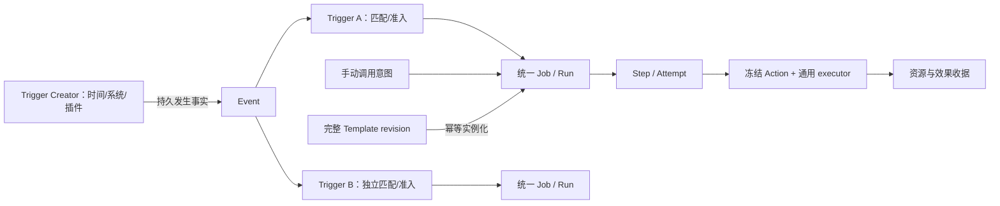

# Job 终局模型与旧链路退场计划

日期：2026-10-25。设计 TA Session：`ses_3f4766dcd0e592c3`。工作树：`D:/project/pan-worktrees/job-final-design-20261025`；分支：`design/job-final-20261025`；代码核对基线：`bcbed26a089441b7782ddc1ca4095836537239d6`。

**交付性质：设计与计划，待实现。** 本文没有修改产品代码，没有运行迁移、服务、构建或外部效果。已定的是用户此次明确的终局约束；本文的具体模型是实施建议，涉及 D1–D6 的部分均为 **provisional／待用户决策**。卡片创建成功只证明问题已持久化，不证明选择获批。

## 0. 目标、依据与状态边界

终局必须同时成立：全部旧 Job 能力由 Action / Event / Trigger / Trigger Creator / 统一 Job / Template 组合表达；表达不了就修改这些抽象；旧链路、旧入口、旧代码最后彻底删除，全部调用经过新抽象。兼容投影、旧 kind 下挂 system Action、保留旧 dispatcher 或双轨页面，均不能作为完成标准。

本要求取代旧设计中“长期保留原 MCP 工具名”“无法映射就一直留旧 owner”“直接 Trigger 仍可独立执行 Action”的终局解释。迁移期间可有明确截止点的旧读取和隔离 owner，不能因此获得永久豁免。用户要求的删除方向已定，不再询问是否保留旧入口。

| 依据 | 本次读到的事实／适用范围 |
|---|---|
| 根 `AGENTS.md`、`CODEBUDDY.md`、跨平台与当前开发计划 | 文档与代码层证据独立；三平台门禁；平台差异进 platform；不动 main/practical、不 push、不启停服务、不碰 8767/8768 |
| `JOB_ACTION_CHAIN_SCHEDULER_EVENT_DESIGN_20261024.md` | **该文件不存在于本工作树基线**；只读参考 `D:/project/Pan-main/docs/design/job-unification/` 同名文件，内容 SHA256 `c4e29ca41a83e31e26605f53f520b728c149795fba70c2bd81dc3ab8775e379a`。它是外部参考，不能当作 bcbed26a 的受版本控制文件 |
| [Phase 1 矩阵](IMPLEMENTATION_MATRIX_20261025.md)、[Phase 4 兼容矩阵](PHASE4_COMPAT_MATRIX_20261025.md)、[Phase 4b 完成矩阵](PHASE4B_COMPLETION_MATRIX_20261025.md) | 已有串行链、来源、组合和局部 owner switch；整体迁移仍 partial；兼容结构实际存在 |
| [Phase 5 E2E](PHASE5_E2E_REPORT_20261025.md) | 历史隔离样例含真实 HTTP/stdio/Chromium；报告记载 525 passed、1 skipped 及两条 E2E。是前阶段证据，**本轮未复跑**；真实 QQ/provider、生产迁移、部署、远端 CI 仍未证明 |
| `packages/automation/{engine,store,service}.py`、`packages/jobs/{chains,legacy_compat,action_runtime}.py`、`packages/scheduler/{time_events,legacy_bridge}.py` 与 §1 入口 | 本轮静态核对真实符号；说明当前行为，不等于已接受的终局设计 |

状态用语统一：**设计已定**＝此次用户已明确的约束；**设计建议**＝无阻塞产品选择的技术方案，尚待实现审查；**provisional Dn**＝不能据此改变产品行为；**待实现**＝本轮没有产品实现。开放决策共 **6 组／6 张卡**，D6 包含记录处置与保留期限两个必须明确回答的子项。

## 1. 真实旧入口与依赖清单

以下路径相对仓库根；定位使用 `文件:符号`，不依赖易漂移的行号。范围是 Job、Scheduler 及其生命周期调用者，不把 Rewind、Worker 或操作系统 Job Object 仅因名字含 Job 就列为退役对象。

### 1.1 HTTP、MCP、UI、CLI

| 编号 | 真实文件与符号 | 当前入口／作用 | 终局处置 |
|---|---|---|---|
| E01 | `packages/web/server.py:api_background_job_start/api_background_job_list/api_background_job_get/api_background_job_cancel/api_background_job_update/api_background_job_retry` | POST/GET `/api/background-jobs`；GET/PATCH `/{job_id}`；POST `/{job_id}/cancel`、`/retry`；普通 HTTP 仍可写旧记录，trusted MCP 部分分流 | 全部删除；调用方转 canonical Job API，取消/重试传显式作用域与 revision |
| E02 | `packages/web/server.py:api_session_message_job_start` | POST `/api/session-message-jobs`；单 Session 或广播 | 删除；改用消息／fanout Action 的 Job composition |
| E03 | `packages/web/server.py:_legacy_mcp_authority/_legacy_action_job` | IPC 来源分流；`legacy-mcp` 权限类型；旧形状返回 | 删除；授权改通用 principal/grant，不能把 transport 当永久执行权 |
| E04 | `packages/jobs/api.py:list_jobs/create_job/get_job/patch_job/delete_job/job_runs/run_job_now/next_preview/job_kinds` | `/api/jobs` 混合 facade，`/{job_id}`、`/runs`、`/run-now`、`/next`、`/kinds`；按旧 kind 校验与分支 | 删除旧 router 后由单一 canonical router 接管。即使复用 `/api/jobs` URL，也必须删除旧 handler、payload 和 kind 分流，不能只改名字 |
| E05 | `packages/jobs/api.py:list_templates/create_template/delete_template`；`packages/jobs/templates.py:list_templates/create_template/delete_template` | `/api/jobs/templates`、`/{template_id}` 是时间片段模板，与完整 Job Template 不同 | 导入为完整 Template 的 time composition 后删除时间模板 API/store；内置快捷项成为普通完整 Template |
| E06 | `packages/scheduler/api.py:list_tasks/create_task/get_task/switch_owner/update_task/delete_task/pause_task/resume_task/run_task_now/task_runs/next_preview/engine_status` | `/api/scheduler/tasks`；`/{task_id}`、`/owner-switch`、`/pause`、`/resume`、`/run-now`、`/runs`；`/api/scheduler/next`、`/status` | 删除旧任务 router；Creator preview/status 与 Job Run 查询分别承担其职责；owner-switch 仅迁移包存在，终局删除 |
| E07 | `packages/mcp/server.py:agent_background_start/agent_background_get/agent_background_list/agent_background_cancel/agent_background_retry` | background 原工具组 | tools/list、tools/call、HTTP catalog、gateway 全部撤销；发布 canonical Job tools |
| E08 | `packages/mcp/server.py:agent_message_job_create/agent_message_job_get/agent_message_job_list/agent_message_job_update/agent_message_job_cancel` | 延时消息／广播工具组 | 同上；Agent 的创建便捷性由通用 composition/Template 提供 |
| E09 | `packages/mcp/server.py:scheduler_create/scheduler_list/scheduler_get/scheduler_update/scheduler_delete/scheduler_pause/scheduler_resume/scheduler_run_now/scheduler_runs` | 旧定时任务 MCP | 删除；时间 Creator CRUD + Job composition/controls；不继续导出旧别名 |
| E10 | `packages/web/server.py:api_main_restart/api_main_restart_status/api_main_exit/api_main_exit_status` | POST `/api/main/restart`、`/exit`；GET 各自 `/status` | 特权意图和状态改通用受保护 Job 操作，随后删除旧路由与旧 Job 构建代码；旧路由不是终局里的“特例入口” |
| E11 | `packages/web/src/views/JobsView.tsx:JobsView/handleLegacyCreate/handleUpdate` 及其 legacy tab；`packages/web/src/components/jobs/NewJobForm.tsx:NewJobForm`；`packages/web/src/components/jobs/JobDetailDrawer.tsx:JobDetailDrawer` 的 legacy branches | Legacy Jobs、New legacy Job、kind editor、旧详情控制；`packages/web/src/components/jobs/LegacyJobDetails.tsx:LegacyJobDetails` | 删 legacy tab/form/details、kind selector 与 kind 行为分支；保留统一 Job 列表与通用 drawer；新 UI 对象导航为 Job/Trigger/Creator，Action/Template 复用管理入口 |
| E12 | `packages/web/src/services/api.ts:fetchScheduledTasks/createScheduledTask/updateScheduledTask/deleteScheduledTask/pauseScheduledTask/resumeScheduledTask/runScheduledTaskNow/fetchTaskRuns/fetchSchedulerNext/fetchSchedulerStatus` | 旧 Scheduler transport | 删除旧函数与类型；编辑器、导航、测试一起迁移 |
| E13 | `packages/web/src/services/api.ts:createJob/patchJob/fetchJobKinds/cancelJob/fetchLegacyJob/retryLegacyJob/runJobNow` | 旧 kind 创建、旧后台取消与重试 | 删除旧实现；名称若复用必须切成新契约；`fetchJobs/fetchJob/deleteJob/fetchJobRuns` 去 mixed facade 解析 |
| E14 | `packages/web/src/services/api.ts:fetchMainRestartStatus/restartMainService/fetchMainExitStatus/exitMainService`；`packages/core/cli.py:lifecycle`；`packages/core/console_exit.py:start_console_exit/ConsoleExit`；`packages/core/host_console.py:HostConsole.start_input`；`scripts/restart.bat`、`scripts/stop.bat`（脚本整体） | Settings/CLI/console 仍调用 main 旧 HTTP；CLI 以 `/api/main/{operation}` 动态拼接，并直接读 `data/background_jobs/jobs/{id}.json` 等终态 | 全部改统一特权 Job 入口与可跨服务停止读取的 operation receipt，再删除旧 URL 字面量、动态旧路由拼接与旧 JSON 文件读取；UI 的 Restart/Exit 用户动作保留 |
| E15 | `packages/jobs/independent_service.py:Handler._run/JobStore.create/request_cancel/retry/events/ack`；`packages/jobs/pan_bridge.py:request/recover_events/public_job` | 独立服务 `/jobs`、`/jobs/{id}`、`/cancel`、`/retry`、`/events`、`/events/{id}/ack` 是旧第二套 Job 生命周期 | 保留独立执行能力，改为同一 Run/Step/Attempt 的 executor 协议；删除独立 Job create/retry/store 形状、旧 bridge 投影和 terminal notice 生产者 |

核对说明：同文件的多个符号以 `/` 分隔，类方法省略类名的后续成员仍属于该类；脚本按整体定位。旧路由清单以 decorator 与 handler 共同核对，动态 CLI 路径单独追踪。

### 1.2 旧 store、扫描 pass、兼容层与必须抽出的安全能力

| 编号 | 真实文件:符号 | 当前职责与退场目标 |
|---|---|---|
| S01 | `packages/core/background_jobs.py:start/start_message/start_broadcast/update_message/cancel_message/retry` | 旧创建/更新/重试；终局删除。`get/list_jobs/_create/_update/_write_job/_job_path/_normalize_job` 的旧 JSON 事实源由 canonical store 取代后删除 |
| S02 | 同文件 `run_due_message_jobs/run_due_scheduled_tasks/_fire_scheduled_entry/_run_job_action/_execute_job_action/_redeliver_undelivered/_advance_paused_entries/_repair_missing_next_fire` | 旧时间认领、旧 api 分发、undelivered 重投；终局整段删除。`_execute_job_action` 对未知旧 action 回落 assign 的语义不得带进新模型 |
| S03 | 同文件 `register_scheduled_tasks/_scheduled_task_hooks/append_run_record/list_run_records/_append_task_run/_append_run_record_once/_reconcile_scheduled_processes` | hooks、旧 runs JSONL 与 parent-child 对账；改 canonical effect backend/Run ledger 后删除 |
| S04 | `packages/scheduler/store.py:_job_from_payload/_task_from_job/_job_for_task/create_task/update_task/delete_task/replace_task_schedule/set_task_misfire_policy/migrate_legacy_tasks/_job_from_legacy_task/_merge_legacy_runs/legacy_root` | task↔Job 投影、旧 tasks 导入与 run 合并；迁移工具一次性使用后删除运行时 loader，终局从交付包删除迁移实现 |
| S05 | `packages/scheduler/engine.py:_ensure_registered/tick_once/run_now/preview_next/start_loop/stop_loop/drain/status` | tick 目前经旧 background pass 间接驱动新 runtime，start_loop 自动 migrate，stop_loop/drain 是兼容桩；删旧依赖、启动隐式迁移与桩。可复用一个调度 wake loop，但只调 Creator 发布与统一 Job coordinator |
| S06 | `packages/jobs/legacy_compat.py:config_for/_schedule/request_key/legacy_view/is_legacy_action_job`；`packages/scheduler/legacy_bridge.py:LegacySchedulerBridge` 全类 | 参数/结果兼容、旧游标投影和 owner switch；零 legacy 后整文件删除，不改名常驻 |
| S07 | `packages/jobs/system_actions.py:definition/arguments/prepare/finish/sync/invoke/settle/execute` | 按旧 kind 注册和执行，`system_scheduled_task` 内嵌旧 action payload；改成真正独立 Action descriptor 和 executor API 后删 kind factories、旧快照 writer 与旧 dispatcher 调用 |
| S08 | `packages/jobs/action_runtime.py:config_job/Runtime.create_legacy/event_targets/queue_event/tick/consume_entry/skip_misfire/publish_events`；`packages/jobs/unified.py:project/projected_schedule/_unknown_legacy_fields` | 新 Job 仍依赖旧 `_job_from_payload`、inline schedule、混合视图和旧 `scheduler.task.fired`；删除这些旧依赖及第二条 Job Event 匹配路径 |
| S09 | `packages/automation/engine.py:Engine.drain/run_attempt`；`packages/automation/store.py:Ledger.claim/finish/prepare_action/confirm_uncertain/sync_attempt`；`packages/automation/chain_engine.py:run_chain` | 独立 Trigger Action 执行/重试账本。D2-A 下删除执行部分，Ledger 保留 Trigger 定义、admission receipts/关联，Run/Attempt 统一归 Job；不能删 Event 广播匹配本身 |
| S10 | `packages/core/background_jobs.py:create_service_job/transition_service_job/find_service_job/get_active_service_job`；`packages/core/main_lifecycle.py:run_supervisor/run_exit_supervisor` | 旧 lifecycle kind writer 删除；supervisor 保留外部监督职责，改统一 executor receipt。不能用 host 内 await 自己退出替代 |
| S11 | `packages/core/background_jobs.py:recover_notifications/_broadcast_independent_terminals/_terminal_broadcast_candidate/_recovery_loop/start_recovery_loop/stop_recovery_loop`；`packages/jobs/pan_bridge.py:recover_events` | 旧通知生产、恢复与 ack；先转唯一通知 outbox，删除重复生产和 legacy notice ID 分支；原队列收据迁移不重发 |
| S12 | `packages/jobs/independent_service.py:JobStore`、`packages/jobs/independent_runner.py`；`packages/core/background_runner.py:main` | 第二 Job store/runner wire 退场；提取后只接收 canonical Attempt lease，独立 backend 不再分配 Job/Run ID；可跨 Pan 停机继续执行 |
| S13 | `packages/core/background_jobs.py:retarget_session_jobs/delete_job/cleanup_jobs_by_statuses/cleanup_job_log_files/run_completed_job_retention`；`packages/jobs/api.py:pin_job/get_completed_retention_settings/put_completed_retention_settings` | handoff、删除、pin、保留五规则不能遗漏。改为通用引用操作/安全资源清理/metadata 后删旧 schema 处理；pin/retention 能力继续存在 |
| S14 | `packages/jobs/process_cleanup.py:terminate_owned_jobs/_capture_process/_verify_completed_proof`；`packages/jobs/owned_process.py:job_startup_info`；`packages/jobs/cleanup.py:CleanupStack`；`background_jobs.py:_owns_process/_kill_tree/runner_spawn/runner_update/reconcile_running` | **安全算法必须迁出再删旧宿主**：PID+birth identity、进程树/句柄、Windows Job Object、隐藏窗口、清理未确认阻止删除。平台私有实现进入 platform backend；不是把安全性一起删掉 |

旧 kind 集合取自 `background_jobs.py` 常量：`background-process/session-message/session-broadcast/scheduled-task/main-lifecycle`。它们及 `action.api=assign/send_session/send_qq/shell/resume_legal_running/action_reference` 的旧枚举 dispatcher 都须退出执行模型。新模型可以有 Action provider/operation 和 capability，但禁止用一个 `legacyKind` 或 `oldApi` 字段重新实现同一分发器。

## 2. 对象模型：定义、边界与一等关系

### 2.1 共同契约

所有定义对象有 `schemaVersion, id, profileId, revision, createdBy, owner, acl, createdAt, updatedAt`；name 不是身份，Session 不是存储 root。Event 从可信来源继承可见性/owner，事实不可编辑，schemaRevision 是事件结构版本；它的 payload 不携带可执行授权。creator（创建者）、owner（管理主体）、executor lease（执行权）、target（效果对象）四者分开。trusted principal 来自服务端认证/绑定 stdio，payload.source/system/creatorSessionId 不能授予权限。owner Session 被删除后不自动删除 Job；归属变为可见的 orphaned，用户可接管，执行权仍需复核。

统一 schema 使用显式版本、严格字段与类型；未知字段进入迁移审查，不忽略、不强转、不执行默认 assign。更新使用 `expectedRevision`；创建和每项控制使用 caller-scoped `requestKey`，同 key 同内容返回原 receipt，同 key 异内容冲突；结果 unknown 只能查原操作身份。定义 revision、runtime stateRevision、ownerEpoch、providerGeneration 分离，暂停不伪装为内容编辑。引用记录 ID、revision、digest 与来源，不接受客户端自报 digest 作为授权。

用户与受委托 Agent 分别有 createDraft/read/update/publish/execute/control/retire 等细粒度权利。默认 Agent 草稿权不自动升级为启用或高风险执行权；精确默认策略沿当前 capability 配置，旧隐含权利的迁移依 D5。插件 manifest 只声明能力与 schema，用户启用/授权后才激活；移除插件不会删除运行证据。



本图按 D1-A、D2-A provisional。手动创建/Run now 直接形成 canonical admission intent，不要求合成虚假时间 Event；审计记录 `cause=manual`，仍经过相同 Job 入场门禁。所有需编排的旧调用均使用同一服务，UI/MCP/CLI 只做呈现与传输。

### 2.2 六个对象的一等定义

| 对象 | 身份与 schema 核心 | 生命周期、所有权及冻结 | 并发、完成与权限边界 |
|---|---|---|---|
| **Action** | `actionId`；input/output JSON Schema；providerRef/releaseDigest；execution descriptor；effect class；requiredCapabilities；completionContract；cancel/reconcile/retry declarations | 产品 system Action 不可用户改写定义；用户 Action 草稿→发布 immutable revision→retired。disabled 是实时撤权 gate，退休不改历史快照。Run 入场固定每步完整 release/参数映射；effect 前查当前授权和禁用 | 不拥有定时、循环、Run 或全局通知；调用一定归 Step Attempt。幂等声明不是自动重投许可证。provider 只实现操作，不决定 Job 终态。内部系统操作同样有 schema/output/error/receipt |
| **Event** | `eventId, eventType, schemaRevision, creatorId, creatorRevision, occurrenceKey, occurredAt, emittedAt, receivedAt, payload, trustedSystem, factDigest` | 不可变事实；同 ID+不同 factDigest 冲突。已持久化→订阅结算→满足保留条件后 GC。所有订阅者独立 receipt；snapshot pins 与去重 tombstone 控制删除 | Event 无 pause/retry/cancel；只能暂停来源或订阅、重试未完成的持久投递。用户 replay 必须带 replayRequestId 和原因，不修改原事实；不触发 unknown effect 重放。`persisted` 不等于 Job 成功 |
| **Trigger** | `triggerId`；eventType/schema/creator selector；纯 filter/condition；参数绑定；`targetJobId`；managedByComposition 可选；admission policy | 草稿→enabled/paused/disabled→retired；用户或 plugin release 所有。接纳固定 Trigger revision、条件观察值、Event、Job revision及授权。Job 编辑器生成的 Trigger 可见且有来源，可导向 owner 编辑 | 只负责匹配和准入，**不执行 Action，不持有第二套效果 retry**（D2）。一个 `(eventId,triggerId)` 仅一次业务准入；revision 不进入唯一键，编辑不重新触发旧事实；多个 Trigger 指向同 Job 的多个 Run 以 triggerId 区分，不被 eventId-only 去重吞掉 |
| **Trigger Creator** | `creatorId`；provider `{type:time/core/plugin,id,release,generation}`；config/schemaRef；eventTypes；configRevision；ownerEpoch；cursor/pendingPublication；capabilities/health/links | **通用对象，D1-A provisional**：配置一个持续产生触发事实的来源。Scheduler 仅 `provider=time` 的一种。系统状态跃迁、插件 webhook/外部订阅也用同一注册/启停/发布/撤权协议；有些 provider 用户只可查看不能新建 | Creator 完成契约是该 occurrence 的持久 Event receipt 后推进 cursor；永不 await Action。每来源一个有 fence 的 publisher，允许不同来源并发；callback generation 不匹配拒绝。poll/stream/webhook 是 provider 实现，不增加另一个任务类型 |
| **Job** | `jobId`；steps[]；input/defaults；Trigger links[]；overlap/recovery/notification/retention；requiredCapabilities；definition/configRevision；templateProvenance；runtime summary | 持久执行定义，不等于进程。草稿→enabled/paused/disabled→retired。一次 manual/event intent 生成 Run；Run 有 StepExecution，Step 有 Attempt/effect receipts。定义与执行状态分离；无旧 kind。每个 Run 固定全部 Action、映射、输入、策略、选择器、来源版本；更新只影响未来 Run | 全部副作用共享 Run ledger/ownerEpoch。Job 的多个 Trigger 共用 overlap gate。特权 Job 与普通 Job 同模型，executor 可在独立服务或 supervisor；保护由 grant 和能力而非旧入口实现 |
| **Template** | `templateId`、immutable published revision、digest、完整 Job 配置、steps、Trigger links 与 Creator create-or-reference composition、provenance | 被动完整配置：草稿→发布→retired；无 enabled/paused/Run。无必填参数洞；实例化不需要回想历史 Job ID。完整 Job 不依赖 Template 也可创建。用户确认的 overrides 是创建新 Job 的显式差异，不修改 Template revision | 实例化 requestKey 幂等；引用固定 ID/revision；模板更新不改已建 Job。create-new Creator 每次实例化分配新 ID；reference-existing Creator 显式保留共享引用；不按规则内容自动合并 |

**D1-B 的替代修改**：若用户选择“Trigger 工厂”，Creator schema 改为输入定义→受管 Trigger 产物及引用，事件发布职责成为通用 EventSource provider 接口；Scheduler 使用它生成来源与 Trigger。需整体调整本节、时间协议、Template 与迁移目标，不能只换 UI 标签。未获答前不冻结 plugin wire/schema。

### 2.3 Run / Step / Attempt / Effect / Operation receipt

这些是 Job 的组成记录，不是新平行产品系统。

| 层次 | 身份和准入 | 状态／完成边界 |
|---|---|---|
| Admission | `admissionId`；cause manual 或 `(eventId,triggerId)`；固定 targetJob/configRevision 与 authority；先持久化再排队 | admitted/skipped/rejected/blocked；每个 skip 有 overlap/paused/condition/capacity 等 reason；未执行不伪造 Attempt |
| Run | `runId`；一次逻辑业务执行，含 frozen planDigest 与 provenance | queued→running→retry_wait/paused_at_boundary/cancelling/settling→completed/failed/cancelled；uncertain 是阻断状态，只有 reconcile 可改。Job summary 不取代多个 Run 的事实 |
| StepExecution | `stepExecutionId=(runId,stepId)`；稳定 stepId，串行顺序与前序输出依赖 | pending→running→completed/failed/uncertain/cancelled；前步完成契约满足才执行后步。步骤各自声明 completion，不使用一个 monitoring 契约强套整条混合链 |
| Attempt | `attemptId`；一次实际执行当前 Step，带 lease/epoch、generation、start/end、backoff、error | 执行前持久 preparing/attempt intent；effect admission 后运行；终态只接受同 ownerEpoch 的可信回执。host coroutine 重建不是一次新效果 Attempt |
| Effect/资源 | `effectKey=(runId,stepId,targetId,operationOrdinal)`；receipt、target selection、process identity/remote messageId、cleanup proof | 同一副作用的重查/重试保持 effectKey；确认未执行的失败可新 Attempt，但不换键规避去重。新的 Run 才有新的 effectKey。成功、明确拒绝、未知、部分成功分开 |
| Operation | 每次 create/update/pause/retry/cancel/retire 的 `operationId+requestKey` 与 expectedRevision | accepted/pending/completed/rejected/unknown；接纳取消请求不等于进程树已经结束。通知 ack 也不等于用户/CLI 已读 |

历史旧 Run、旧 retryOf、旧 Attempt、dispatchKey、queueItemId 都以原身份进入 provenance/receipts。无真实 Step/Attempt 的历史标 `historicalEvidenceOnly`，不得伪造“曾由新引擎执行”。未知记录的可执行配置与历史审计分开，详见 §5。

### 2.4 最小 schema 草案（设计建议，非已存在 API）

```json
{
  "schemaVersion": 2,
  "id": "job_example",
  "configRevision": 4,
  "owner": {"type": "session", "id": "ses_example"},
  "steps": [
    {"stepId": "prepare", "actionRef": {"id": "act_process", "revision": 2},
     "arguments": {"argv": {"from": "input", "path": "argv"}},
     "completion": {"contract": "process-exit"}},
    {"stepId": "notify", "actionRef": {"id": "act_session_send", "revision": 3},
     "arguments": {"text": {"from": "step", "stepId": "prepare", "path": "summary"}},
     "completion": {"contract": "durable-queue-accepted"}}
  ],
  "triggerLinks": [{"triggerId": "trg_example", "creatorId": "creator_example"}],
  "overlap": {"mode": "queue", "maxActive": 1, "maxPending": 128},
  "recovery": {"automatic": false, "maxAttempts": 3},
  "notification": {"on": ["completed", "failed", "uncertain"], "recipients": []}
}
```

示例 ID 与 Action/output 仅示意；生产发布需要完整 JSON Schema。沿用 `chains.resolve` 的 literal/input/event/前序 step 绑定思想，无任意脚本。缺字段/错类型/前向或循环引用显式失败；完整链在副作用前校验静态映射，每步前校验动态结果。对象 literal 中的保留键必须明确转义。结构化输出与 MCP rich result 分开保留，不能把所有结果压成文本。

### 2.5 控制、通知、并发的精确作用域

| 对象／操作 | pause / resume | retry / cancel | update / retire / notification |
|---|---|---|---|
| Action | 没有“暂停一个定义的运行”；disable 撤销后续 effect，已发生效果不可回滚 | 不直接 retry/cancel；操作 Job Run/Step | 新 revision 不改变已冻结语义；紧急撤权仍立即复检；引用和保留快照在时不物理删除 |
| Event | 不支持，返回明确 unsupported | 不支持取消事实；重投未结算 admission 不等于效果 retry | 不可编辑；到期 GC 不得清除未结算/uncertain 去重证据 |
| Trigger | 暂停其新准入；已持久 admission 留在 Job。恢复只按显式 backlog policy 处理暂停期事实，不默认补发 | 无效果 retry；cancel subscription 退订，不取消已接纳 Run | 改 revision 固定生效边界，不重新匹配已结算旧 Event；通知是 admission 诊断，不产生第二条业务终态通知 |
| Creator | 暂停未来发生点预留；已 pending publication 必须结算或显式 disposition；resume 依 misfire/backlog policy | 可重试同一 publication envelope；cancel 仅撤销尚未发布 occurrence，已有 Event 不撤回 | 更新 pending 存在时先结算或返回冲突；共享来源修改展示全部引用；delete 要禁用、无引用、无 pending/pin/lease |
| Job | pause 停新 effect/Attempt 入场，Run 到安全步骤边界等待；运行中外部进程继续，不假装 OS suspend。resume 不解除 Session Illegal/Pause/readonly/lease | `retry(runId,stepId)` 按 D3；`cancel(runId)` 与 `cancelJob` 分开，后者还 disable/取消 queued；控制 receipt 明确 scope。取消等当前 backend 证明 stopped/cleanup，无法证明→uncertain/cleanup_pending | 内容更新未来 Run 生效；pause 运行状态变化不使旧 queued plan 隐式失效。移除配置不得删除历史和活资源；通知 policy 在 Run 入场冻结，发送时重检接收权限 |
| Template | 不支持，返回 unsupported | 无运行与 retry/cancel；实例化操作可在未激活组合前取消 | publish 新 revision，retire 阻新实例；不改变已建 Job；实例化成功通知指配置已建，不是 Run 完成 |

全局 Pause everything、Session queue_paused、Manual、Illegal、Stop reports、编辑 lease、native owner/generation 等保持独立 gate；Job resume 不能绕过。显式 Wake 是特权 Action，按 §3 的选择器和权限执行。后台进程已经运行时 pause 只暂停后续 admission；用户要停进程用 cancel。

overlap 在 Job 层唯一裁决：forbid→持久 skipped，queue→有界 FIFO，parallel→显式上限。所有关联 Trigger/手动 Run 共用额度；quota、全局容量与 provider 并发另有明确预算，但不得再形成第二套效果重试宿主。满队列返回可见 rejected/backpressure；不因“临时错误”丢掉已接纳 intent。跨 Trigger 的旧并发不同须在新 Job 中显式表达；不能擅自把 serial 改 parallel。

通知用一个通用持久 outbox：键含 `(runId,transitionSeq,recipientId,channel)`；事务提交结果和通知 intent 后异步投递，取得 Queue 或通道持久收据再 ack。未知投递查原键，不换 ID 重发；Session 已删记 undeliverable，不能改投任意存活 Session。用户配置的终态/目标/来源与错误码保留；中间 retry 可见而是否通知按冻结策略；实时 WS 不是持久通知回执。Job cleanup 不得先删未 ack outbox。

### 2.6 冻结、清理与恢复

Run 接纳即固定完整计划；不是等拿到执行槽才读最新 Action/Job。每步前重检当前授权、Action enabled、插件 generation 与每目标门禁；撤权阻止未来效果，但不把已产生效果改成“未执行”。绑定交互卡批准还须校验原 Trigger/Action digest、参数、目标与授权来源，不把任意卡片回答作为通用执行权。

失败重试用原冻结计划；Step 已完成绝不重跑。自动重试须同时有显式 policy、有限预算、可证明的安全边界与 Action/backend 契约；uncertain 不自动 retry，用户点击也先 reconcile。异常不一律算“明确未执行”；QQ 网络超时、进程身份未知、队列写后回执丢失均保留未知。

completion 由 Action 契约定义，Job/Step 只能选择它声明支持的契约或加严，不能把 process/monitoring 偷换成“调用返回即成功”。普通进程要求 exit outcome 与可验证进程树结束；monitoring 还要来自该 Run/Step/Attempt 的结构化完成信号，exit 0 不能单独证明完成，late/错执行身份的 signal 拒绝。恢复的 maxAttempts/backoff/stableReset 使用 Run 冻结策略；沿用当前 5/15/60 秒、300 秒稳定重置的配置语义但不静默启用恢复。重试预算与门禁等待分开，合法暂停等待不消耗实际效果 Attempt。失败/异常退出已证实、资源已退出且策略允许时才可能恢复；进程或副作用未知始终阻断。

可执行快照与不可执行审计分离。活 Run、retry_wait、paused_at_boundary 的冻结材料保留；终结后先写 settlement intent、保存允许保留的输出/收据和 digest，再删除可执行副本并提交 cleaned，写失败保持 settling。uncertain 清掉可执行副本后只保留 reconcile 句柄，不允许靠最新 Action 重建重放；确认未发生且需要恢复时，重新审核可执行内容并显式接纳。失败若已彻底终结并清掉快照，D3 的同 Run retry 也必须重新审核重建且 digest 一致，无法一致则只能显式新 Run；绝不隐式升级版本。审计不保留秘密与完整命令正文，效果查询所需材料按最小权限独立加密/引用保存。

## 3. 语义对等矩阵与必须发生的模型变更

本节缩写：C=create、U=update、L=list/get/runs、X=cancel、R=retry、P=pause/resume、N=notify。以下是**新契约的完整覆盖目标，均待实现**；带 Dn 的产品选择未冻结。通用 API 草案是 `/api/jobs`、`/api/jobs/{id}/runs`、`/api/job-runs/{runId}/operations`、`/api/triggers`、`/api/trigger-creators`、`/api/job-templates`；旧 router 必须先退场，不能在同路径上同时注册两个不同 owner。MCP 直接导出这套服务的 operations，UI/CLI 也调用同一服务。

| 行 | 旧能力与代码锚点 | C / U / L 新表达 | X / R / P / N 新表达 | 当前不能表达处 → 修改抽象（不留兼容层） |
|---|---|---|---|---|
| M01 | background argv/cwd/name、creator/target、hideWindow、日志；S01/S14 | C=process.exec Action 单步 Job（直接创建或完整 Template）；U=未来 Run 的 arguments/metadata；L=Job+Run+logs/resource receipt | X=backend 按 PID/birth/lease 取消整树；R=原 Step 新 Attempt（D3）；P=阻未来启动，当前进程继续；N=原 creator/指定 recipients，保留 exit/error | 必须新增 executor lease/resource receipt，后台 detach 为 capability；不能继续调用旧 `start` 另建隐形 Job |
| M02 | 独立 Job service 离线存活、恢复、terminal outbox；E15/S12 | C=同一 Job/Run/Step 委派 independent executor；U=配置在 canonical store，已交付 attempt 不变；L=同一身份与 owner，离线可查资源真相 | X=通用 cancel receipt；R=同一 effectKey/Attempt 规则；P=停后续 admission，进程不假暂停；N=同一 canonical outbox，独立 backend 只交回 receipt | 模型必须区分 control-plane、execution lease 与通知投递；删除第二套 Job ID/store/retry。Pan 离线不等于 executor/Creator 支持离线；能力显式发现 |
| M03 | 单 Session 延时/周期消息、source/prefix/handoff；`start_message/update_message/run_due_message_jobs` | C=session.send Action + time Creator + Trigger + Job；U=消息、目标、日程分别按 revision 更新；L=关联图和每次 queue receipt | X=撤销尚未 effect 的 Run；已 queued 消息不可声称撤回；R=查原 queueItemId，明确拒绝才可重试；P=Job 与 Creator 暂停分开；N=保留 creator、target 和 source 分类 | 新增 durable-enqueue completion、可信来源审计、Session alias/显式 retarget 操作；不能把 queued 当 CLI 已消费 |
| M04 | 广播顺序去重、逐目标结果、单目标列表身份；`start_broadcast`、`system_actions.execute` | C=通用 fanout receipt 契约的 session.send-many Action；U=未来 Run target list；L=每目标 accepted/rejected/unknown 及 queueItemId | X=停止未发目标，已发保留；R=仅明确未发生的目标；P=目标间安全边界停；N=全量统计+部分失败/未知，不只 aggregate success | 新增 target selection checkpoint、每目标 effectKey 与 all/partial/uncertain 结果；不是另一种旧 broadcast kind。空集合完成、部分成功失败策略必须在 Action contract 明示 |
| M05 | scheduled assign；`_execute_job_action` 最后 assign 分支；scheduler runs | C=session.assign Action + time Creator/Trigger/Job；U=未来文字/目标/时间；L=Run+task correlation+receipt | X=取消未准入；队列已收后沿原 Queue 控制，不假停止模型任务；R=同一 task/dispatch receipt；P=来源/Job 分别暂停；N=dispatched 与业务答复完成分开 | Action completion=durable dispatch，不是 Session 回答完成。需要等回答时显式等待 receipt/event Step；任务关联身份不能只用新随机 Attempt ID |
| M06 | scheduled send_session；旧 source=automation；同 S02 | C/U/L=与 M03 同 Action，显式保存 source policy 与 schedule composition | X/R/P/N=同 M03，保留原来源及队列 gate | 删除 `system_scheduled_task.action.api=send_session` 路径；调度不是一种 Action 类别 |
| M07 | scheduled shell、自定义命令、parent/dispatch child；`start_scheduled_process/_reconcile_scheduled_processes` | C=process.shell Action（受控 command/cwd/hideWindow）+ time composition；U=未来参数；L=Step resource/log/output，不再返回隐藏 child Job | X=与 M01 同整树清理；R=确认原 child 终结后当前 Step；P=阻未来 fire；N=exit/output/error/timeout与 process receipt | 新增 shell backend descriptor 与父 Run/Step admission；进程资源不是第二 Job；不得把 shell command 当 argv 任意拆词或按平台猜解释器 |
| M08 | QQ 文本、targetType/targetId/botUin、messageId/qqErrorCode；`normalize_scheduled_qq_action/_execute_job_action` | C=channel.qq.send Action + time composition，可由完整 Template 预填；U=未来正文/联系人/bot；L=Run+明确通道回执 | X=未发送可取消，已发送不承诺撤回；R=明确拒绝按契约，timeout unknown 查证；P=停未来 effect；N=保留 messageId、QQ 错误码与原失败通知 | 输出 schema 必须保留 provider typed receipt；通道异常不能统一折叠 failed 然后自动重发。插件缺失=unavailable，非成功 |
| M09 | `resume_legal_running`；`background_jobs._execute_job_action` | C=session.wake-matching 受保护 Action + time composition；选择器实际为 `Illegal && no alive Worker`；每次 effect 开始解析一次并持久固定排序目标；U=只改未来规则/授权；L=选择证据、逐目标 Wake receipt | X=停止未开始目标；R=同 fire/Session 原 Wake key；P=不解除 Illegal/Manual/Pause；N=matchedCount、每目标错误与通知 | 新增受授权的动态 selector + 每目标 gate + Wake 操作；不能按旧名字猜选 running，也不能用普通 send“继续”代替 Behavior 唤醒。旧 `job-resume:*` key 迁入 effect identity，不重置；权限 D5 |
| M10 | main restart/exit、ask/offline/preserve、supervisor；E10/S10 | C=service.restart / service.exit 受保护 Action 的单步 Job，携带用户 intent、root/port/PID birth、策略快照；U=效果前可修改未激活 intent，进入不可逆阶段后拒绝；L=同一 Job/Run/operation 跨服务停止可查 | X=stop 前可取消；已 stop 则按 phase 显式 unsupported 或仅取消后续 start，不能谎报撤回；R=先查 supervisor/新进程 ready；P=仅在 stop 前安全边界；N=独立 supervisor 持久写并稍后转投 | 新增 protected invocation + external executor + phase/cancellation window + evidence-based completion。restart 必须新 PID/root/port/ready 确认，exit 必须 offline 证明；不允许现有 main-lifecycle 继续旁路。授权/可组合性 D5 |
| M11 | once/delay/interval/weekly/cron、多 entry、时区/DST、秒/分数；`legacy_compat._schedule/LegacySchedulerBridge._entry/time_events.Sources.put` | C=通用 time Creator 的显式 rule set，多个 occurrence identity；多 entry 可一来源多规则或明确多 Creator links，不静默合并；U=revision+生效切点，保持原 nextFire；L=preview/occurrence/cursor | X=撤未来规则不撤已发布 Event；R=同 pending envelope；P=明确 producer backlog/misfire；N=skipped/expired/lateness 可查，业务终态仍归 Job | **必须扩 time schema**：原生 weekly 秒、decimal interval/精度、anchor、zone/fold/gap、旧时间解释证据。当前分钟 cron 不能复刻 weekly 秒；bridge 只收一 entry 不够。D4 |
| M12 | pause、misfire/grace、undeliveredFires/maxRuns、manual run_now；S02/S08 | C=Creator producer policy + Trigger admission + Job overlap/limit 分层；U=计数域、生效边界显式；L=occurrence/admission/run 分层计数 | X=每层明确 scope；R=补持久交接缺口非重做 effect；P=producer 与 consumer 分开；N=跳过/过期/队列阻断有 receipts | 新增 `limit.counterDomain`、pause admissionDisposition/backlog policy、deferred effect receipt；maxRuns 不按 Attempt 增长。旧不同语义须逐记录提取，D4 决定新默认；手动 Run 不移动周期 cursor |
| M13 | list/get/edit/cancel/delete/retry/pause/runs、pin/五类 retention；E01/E04/S13 | C=通用 composition；U=按对象归属和 CAS；L=唯一可分页事实源+非执行 provenance，原 Job ID 保留或审计 alias | X=Job/Run/Step 明确 scope；R=D3；P=§2.5；N=一个 outbox、原通知对象。delete 先 retire、清理资源和引用，满足保留再 purge | Job metadata/pin 不参与执行权；五规则 completed/failed/timed_out/cancelled/logs 映射通用 outcome/日志 retention，unknown/cleanup_pending 不自动过期；不能因旧 kind 删除而丢此能力 |
| M14 | Schedule 模板、完整 Job Template、draft CRUD；E05、`action_templates.Templates`、`job_config_drafts` | C=完整 Template，可保存整链和全部 composition；U=新 revision；L=检索/引用/digest；实例化固定版本与新 Job ID | X=取消未激活 composition 操作；R=原实例化 key 查原结果；P=模板无运行返回 unsupported；N=实例化 receipt 与 Job completion 分开 | 旧 schedule-only 模板补齐完整配置或进入 blocked 审查，不能给用户暗藏必填洞。新增 Creator create/reference 的冻结和幂等组合意图 |
| M15 | 旧直接 Trigger→Action/steps 与新 Job event trigger 双路径；`Engine.run_attempt/Runtime.event_targets` | C=Trigger + 可见受管单步/链 Job；U=分对象 revision；L=一套 Run/Step/Attempt，旧 Run 挂历史证据 | X/R/P/N=归 Job；Trigger 仅控制准入。每订阅独立成功/失败；已禁用订阅记录 skipped/disabled，无效果 Attempt | D2-A：删除直接 Action executor 和 Job 内嵌事件扫描，统一 Trigger admission。新增多 Trigger 同 Job 的 admission identity，避免当前 eventId-only eventReceipts 误去重 |

M01 的 monitoring/recovery 与混合链由 §2.6 的逐步 completion 契约覆盖；M14 中 Action 引用固定 Template 的现存能力继续表达为 `job.instantiate-template` Action，完成于新 Job composition 已持久提交，返回 createdJobId，不伪称子 Job 已执行完成。需要等待子 Run 时用显式关联 receipt/后续 Step；引用图继续验证循环/深度与授权，不恢复旧后台 child Job。

**覆盖结论**：M01–M15 每行的 C/U/L/X/R/P/N 都有新表达或明确“不适用/不可逆”；没有任何一行以“保留 legacy executor”补洞。是否逐行为等价必须由实施证据决定；本矩阵不是产品已通过声明。M09 的真实筛选与 M10 的退出完成边界尤其不得依据旧命名推断。

三大模型变更建议：

1. **通用 Trigger Creator 与发布协议**：从时间专属 Sources 提升为时间/系统/插件来源；扩精度、规则、游标、backlog 与 generation；Scheduler 只是 provider。（D1/D4）
2. **唯一 Job 执行账本与效果身份**：Trigger 只准入，Run→Step→Attempt→每目标 receipt；拆掉旧 kind/api 和双执行宿主，独立服务作为 executor；统一 retry/cancel/通知。（D2/D3）
3. **能力与受保护执行、迁移证据进入模型**：每步完成契约、资源所有权、外部 supervisor、显式授权及 blocked evidence；无法复刻时扩模型或阻断审查，绝不回旧默认分发。（D5/D6）

## 4. Creator、时间与跨存储组合协议

### 4.1 所有 provider 共用的持久发布

`reserve(creatorId,revision,epoch,occurrenceKey)` 先写完整不可变 envelope 和 next cursor；`publish` 调 EventStore，收到相同 eventId 的 persisted receipt；`advance` 对 pending ID+epoch CAS 提交 cursor；最后 release pin/ack。三个提交边界靠稳定身份与恢复，不声称跨数据库天然原子。发布回执丢失重查原 event；Event Store 去重保留期不能短于未结算 cursor/pin。修改 provider generation 后，旧 callback 只能结算已接受句柄，不可预留新事实。

time occurrenceKey 必须包含 creator/规则 ID、configRevision、精确计划点与重复墙钟的 fold/ordinal；eventId 为该事实稳定 hash。不要用 emittedAt 或 Trigger ID。迁移已预留 occurrence 使用原稳定 Event ID，记录 identityVersion；不能因 v2 算法改变把同一旧发生点发两次。core 状态来源使用持久 transitionSeq/boot identity，不能把重启后的初始采样伪装成发生过的边沿；plugin 使用受认证 provider event key。没有稳定上游 key 的来源明确声明弱去重并阻止有重投风险的自动效果，不能宣称 exactly-once。

Scheduler 的 time calculator 迁入通用 time provider，避免新来源 import `background_jobs._entry_next_fire`。时间用显式 UTC instant+IANA zone/wall rule 表达，保存 decimal precision 和 DST policy；旧 naive 时间只有确定原 host zone/解释规则后才映射。tzdata 缺失或能力不足显式 unavailable，不 silently 改 host-local。D4 未决时不改默认 gap/fold、补发和暂停策略。

### 4.2 组合创建／更新／删除

通用 `CompositionOperation` 持久保存 requestKey、预期对象 revision、全部 IDs、desired graph、授权证据、旧图 digest 和 phase。步骤为 reserved→disabled_objects_created→links_verified→activation_committed→active→complete。对象可分库，统一激活 token/epoch 是准入硬 gate；没有 committed token 的 Job/Trigger/Creator 即便 enabled 字段误写也不能执行。

失败重启按同一 operationId 恢复，不另建对象；保留用户可见的 pending/failed setup 与修复/撤销入口。取消只退订本组合拥有的 Trigger/新建且未共享来源；已被其它组合引用的来源不删。编辑共享 Creator 要列出影响对象与 CAS；更换一个 Job 的来源只换它的 link。删除 Job 先 disable/retire，拒绝新准入，再清理自己的 Trigger link，不自动删共享 Creator；来源删除要无引用、无 pending/lease/pin。Template 实例化使用同一协议，不引入另一个“模板调度器”。

### 4.3 三种重试严格分开

publication retry＝相同事实同 envelope；admission persistence retry＝同 Event/Trigger 的原准入；effect retry＝D3 的原 Run/Step 新 Attempt。misfire、Job overlap、Step recovery 分别由 Creator、Job admission、Job executor 负责。共享 Event 的订阅者失败不持有其它订阅者的执行锁；只有 metadata commit 用短锁，provider I/O、进程等待、插件 handshake/close 不在全局锁内。

## 5. 迁移协议：可盘点、可停、可恢复且不双执行

### 5.1 盘点与 dry-run（本轮未执行真实数据）

仅未来获得真实数据读取/迁移授权后进行。对每个 profile/registry/independent executor 盘点，不能只扫当前 main 默认目录：旧 `job_*.json`、scheduler legacy tasks/runs、Actions JSON 中 Templates/TriggerRuns/snapshots、time-events SQLite sources/links、独立 service SQLite/outbox、pins/retention、Session queue notices、handoff references、CLI/MCP/tool catalog、运行中的 Runner/supervisor 身份。秘密、真实文本和账号不进 Git。

每条 manifest：`migrationId, sourceType, originalId, schemaFingerprint, sourceDigest/revision, owner/target/authEvidence, status, cursor/pending, activeEffectHandles, noticeReceipts, referenceEdges, targetIds, mappingVersion, classification, reason, expectedSemanticDiff`。分类至少 exact、needs-model-extension、needs-user-decision、inflight、uncertain、corrupt、historical-only。先对 unknown 原始字节做受限加密备份/哈希，未知字段不丢弃、不回落默认。

dry-run 禁止写实际 operational store、建立活来源、发 Event/启动进程/投队列。离线输出目标图、字段去向、丢失检查、next N occurrences、pause/maxRuns/misfire 对比、权限 diff、通知目标和不可逆效果边界。每字段必须是映射/审计/用户明确 retire 三者之一；不能“忽略字段”算 exact。manifest 分页统计与总数守恒，真实敏感材料只放受限备份，不放仓库。

### 5.2 影子期

使用同一份不可变输入/可信时间快照计算新旧语义差异；影子存储独立，`executable=false` 且 provider credentials/Queue/process executor 不可达。影子不 publish 生产 Event、不抢 owner、不写生产 cursor、不发送通知。比较 occurrence、目标集合、授权、参数 digest、completion、控制和通知，而非只比较“最终 status”。进行中效果只观察原收据，不复跑。差异为零或每项有批准的 semantic change 才可进入切换；影子期时长不是正确性的替代物。

### 5.3 单 owner 切换状态机

迁移单位是具有共享副作用/来源/引用的 connected cohort；不能把共享 source 的一半复制成新 owner。持久 `MigrationOperation` 的 phase 与 ownerEpoch 放在旧/新双方都必须检查的 fencing authority；仅 asyncio.Lock 或改 JSON `schedulerOwner` 不足以防跨进程旧实例继续 fire。

| 阶段 | 必须持久化的动作 | crash/retry 后结果与禁止事项 |
|---|---|---|
| inventoried / approved | 固定 manifest digest、mapping/schema version、用户决定、source revisions、预期 owners | CAS 不符回到 dry-run；不能用过期盘点覆盖用户新编辑 |
| freeze_requested | 冻结该 cohort 的新旧写入口与新 claim；原 owner epoch 尚有效，记录 lastAcceptedSequence | 等旧 owner 确认 fencing；未知版本旧二进制不能读 fence 时必须先停止其 owner 并证明进程身份，不能热双开 |
| quiesced | 证明旧 owner 不再认领；drain 已准入效果，或将活资源句柄/lease 在同一 operation 中交接 | 不杀未知归属进程、不把 running 改 completed；无可验证交接就保持 blocked/cohort 冻结 |
| staged | 新对象 disabled，映射旧身份/游标/pending/receipts；引用与 schema 校验；建立 dedupe/tombstones | 新对象不准入；重试复用 IDs。通知旧 producer 停止前不得新 producer 发同通知 |
| ownership_committed | 单个 fencing authority 原子改 owner=new/epoch+1，绑定 manifest 和 activation token | 此为唯一执行切点；旧 epoch 的 claim/写回拒绝。事务结果 unknown 查原 operation，不猜 owner |
| activated / reconciled | 激活 committed 图；从冻结 cursor 接续；补结算原 pending；独立 backend 采用同一 effectKey/epoch；恢复通知仅补未 ack | 已在旧路径 accepted 的 queue/QQ/process 收据不得用新 ID 重做；晚到旧回执转 reconcile evidence，不覆盖新 owner 决策 |
| finalized | 校验数目守恒、单 owner、零旧写、逐对象 receipt、引用及通知；删除该 cohort 旧 executable records/leases | 保留非执行审计和受限 rollback 包；不能把 renamed legacy 文件搬进新目录就算零 legacy |

旧 executor 仍运行时必须支持 epoch fence 或排空后切；部署控制程序先核验 root/profile/PID birth/版本，不能只凭端口或 PID。当前 `LegacySchedulerBridge._switch` 可作字段映射参考，不能当本协议已有跨存储 crash-safe 证明。

### 5.4 未知记录与活资源（D6 provisional）

推荐新模型提供通用 `MigrationEvidence` 关联：`originalIdentity, sourceDigest, unresolvedFields, observationReceipts, resourceHandles, disposition, reviewedBy, reason`。它是不可执行审计记录，不是万能旧 payload adapter。可解释业务配置放正常 Job disabled/blocked；无法解释的仅存证据对象，禁止生成假的 Action/Step；UI 有待处置入口。opaque 原文留受限归档，不被运行时解析，更不能以 evidence 调用旧 executor。

效果未知→同一 Run/receipt blocked；PID/出生时间不明→不 claim、不 kill、不 retry；字段未知→修改模型版本并重跑 dry-run，或用户明确 retire；破损记录→保留原哈希/备份、修复/结案；owner/target 已删→标 orphaned，不能扩大权限或重定向到当前 Session；历史 unknown action 曾默认 assign 的记录不可继续默认，需证据/人工解释。

只有 `confirmed_completed / confirmed_not_effected / explicitly_retired / ownership_transferred` 等带证据和审阅者的 disposition 能解除阻断。用户确认风险不等于技术证明效果未发生；若明确批准再次执行，必须是带风险确认的新 Run，而不是把原 uncertain 改 failed 后自动 retry。取消资源和业务效果状态分开：进程已清理不能证明此前 shell 未写文件、QQ 未送达。

### 5.5 回滚与保留

commit 前可取消 staging，恢复原 epoch 的旧 owner（确认从未激活）；commit 后先 fence 新 owner，收齐 publication/admission/effect/outbox receipts，再判是否能反向映射。已有新模型独有链、精度、多个 Trigger、特权 grant 或已产生效果不能反向解释时，**不能回旧 schema 执行**：保持新模型暂停并前向修复，或回滚到仍支持 canonical schema 的上一应用版本。绝不同时运行旧/新 owner，不做无条件“恢复备份并重跑”。

rollback 包含 bin/schema compatibility、原 source snapshot、manifest、所有 epoch/cursor/receipt delta 及通知 ack；恢复旧二进制之前先验证它不能重放已完成效果。最终移除旧 schema 后不提供在线 legacy downgrade；此 release 的支持下限需写 release note。

D6 建议：切换 rollback 包 30 天，非执行审计 90 天，均从验收通过且可恢复性验证成功算起；用户可修改，当前未生效。uncertain、活资源、cleanup_pending、未 ack 通知、诉诸人工处置的记录不自动到期。事件 dedupe/pins 保留由恢复窗口决定，不能套普通已完成日志保留。到期删除有 preview、引用/资源复检、审计 receipt；旧执行记录应在 finalized 时退出 operational store，不能等 30/90 天继续被旧 scanner 读取。

## 6. 依赖排序的退场实施计划

工作包按路径分配，MA 决定派发、独立验收与整合；本文不创建 TA、不启动实施。工作包有源代码门禁、迁移门禁和明确删除出口；“新功能写好了”不足以完成任一退场阶段。D1–D6 对应的改动在回答前保持设计草案。阶段准备期间可以只有设计/测试工件，但不能将其标为迁移阶段完成。

| 阶段／依赖 | 实施落点与目标 | **阶段出口必须删掉什么** | 必需证据与阻塞 |
|---|---|---|---|
| R1：统一执行内核；D2/D3/D5 | `jobs/` 定义 Run/Step/Attempt/receipt、抽出 process/channel/Session/service primitives；`automation/` 只匹配准入；将当前直接 Trigger definitions 与历史执行证据转为受管 Job；单库事务或跨库 intent+fence；独立 Action 不再调用旧 api dispatcher | 删除 `Engine.drain/run_attempt` 的 Action 执行与 retry、`automation.chain_engine.run_chain` 的独立宿主、Ledger 旧执行 claim/finish/confirm retry。旧 scheduled cohort 尚未切换的 dispatcher 仅归旧 owner，列入 R4 必删，不让新 Action 借它执行 | 相同 Event 广播、链逐步恢复、多 Trigger 同 Job、不重做已完成目标、特权拒绝和进程所有权契约；该批活 Trigger 运行交接完成。保留 Trigger/event admission，不删除匹配算法 |
| R2：通用 Creator；依 R1、D1/D4 | 泛化 Sources/provider/capabilities，time rule 精度和版本；统一 composition/Template；新建 Job 一律显式 Creator/Trigger links | 删除 `Runtime.event_targets/queue_event` 的第二套订阅入口，Job inline `schedule`/`trigger.kind=schedule` 分派、`consume_entry/skip_misfire` 旧分支；删除新 time provider 对 `background_jobs._entry_next_fire`、`scheduler.store._normalize_schedule` 的旧 store 依赖，迁 pure calculator 后删原副本 | 真实 timezone/DST/秒/分数/多 entry 回归；reserve/persist/advance 每断点 kill；共享来源修改/删除与组合失败恢复。旧计划先迁 staged/fence，不在两个 pass 并跑 |
| R3：新建与全部客户端切换；依 R1/R2 | 新 canonical routes/tools/React editor/CLI/console；完整 Template 取代 schedule-only 模板；M10 特权受保护 invocation 通过同一 Job 服务 | 删除 E01/E02 的 POST 创建、E07/E08/E09 的旧 MCP 创建/更新/run-now 工具及其 export/catalog/bridge allowlist，E04 旧 `create_job/patch_job/job_kinds`、E05 模板 store/router；删除 E06 旧 create/update/run-now 及 pause/resume 的新效果准入（管理改 canonical operations，owner-switch 临时移入受限迁移包）；删 JobsView New legacy Job 与 NewJobForm 旧 kind editor；删 E10 POST 及 E14 旧调用；删除 `legacy-mcp` 新准入分支 | 零旧创建/编辑/新效果准入路径；真实 HTTP/stdio tools/list/call、authenticated UI/CLI、三平台构建导入；既存旧记录冻结并由新控制服务/迁移计划处理，尚需旧 owner 排空时只允许受限的查询/取消/结算写，R4 必须清零；不能让删除工具使活资源无法取消 |
| R4：全部数据与 owner 清零；依 R3、D6 | 按 §5 对剩余 legacy JSON/任务/independent service/通知/活动 Runner 批迁；新模型 blocked 处置或人工结案；M02/M10 外部执行器改 lease 协议 | 删除旧 `run_due_message_jobs/run_due_scheduled_tasks/_fire_scheduled_entry/_run_job_action/_execute_job_action/_redeliver_undelivered`、`system_scheduled_task` 定义及旧 api 枚举 dispatcher、旧 scheduler hooks/run log writer、independent `JobStore.create/retry` 及旧第二账本、`create_service_job/transition_service_job`；删除每个 profile operational legacy records/cursors/outbox（成功搬迁 ack 后），删除 `_ensure_registered` 旧 pass 接线 | 全 profile 数量守恒、active legacy=0、legacyExecutableRecord=0、unknown disposition 完整、单 owner fence、真实副本 migration/crash/rollback 及外部进程/通知接受证据；不能仅用默认 profile 空表证明 |
| R5：旧读控与兼容层退场；依 R4 | 统一管理 query/cancel/edit/retry/pause/retention/pin/handoff；历史在统一非执行审计里查询；移除 mixed facade | 删除 E01 剩余 GET/PATCH/cancel/retry，E06 全 router、E07–E09 剩余旧工具，E10 status；删 `legacy_compat.py/legacy_bridge.py` 全文件、`Runtime.create_legacy/config_job` 旧 builder、unified legacy projection、old kind factories、`background_jobs.py` 旧 store/pass/notice 剩余宿主；删 Legacy Jobs tab/LegacyJobDetails、JobDetailDrawer legacy branches、api.ts 旧 transport/types、旧 notice producer；安全 primitive 已迁移才删旧定义 | 路由/MCP/GUI/静态调用图均零旧入口；旧 IDs 只由 canonical provenance index 查询，不能执行旧格式；删除操作仍有 cleanup proof。原文件若全部职责迁走应整文件删除，不留 pass 壳 |
| R6：移除迁移运行时与正式关账；依 R5、保留期/用户验收 | 发布仅含新模型的包与文档；迁移包证据按期限留受限归档，不随生产运行时发货 | 删除 `owner-switch`、`migrate_legacy_tasks/_job_from_legacy_task/_merge_legacy_runs`、legacy loader/flags/rollback-to-old 分支、双轨 feature flags、旧测试 fixtures 中会创建运行时 legacy 的 helper；过期 rollback 包按批准策略删除。保留独立审计样本和新格式安全负控，不削弱断言 | 静态+运行时零旧写，operational legacy=0；三平台 CI、生产迁移、部署 readback 和人工验收分别签收；构建包无旧模块/入口。未决 evidence 非 executable 且有责任人，不冒充迁移 fully resolved |

R1/R2 的大删除必须由新内核/模型替换和关联 cohort 转移共同满足，可以拆多个 PR，但未完成删除不能关闭阶段。R3 开始的旧客户调用会破坏兼容，需 release note 与工具目录更新；这是用户指定终局方向内的受控切换，不再新增永久同名工具 wrapper。迁移期只读/控制适配必须有阶段、owner、删除项和 CI denylist，不是产品抽象的一部分。

不删除底层真实能力：Worker queue/Wake、trusted Session 身份与业务 gates、QQ 插件、native Runner 清理、supervisor、platform backend。它们迁成新 Action/executor 的实现依赖；必须删除的是它们依靠旧 Job kind/store/路由自建生命周期的代码。终局业务模块不能 import `core.background_jobs`；文件若仍承担安全 primitive 应先迁到有明确契约的共享/platform 模块再整体移除。

## 7. 准入条件与 CI／实测门禁

### 7.1 机器可判定的零 legacy 定义

1. **零旧写路径**：route table、MCP tools/list 与 call、gateway catalog、CLI/React transport、startup hooks、independent executor 全入口枚举；无旧 Job create/update/retry/pass。任何旧 URL/tool 调用明确不存在，不得经 alias 继续写旧记录。canonical store 的 writer 只有 admission/lease/settlement 服务，executor 只可提交带 fence 的 receipt。
2. **零 legacy operational 记录**：不能仅看 `kind` 字段。按 schema validator、旧 `legacyCompat/legacySchedulerCompat/schedulerMigration/legacySchedule/schedulerOwner` flags、旧 action payload、旧 tasks/runs store、旧 independent store、pending notification producer、活动 lease 与 loader 逐项计数；新 Job 不允许夹带可执行旧 payload。原 ID/provenance、非执行审计与受限归档不算可执行 legacy，但必须列出计数与 disposition，不能藏报表。
3. **零 legacy 执行代码**：依赖图无旧 dispatcher/import、无旧 pass、无 compatibility response/runtime flags、无旧 UI；发布包不含旧模块。文本搜索只作初筛，AST/import/route/tools 动态发现和真实调用验证共同证明。文档中的历史名称、OS Job Object 与恶意输入负控列有限 allowlist，需有原因，不能全目录忽略。
4. **零隐性 fallback**：未知 action/schema/owner/平台能力明确 error/unsupported/blocked；无 assign/immediate/default timezone/空目标成功替代；unknown/uncertain 不自动执行。所有 schema version 只有显式 upcaster，未知版拒绝启用。

最终 runtime schema validation 对旧记录 fail closed；旧版本升级需显式迁移包，不在每次启动悄悄扫描改写并继续执行。发现 legacy 记录报告 operator-required，不能为了启动绿自动删除。

### 7.2 测试与证据分层

| 层 | 准入断言与执行要求 | 证据工件 |
|---|---|---|
| 源码／契约 | 六对象 schema、每控制 operation、权限、revision、状态迁移、target/effect key、输出和完成契约；M01–M15 的七操作逐格追踪；删旧符号/路由/工具/生产 import | source SHA、schema versions、symbol removal list、矩阵→测试 ID 清单 |
| 三平台快 CI | windows/ubuntu/macos 依赖安装、`import packages.web.server`、pytest collection、单元子集；共享代码无新的 win32 顶层导入/盘符/反斜杠/`/proc` 假定；新增功能 capability 同步矩阵 | 每平台 exit code、collected/passed/skipped、skip 原因与日志；Windows 专属按平台明确 skip，不冒充 POSIX 已实现 |
| backend 行为 | publication 三提交边界、composition/owner switch 各阶段、late old epoch、授权撤销、并发、容量、pause/retry/cancel 边界、原 effect unknown、receipt 丢失、通知 ack、retention pin、handoff、Job delete 的整树退出 | 隔离 profile 的 JUnit/日志/脱敏 manifest；测试通过不能依赖真实 data/profile 或 8767/8768 |
| 前端构建／交互 | 修改 React 后在 packages/web `pnpm build`；真实 bundle authenticated create/update/read/control，JSON headers、1440/390/320、共享 Creator 影响确认、blocked evidence、无 Legacy tab；MCP stdio/gateway 与 CLI 相同 service | build exit、资产 SHA、真实 HTTP/WS/Chromium 截图及 assertion；mock UI 单测不能替代 transport 证明 |
| 平台 executor 契约 | Windows/POSIX 同接口 spawn/wait/cancel/tree proof/identity/late receipt，独立 backend 跨 host 停机存活；service.lifecycle/durableDetach/processTreeCancel/nativeHideWindow 等 capability | 真实 owned PID birth/退出/句柄日志，平台 unsupported 负控；当前平台文档已有差距不能被“设计支持”抹平 |
| 真实集成慢层 | ubuntu 真实 HTTP/浏览器/MCP；Windows 真实进程/Job Object；QQ/provider 在获授权隔离账号下验证成功/明确拒绝/回执未知；main lifecycle 在自有测试 service 的 restart/exit/ask/offline/preserve | 脱敏通道 receipt、队列 ID、过程阶段与清理证明；不得触碰生产保护端口/真实用户会话 |
| 真实数据迁移 | 获授权后的只读盘点→真实副本 dry-run/影子/切换/crash/rollback→生产操作；覆盖未知字段、暂停、时区、多 entry、旧失败/unknown、运行资源/通知。全 profile 总量守恒与零旧写/记录报告 | manifest digest、批准记录、前后计数、异常清单、rollback 演练；脱敏副本与合成 fixture 分别报告 |
| 部署与人工验收 | MA 独立验收→整合指定分支→远端三平台 CI→获授权部署→运行版本/路由/tools/catalog/owner readback→迁移→用户验收；每步独立签收 | commit/build/schema/profile fingerprint、时间、部署版本、剩余 blocked 项、用户确认；“测试绿”不能跳到“部署完成” |

建议命令沿仓库约定：`python scripts/run_tests_isolated.py -- python -m pytest <受影响子集> -q`；最终后端回归为 `python scripts/run_tests_isolated.py -- python -m pytest tests/ -q`，实施者再按规模安排后台 Job。本文仅列未来检查，不执行它们。三平台能力矩阵在实际平台改动 PR 同步更新，不能仅靠本文宣布平台支持。

### 7.3 发布停止条件

任一阻断即不允许宣布迁移完成：D1–D6 影响的 schema/政策未答；旧读写入口仍存在；任一 profile/cohort 未盘点；legacyExecutableRecord/oldOwner/unknownOwnership 不为零；未证明旧 lease 已 fence；通知原键丢失；计划精度/次数/来源权限有未批准差异；未跑真实数据与 rollback；缺三平台 CI 或部署 readback；以 cleanup_pending 当已删除。未决 MigrationEvidence 可在 D6-A 下允许“旧执行链已退场”，但必须另报“业务未知项未结案”，不可合并为全部成功。

## 8. 开放决策与 interaction cards

本轮使用可信 stdio 绑定身份创建，owner 均为 `ses_3f4766dcd0e592c3`，recipient=`user`；稳定 request_key 如下。choices 无 triggerRef，回答本身不会运行 Job、迁移或服务动作。最终状态以交付前查询为准；下面初始均 open，未记录用户选择。

| 决策 | card id / request_key | 阻塞点、选项与推荐 | 影响章节／替代路线 |
|---|---|---|---|
| D1 通用 Creator 定义 | `card_60f7de9dd3b236240b48a4cd94a2a2c5cc68bfcc75832390d238a6f3e344cdab` / `job-final-20261025-D1-creator` | A **推荐**通用触发来源（时间/系统/插件）+组合服务创建 Trigger；B 真正 Trigger 工厂，另分 EventSource | §2/4、R2/Template/plugin protocol；B 需明确额外来源接口，不能把 Scheduler 改名即结束 |
| D2 执行收敛范围 | `card_273a87a59fde744425a0aebe9cb2da5cf98a04134d503bef097899c629f3d872` / `job-final-20261025-D2-execution` | A **推荐**直接 Trigger 也生成受管 Job，唯一 Run ledger；B 暂留直接 Action 宿主、单独延期 | §2/3 M15、R1；B 只可宣称旧 Job 退场，不可宣称全站唯一执行宿主，需改终局范围表述 |
| D3 retry 身份 | `card_4fe2a0158a8a6f631f1bb5af2407c39ae93910d825bd951fd8a471e2ce04d53c` / `job-final-20261025-D3-retry` | A **推荐**原 Run/Step 新 Attempt，Run again 新 Run、复制新 Job；B 旧 background 行为变显式 Clone and run。均不保留旧 retry 入口 | §2.3/2.6、M01/M13、R1/R3；影响返回 ID、通知身份和用户操作习惯 |
| D4 时间与暂停 | `card_e428ca2fca020bf65ebd5716c0133305e8dd4822817932149548064cf19fe0c3` / `job-final-20261025-D4-time` | A **推荐**扩模型显式保留可证 precision/zone/backlog/maxRuns 行为；B 用户批准采用统一新规则，逐记录确认差异 | §3 M11/M12、§4/5、R2/R4；不可把有损迁移算 lossless；具体不明记录继续待审 |
| D5 特权与权限迁移 | `card_806896e76a545e9673ccf7858090e39c8432caea30feb4f92693f9aca0cda8fb` / `job-final-20261025-D5-privilege` | A **推荐**受保护 Action/external executor，旧隐含权限禁用复核；B 有审计范围的 grandfather grant。均不能由插件/Agent 普通链绕过 | §2 权限、M09/M10、R1/R3/R4；影响旧自动执行连续性及是否承继用户授权 |
| D6 未知记录与期限 | `card_213d86fa6a943c9de5513ffa82b719eefefa18993eeb473a75cd51b827118f4e` / `job-final-20261025-D6-unknown-retention` | A **推荐**新模型 blocked evidence/资源句柄，建议 rollback 30天、审计90天、未决永不自动过期；B 人工逐条结案才切换，期限另定。**须分别明确处置路线和保留期** | §5.4/5.5、R4/R6、发布门禁；A 可停旧但必须报告未结案业务，B 推迟 cohort 切换；不能直接删除/猜测 |

回答后工作：逐项记录选择/文字范围和证据、改 provisional 标记、同步模型/矩阵/迁移/删除出口/测试映射；如聊天已答，按原 card id/revision 标 no_answer_needed，不要求用户再答一遍。不把“继续”、通知或 MA 意见当用户选择；不新建同一 request_key 的重复问题。D6 未给期限就仍 pending，不从沉默推定 30/90 天。

## 9. 本轮自证与实施交接

设计自证：六对象在 §2 有身份/schema/lifecycle/owner/permission/revision/control/notification/concurrency/completion；M01–M15 全覆盖七操作，每个缺口有模型变更；§5 含盘点、dry-run、影子、单 owner、未知、回滚、保留、审计；R1–R6 每阶段都有删除出口；§7 将源码、单测、构建、真实 HTTP/浏览器、远端 CI、迁移、部署、人工验收分列。

本轮验证只限文档一致性、源码符号核对、Markdown diff 与工作树边界。历史 Phase 1–5 通过数不是本轮运行数。未实施任何模型、路由、MCP、UI、store、迁移或测试修改；未跑产品测试/构建、未启动隔离服务、未触碰 8767/8768；未推进 main/practical、未 push。交付后由 MA/用户回答 D1–D6 并独立审阅，才能冻结相应实施边界。

交付自检记录：用 Python AST/TypeScript 声明扫描核对本文 45 组完整文件引用、186 个符号，missing=0；JSON 示例可解析；M01–M15、R1–R6、D1–D6 连续且无重复；6 个 card id 与 request_key 唯一。交付前卡片查询仍为 6 张 open、response=null，owner 与本 TA 一致。此检查仅证明文档及静态引用，不能当作产品测试或模型实现验收。入口与模型审查结果记录在本文，不额外改现有矩阵或计划文件。
